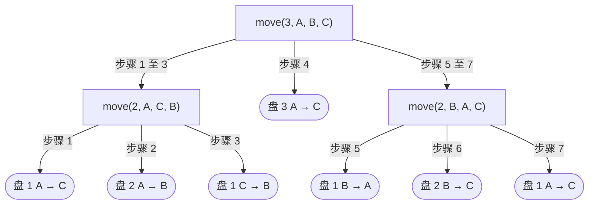
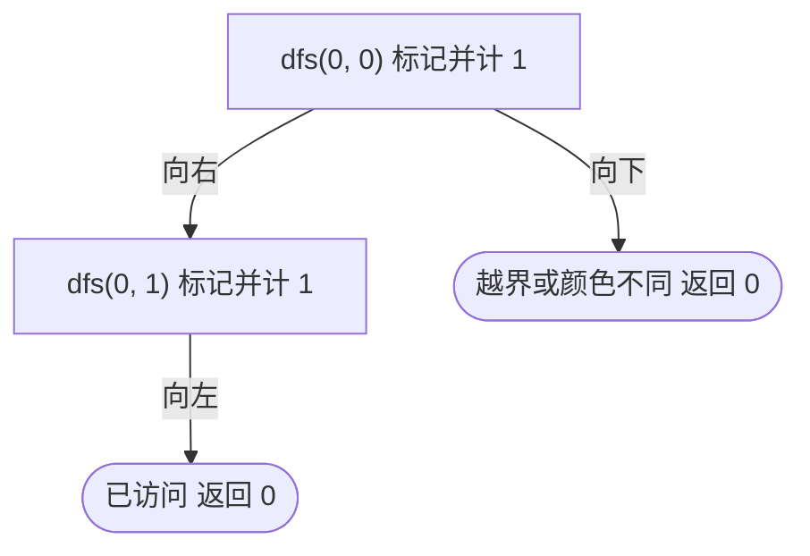
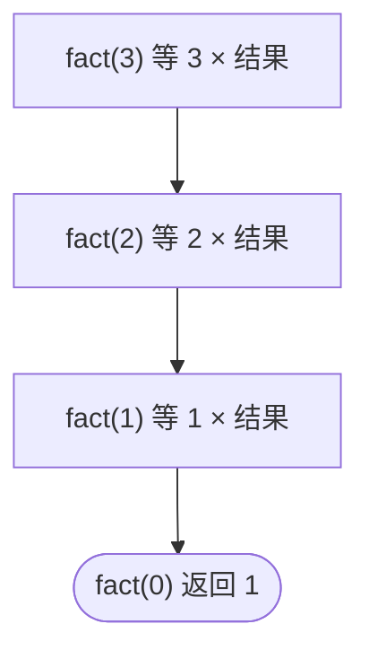
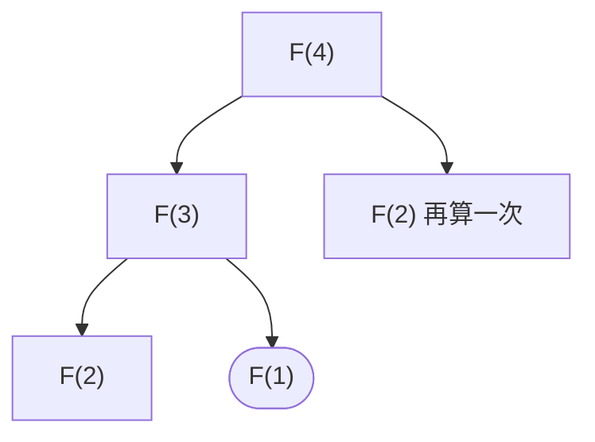

# C 语言复习讲义

## 环境搭建与调试实训

### 从 Hello World 理解编译和运行

在 VS Code 打开工作文件夹，新建 `hello.c`。先在终端执行 `gcc --version`，看到版本信息后再编译。编辑器负责编辑，实际把 C 源码变成可执行程序的是编译工具。VS Code 的 C/C++ 扩展可以提供补全和调试支持。

```c
#include <stdio.h>

int main(void) {
    puts("Hello, C!");
    return 0;
}
```

把文件保存后，在 Windows PowerShell 的项目目录执行以下命令。

```powershell
gcc -std=c11 -Wall -Wextra -g hello.c -o hello.exe
.\hello.exe
```

第一行用 C11 编译，启用常用警告，生成带调试信息的 `hello.exe`。第二行从当前目录启动它。`puts` 会加一个换行，`return 0` 表示正常结束。添加 `-g` 是为调试器保留变量名和源码行等信息。

### 从报错的位置判断是哪一层

| 现象 | 要检查的东西 | 自己验证 |
|---|---|---|
| 终端找不到 `gcc` | 当前终端的 PATH 能否找到编译器 | 执行 `Get-Command gcc`，核对路径 |
| 提示某一行语法错误 | 当前行和上一行的括号、分号、声明 | 从报告的第一个诊断开始修 |
| 链接报 `undefined reference` | 函数定义是否写对，源码是否一起编译 | 有 `main.c` 和 `util.c` 时，两者一起参与构建 |
| 输出与预期不同 | 输进去的内容、整数除法、输出分隔符 | 先手算最短用例，再检查一两轮变量 |
| 打开调试后程序等输入 | 控制台是否能接收标准输入 | 在终端直接运行可执行文件试一次 |

多文件时，头文件声明接口，调用方在调用前看到声明，实施细节放在相应的 `.c` 文件。编译和链接的区别可以用一个实验观察。先用 `gcc -c main.c` 生成目标文件，只把 `main.o` 交给链接器时，若它引用 `util.c` 里的函数，就要补上 `util.o`。

### 用断点找出第一次算错的位置

拿数组中心下标举例，在计算 `right` 那一行打断点。每次暂停时观察 `i`、`left`、`a[i]` 和 `total`，把它们和手算表对比。单步执行过 `left += a[i]` 后，左侧和才应包含当前元素。碰到与当前题无关的函数，单步跳过；需要观察函数内部状态时，单步进入。

练习用 `2 -2 5`。总和是 5。到下标 2 时，左侧 `2 + (-2) = 0`，右侧为空也是 0，所以输出 2。接着用单个数 `7` 检查边界。更多过程见[编译运行与断点调试](c-study-notes.md#review-debugging)与[中心下标](c-study-notes.md#pta-pivot-index)。

## 数制、类型与表达式讲义

### 进制转换从每位的权重开始

同一串数字随着基数变化而改变含义。比如 `(132)₄ = 1 × 4² + 3 × 4 + 2 = 30`，`132` 在四进制里合法，因为数码只用 0 到 3。遇到 `(98)₉` 应先检查数码，9 超出了范围。

从十进制 30 转四进制，除以 4 依次得到商 7 余 2、商 1 余 3、商 0 余 1。先得到的是最低位，所以从最后一次的余数向前读出 `132`。小数则从高位开始。例 `0.625 × 2 = 1.25`，取 1；`0.25 × 2 = 0.5`，取 0；`0.5 × 2 = 1.0`，取 1。结果是 `0.101₂`。

### 固定字长补码与有符号溢出

以 8 位补码为例，位权可以写成 `-128, 64, 32, 16, 8, 4, 2, 1`。`11110110` 的值为 `-128 + 64 + 32 + 16 + 4 + 2 = -10`。手算 `7 - 10` 时，将 `00000111` 与 `11110110` 相加，得 `11111101`，读作 `-3`。

| 8 位运算 | 原始位串 | 如何解释 |
|---|---|---|
| `127 + 1` | `10000000` | 两个正数相加却得到负号，超过 8 位有符号上限 |
| `-1 + 1` | `1 00000000` | 丢掉最高位进位后为零，有符号结果在范围内 |
| `-128 + (-1)` | `1 01111111` | 两个负数相加却出现正号，有符号溢出 |

在题目设定的 8 位补码里可以直接算位串。在 C11 表达式里还要判断运算类型。典型机器上的 `signed char` 在计算前通常提升为 `int`。C11 中有符号表达式溢出行为未定义，无符号运算按其类型的模数回绕。[C11 N1570 `6.2.5、`6.3.1](https://www.open-std.org/jtc1/sc22/wg14/www/docs/n1570.pdf)

### 类型转换要看发生在运算前还是运算后

`(double)(-5 / 2)` 先得整数 `-2` 再转换，`(double)-5 / 2` 在除法前转换，结果为 `-2.5`。余数可以用恒等式检查。在这里 `(-5 / 2) * 2 + (-5 % 2) = -5`，所以余数是 `-1`。

有符号和无符号混算时要辨认转换规则。例如 `-1 < 1u` 中，`-1` 转为 `unsigned int` 的最大值，所以条件不成立。数组下标常用 `size_t`，倒序循环可以写成 `for (size_t i = n; i > 0; --i) use(a[i - 1]);`，判断时不依赖无符号数变为负数。

### 优先级、短路与递增

优先级解决括号如何分组，执行顺序还要看运算符。`size > i && a[i] != 0` 会先检查范围。左边为假时右边不执行，所以可以在右边使用已经验证过的下标。比较整数范围要写成 `2 < x && x < 9`。在 C 中 `2 < x < 9` 先得到 0 或 1，再拿它与 9 比较。

初始 `i = 3`，单独执行 `a = i++;` 得到 `a = 3, i = 4`，再执行 `b = ++i;` 得到 `b = 5, i = 5`。如果在 `i++ + i++` 里让两边都修改同一个变量，两次修改缺少顺序约束，C11 不规定结果。

### 宏展开、常量与作用域

宏在预处理时替换记号。`#define SQUARE(x) ((x) * (x))` 能让 `SQUARE(1 + 2)` 展开为 `((1 + 2) * (1 + 2))`。传 `i++` 会导致参数被写两次，所以需要有副作用的实参时用函数。`const int k = 4;` 是有类型的对象，C11 的 `case` 需要整型常量表达式，可用 `enum { K = 4 };`。

遮蔽和生存期分别看。内部块的同名声明能遮蔽外部名称。块内的普通局部变量离开作用域后就不能通过原地址访问。块内的 `static` 变量的名称仍在块内可见，对象却在整个程序运行期间存在。更多见[考前表达式笔记](c-study-notes.md#review-expressions)和[变量存储期](c-study-notes.md#c-pointer-storage-duration)。

## 流、字符与字符串讲义

### 看见 scanf 读完后留下的字符

设输入是 `42↵hello world↵`，终端的回车在文本流里通常表现为 `'\n'`。`scanf("%d", &n)` 成功读到 42，流里接下来是 `\nhello world\n`。此时 `getchar()` 或 `scanf("%c", &ch)` 会拿到换行。格式里的 `" %c"` 会跳过空白，读到 `h`。如果需要下一整行，先消耗当前行剩余字符，再调用 `fgets`。

`scanf` 的返回值是成功赋值的项数。读两个整数要检查返回 2。输入 `12 x` 时它返回 1，第二个目标没有成功赋值。遇到字符不匹配后接着循环调用同一个格式时，先消耗或处理这个字符，避免一直卡在同一位置。

### fgets 的容量、换行和最后一行

`fgets(buf, sizeof buf, stdin)` 的容量包含末尾的 `'\0'`。例如容量是 5，读入 `ab↵` 时数组前四格为 `a b \n \0`。读入 `abcde↵` 时第一轮只有 `a b c d \0`，接下来的输入从 `e` 开始。返回空指针要先检查，成功时再处理缓冲区。

以下程序逐行显示文本长度。输入约定每行最多 100 个字符，因此 102 格能同时容纳正文、换行和结束符。最后一行没有换行也能处理。输入可能有 Windows 风格行结束时，先找到 `'\r'` 或 `'\n'` 并截断。一般文本处理若允许正文含回车，应只移除实际的尾部行结束符。

```c
#include <stdio.h>
#include <string.h>

int main(void) {
    char line[102];
    while (fgets(line, sizeof line, stdin) != NULL) {
        line[strcspn(line, "\r\n")] = '\0';
        printf("%zu\n", strlen(line));
    }
    return ferror(stdin) ? 1 : 0;
}
```

试输入空行、`a b` 和没有换行的 `xyz`，预期长度依次为 0、3、3。如果正文长度没有题设上限，先决定按段处理、丢弃余下输入还是扩容。缓冲里找不到换行也可能恰好遇到 EOF，需要结合下一次读取的结果判断。

### getchar、putchar 与 ungetc 的输入游标

`getchar()` 返回 `int`，既能表达按 `unsigned char` 解释的输入字符，也能表达 `EOF`。收到 `EOF` 时用 `feof(stdin)` 和 `ferror(stdin)` 判断结束或错误。`putchar(ch)` 输出一个字符并可通过返回 `EOF` 报告写出失败。做字符分类时，先判断 EOF，再调用 `isdigit` 等函数。

`ungetc(ch, stdin)` 可以把读到的分隔符交回输入流。下一个读操作就会拿到它。可移植代码只依赖一次成功回退的保证，并检查返回值。下面程序把开头的一串数字写到输出，读到第一个非数字时退回，再原样复制剩余内容。

```c
#include <ctype.h>
#include <stdio.h>

int main(void) {
    int ch;
    while ((ch = getchar()) != EOF && isdigit(ch)) {
        if (putchar(ch) == EOF) return 1;
    }
    if (ch != EOF && ungetc(ch, stdin) == EOF) return 1;
    if (putchar('|') == EOF) return 1;

    while ((ch = getchar()) != EOF) {
        if (putchar(ch) == EOF) return 1;
    }
    return ferror(stdin) ? 1 : 0;
}
```

输入 `007,x` 输出 `007|,x`。输入空文件输出 `|`。画输入游标时写下三步 `读到逗号 → 退回逗号 → 下一轮从逗号开始`，很容易看出是否会漏字符。另见[逐字符输入详解](c-study-notes.md#c-character-input)。

### 字符数组、结束符和复制函数

`char s[] = "map";` 的容量是 4，`strlen(s)` 是 3。`char t[3] = "map";` 在 C11 中可以初始化，但三个格子都被字母占用，无法用它调用要求字符串的函数。`char *p = s;` 时 `sizeof p` 得到指针的大小，数组容量要另外传递。

| 操作 | 数什么或比较什么 | 典型边界 |
|---|---|---|
| `strlen(s)` | 到首个 `'\0'` 前的字节数 | 要有可访问的结束符，UTF-8 汉字通常不止一字节 |
| `strcmp(a, b)` | 按字节比较，返回负、零、正 | 比较结果不要求恰好是 -1 或 1 |
| `memcpy(dst, src, n)` | 复制恰好 n 个字节 | 源和目标都要够长，区域不能重叠 |
| `memmove(dst, src, n)` | 复制 n 个字节，允许重叠 | 复制字符串时先想要不要连结束符一起搬 |
| `snprintf(buf, cap, ...)` | 有容量限制的格式化写入 | 返回值为负表示错误，大于等于容量表示截断 |

例如把 `"lamp"` 的头一个字符删掉，可以用 `memmove(s, s + 1, strlen(s));`。原长度 4，恰好从第二个字符开始复制三个字母和一个结束符。练习：用同样的方法删去头两个字符，应该复制 `strlen(s) - 1` 个字节，前提是长度至少为 2。

### 字符串的双下标、频率表和状态

原地去重时，`read` 每轮前进一步，只有首次出现的字符才能写到 `s[write++]`。检查 `write <= read`，保证写入时不会破坏右侧尚未读取的内容。最后补 `s[write] = '\0'`。如果题目要求保持顺序，记录“是否见过”比直接排序更符合要求。

单种括号配对可用计数。看见左括号加一，看见右括号减一。一旦为负便可判错，扫完还要等于零。遇到多类括号就需要栈，右括号必须和最近未匹配的左括号同类。例如 `([)]` 的数量相等，匹配顺序仍然出错。[字符串函数笔记](c-study-notes.md#c-string-functions) · [括号匹配例题](c-study-notes.md#pta-parentheses)

## 数组模型与 PTA 题解串讲

### 从题意选择数组模型

| 题目里出现的条件 | 先保存的状态 | 对照题解 |
|---|---|---|
| 每个输出依赖原来的邻居 | 原数组加独立结果，或滚动保存旧值 | [数字信号的平滑滤波](c-study-notes.md#pta-signal-smoothing) |
| 数字长到装不进整数类型 | 每格一位，从个位方向处理进位 | [大整数加一](c-study-notes.md#pta-plus-one) |
| 原地保留符合条件的元素 | 读下标固定扫，写下标按保留次数递增 | [移动零](c-study-notes.md#pta-move-zeroes) |
| 多次问区间和或左右和 | 总和与前缀和，先比较后更新 | [中心下标](c-study-notes.md#pta-pivot-index) |
| 有序序列需要插进一个值 | 预留空位，从右向左移动大元素 | [有序插入](c-study-notes.md#pta-sorted-insert) |
| 连续相同项压成一段 | 当前值和长度，换值结算，末尾结算 | [行程长度压缩](c-study-notes.md#pta-run-length) |

### PTA 7-22 平滑滤波的负数与首尾

输入 `-4 1 2`，首项平均是 `-3 / 2`，数学下取整为 −2。中间求 `(-4 + 1 + 2) / 3`，下取整为 −1。末项为 `3 / 2`，得 1。预期 `-2 -1 1`。如果先将首元素改成 −2，中间计算会误用新值，结果会变成 0。

当除数 `d > 0` 时，C11 向零截断。要实现下取整，可写 `sum / d - (sum % d < 0)`，整除和正数分支都不减。`long long sum = (long long)a[i - 1] + a[i] + a[i + 1];` 在第一步加法前提升类型。长度恰好为 2 时两个输出都由同一对数得到。完整实现见[平滑滤波](c-study-notes.md#pta-signal-smoothing)。

### PTA 7-23 大整数进位追踪

用一个额外位置保存最高位进位。输入 `9 9 9` 时，初始四个格子为 `0 9 9 9`，扫过个位、十位、百位后得到 `0 0 0 0`，最后把预留位从 0 加为 1。普通输入 `1 0 9` 只需要传播过一个 9，输出 `1 1 0`。输入 0 时直接变成 1。

推广到两个大整数相加时，每轮计算 `s = a[i] + b[j] + carry`，当前位写 `s % 10`，下一位进位是 `s / 10`。如果一个数字先用完，把缺失位当 0。两数都用完但仍有进位时还需输出一位。参考[大整数加一程序](c-study-notes.md#pta-plus-one)。

### PTA 7-24 原地移动零的读写轨迹

以 `[0, 4, 0, -2]` 为例，`read` 走到 1 时把 4 写到 0，走到 3 时把 −2 写到 1。此时 `write = 2`，最后两格补零，得到 `[4, -2, 0, 0]`。任意时刻，前 `write` 格是已读部分中的非零元素，顺序与输入一致。这个条件就是循环不变量。

同一套路还能用于原地删除所有等于给定值的元素。一遍扫描完后可以直接返回 `write` 作为新长度。移动零的题目保留原长度，所以还要补零。测试全零、无零、只有一个非零元素和重复的负数。[移动零完整代码](c-study-notes.md#pta-move-zeroes)

### PTA 7-25 中心下标与通用前缀和

为了检查下标 `i`，令 `left` 只包含它前面的元素，`right = total - left - a[i]`。以 `[2, -2, 5]` 为例，`total = 5`。

| `i` | `a[i]` | `left` | `right` | 是否相等 |
|---:|---:|---:|---:|---|
| 0 | 2 | 0 | 3 | 否 |
| 1 | -2 | 2 | 5 | 否 |
| 2 | 5 | 0 | 0 | 是 |

一般前缀和定义为 `prefix[0] = 0`、`prefix[i + 1] = prefix[i] + a[i]`。半开区间 `[l, r)` 的和为 `prefix[r] - prefix[l]`。带负数照样成立。只找中心下标时一边走一边更新左和即可，多次查任意区间才需要整张表。[中心下标完整代码](c-study-notes.md#pta-pivot-index)

### PTA 7-26 顺序表插入与插入排序

向 `[1, 3, 5, 7]` 插入 4，先把 7 右移到空位，再把 5 右移。碰到 3 就停，填入 4。守住 `pos > 0 && a[pos - 1] > x` 的条件顺序。左端到头时短路，避免访问 `a[-1]`。因为比较用 `>`，新元素放在已有同值后面。即使用二分找插入位置，顺序表最坏仍需要移动线性个元素。

插入排序反复对前缀做这件事。先把当前元素保存到临时变量，然后把它前面的较大元素挪右。趟与趟之间，已经处理过的前缀保持有序。更多见[有序插入完整代码](c-study-notes.md#pta-sorted-insert)。

### 二维数组的边界与窗口

遍历矩阵时，先区分行数和列数。相加要求坐标对应；乘法中的一个结果格子是左矩阵一整行与右矩阵一整列的点积。最大池化等窗口题先定左上角，再扫窗口内部。以四个数 `-8 -3 -6 -9` 为例，最大值是 −3，用 0 初始化会得到错误结果。用窗口第一个值或者题设允许的下界初始化。

非重叠 2×2 窗口以 2 为步长。行列都是偶数时，最后一个左上角是 `(r - 2, c - 2)`，内部再向右和向下走一格正好到边界。复习[向量内积](c-study-notes.md#pta-dot-product)并到考试自测练二维窗口。

## 指针、函数与动态内存讲义

### 一张内存图分清对象和地址

`int score = 60; int *p = &score;` 产生两个对象。score 存 60，p 存 score 的地址。`*p = 90;` 沿地址找到 score 并更新它。`&p` 是指针变量自身的地址，类型为 `int **`。

```text
p                       score
┌────────────┐          ┌─────┐
│ score 地址 │ ──────→  │  60 │   *p = 90 后变成 90
└────────────┘          └─────┘
    ↑ &p
```

例如 `p = NULL;` 只修改 p 保存的地址。若另一个指针 q 同时指向 score，通过 q 仍可读到 score。空指针可以比较，解引用前必须确认指向有效对象。详见[指针与内存实验](c-study-notes.md#c-pointer-memory)。

### 数组指针、指针数组与二维形参

| 声明 | 从名字开始读 | 加一时 |
|---|---|---|
| `int *p` | p 指向一个 int | 跨一个 int |
| `int (*row)[3]` | row 是指针，指向三个 int 组成的数组 | 跨一行 |
| `int *refs[3]` | refs 是三个元素的数组，每个元素是 int 指针 | `refs + 1` 指向下一格指针 |
| `int (*whole)[2][3]` | whole 指向完整的 2×3 数组 | 跨整个二维数组 |

`int m[2][3];` 在普通表达式中转换成首行的地址，因此 `int (*row)[3] = m;`。`&m` 指向完整对象，类型为 `int (*)[2][3]`。对于 `void f(int m[][3], size_t rows)`，形参 m 调整成指向一行的指针，所以列宽必须能从类型获得，行数通过参数传。写 `int **` 会期待内存里首先存指针，再由指针找到元素，这和连续的二维数组布局不同。[二维数组逐步推导](c-study-notes.md#c-pointer-array-walkthrough)

### 函数如何带回多个结果

C 的参数按值传递。给函数一个整数时它获得整数的副本；给函数一个地址时它获得地址的副本，通过解引用可以改变外部对象。若要带回最小值与最大值，函数可写成 `void range(const int a[], size_t n, int *low, int *high);`，调用处传 `&lo` 与 `&hi`。也可用结构体把两个结果一起返回。接口应写清 n 大于 0、两个输出指针指向有效且独立的对象。

若要让函数修改外层指针变量，例如让 `p` 指向新位置，传参应写 `&p`，形参写 `int **out`，函数用 `*out` 修改外层指针。先画出 `out → p → 被指对象`，每多一个星号便沿箭头走一层。[输出参数题解](c-study-notes.md#functions-output-parameters) · [二级指针详解](c-study-notes.md#c-double-pointer)

### 指针上的 const 与对象生存期

`const int *p` 表示可以让 p 指向别处，通过 p 只读目标。`int *const p = &x;` 固定 p 保存的地址，通过 p 可以写 x。`const int *const p` 同时限定通过该指针访问的值和指针本身。

地址需要和生存期一起看。函数返回后，普通局部变量已失效，返回它的地址会留下悬空指针。`static` 局部变量有静态存储期。动态内存需要显式释放。`free(p); p = NULL;` 只处理当前这个指针变量，其他曾保存同一地址的别名也不能再使用。[对象生存期笔记](c-study-notes.md#c-pointer-lifetime)

### malloc、calloc 与 realloc 如何配合

先明确多少元素，用 `n * sizeof *values` 计算字节数。`malloc` 分配后内容未初始化，`calloc` 将字节置零。访问之前检查返回值。扩容时让临时指针接收 `realloc` 的结果，扩容失败时仍可用原指针管理旧内存。成功后改用新的指针，重新计算所有指向旧数组内部的位置。

下面是一个可单独运行的实验。先容纳两个整数，再扩到四个，前两个值仍然保留。新增加的两个格子在读取前明确赋值。容量来自外部且很大时，需要先检查 `n > SIZE_MAX / sizeof *values`，以免计算字节数时回绕。

```c
#include <stdio.h>
#include <stdlib.h>

int main(void) {
    int *values = malloc(2 * sizeof *values);
    if (!values) return 1;
    values[0] = 4;
    values[1] = 8;

    int *grown = realloc(values, 4 * sizeof *values);
    if (!grown) {
        free(values);
        return 1;
    }
    values = grown;
    values[2] = 12;
    values[3] = 16;
    printf("%d %d %d %d\n", values[0], values[1], values[2], values[3]);
    free(values);
    return 0;
}
```

预期输出 `4 8 12 16`。当容量为 0 时，应在接口中先决定把它看作空数组还是非法输入，扩上述数组时明确使用正的字节数。[C11 N1570 `7.22.3](https://www.open-std.org/jtc1/sc22/wg14/www/docs/n1570.pdf)

## 结构体、排序与标准库

### 用结构体表示一条完整记录

如果要保存机器的编号、名称和两次读数，`struct Device` 可以把三项绑在一起。`devices[i]` 是整个记录，`devices[i].readings[j]` 指向其内部某次读数。指向记录的指针 `p` 可用 `p->id`，等同于 `(*p).id`。比较内容是否一致，要决定比较哪些字段，并按字段语义比较。

`sizeof(struct Device)` 可能大于各成员大小的和，因为编译器会为对齐插入填充。需要知道具体位置时用 `offsetof`。把整个结构体直接用 `fwrite` 写入文件，结果与平台的布局、字节序和类型宽度有关。要做可互换的文件，应明确字段格式。[结构体数组实例](c-study-notes.md#pta-student-struct)

### 从题意写出排序比较规则

比赛排名若规定分数降序、同分编号升序，只有分数相同才比较编号。若排序的是 `struct Item[]`，传入比较器的是结构体元素的地址。若排序的是 `char *[]`，传入的是指针格子的地址，需要先取出该格存的字符串指针。排序期间按元素类型解读地址，第三个参数使用 `sizeof items[0]`。

```c
#include <stdio.h>
#include <stdlib.h>

typedef struct {
    int id;
    int score;
} Item;

static int compare(const void *left, const void *right) {
    const Item *a = left;
    const Item *b = right;
    if (a->score != b->score)
        return a->score > b->score ? -1 : 1;
    return (a->id > b->id) - (a->id < b->id);
}

int main(void) {
    Item items[] = {{9, 70}, {2, 70}, {1, 69}, {5, 78}};
    size_t n = sizeof items / sizeof items[0];
    qsort(items, n, sizeof items[0], compare);
    for (size_t i = 0; i < n; ++i)
        printf("%d%c", items[i].id, i + 1 == n ? '\n' : ' ');
    return 0;
}
```

预期输出 `5 2 9 1`。直接返回两个字段相减可能导致溢出，关系比较不会遇到这个问题。`qsort` 不保证相等元素的原始顺序，题目要求稳定时可用稳定排序或把输入序号加作最后一级比较。[结构体排序题解](c-study-notes.md#pta-struct-sort) · [字符串指针排序](c-study-notes.md#pta-dynamic-qsort)

### 标准库函数按契约使用

`<stdio.h>` 提供流操作，`<string.h>` 提供字符串和内存操作，`<ctype.h>` 提供字符分类，`<stdlib.h>` 提供内存管理、排序和数值转换。写题时先确认返回值的语义。`fgets` 返回缓冲区地址或空指针。`strtol` 可用结束指针判断有没有读到整数、后面是否有多余字符，并结合 `errno == ERANGE` 检查溢出。

`fopen` 的 `"r"` 打开已有文件，`"w"` 创建或清空文件。每次打开先检查返回结果，处理完调用 `fclose`。文本流读取可复用 `fgets` 循环，读取结束后用 `ferror` 区分错误。字节读入用 `fread` 时，返回值是成功读取的元素数。把读取写在循环条件里，避免使用 `while (!feof(fp))` 后再无条件处理缓冲区。

### 用栈处理最近一次尚未完成的事

数组栈用 `top` 表示下一个可写的位置。压栈前检查容量，执行 `stack[top++] = value`。弹栈前检查非空，执行 `value = stack[--top]`。多种括号匹配需要记下每个左括号的类别。读到右括号时核对栈顶，如果比对成功才弹出。

函数调用也可以想成进出栈。顺序调用两个子函数时，第一个先执行完并返回，然后才开始第二个。遇到递归可画调用树，逐个核对每次入栈的参数和退出后的结果。

## 递归、搜索与整数算法讲义

### 按任务、出口、递进推导递归

写代码前三问。当前函数答什么？哪个输入能直接回答？下一次调用是否更接近出口？以进制输出为例，任务是输出非负数 `n` 的二进制。若 `n < 2` 直接输出一位；否则先递归输出商，再输出余数。把代码中的输出写在递归之前会先打印低位。


从底部返回时，3 输出余数 1，6 输出余数 0，13 输出余数 1，拼成 `1101`。向下走是调用，向上走时补打印。再追踪 0，能直接走基本情况。[原笔记里的递归进制转换](c-study-notes.md#practice-base-conversion)

```c
#include <stdio.h>

static void print_bits(unsigned n) {
    if (n >= 2) print_bits(n / 2);
    putchar('0' + (int)(n % 2));
}

int main(void) {
    unsigned n;
    if (scanf("%u", &n) != 1) return 1;
    print_bits(n);
    putchar('\n');
    return 0;
}
```

`n >= 2` 时先处理商，`n < 2` 时省略递归调用。两种情况都会输出本层的余数，因此输入 0 会打印一位 `0`。

### 汉诺塔从三步写出函数

设 `move(n, from, spare, to)` 的任务是把 n 个盘从 from 移到 to，允许使用 spare。要动最大盘，必须先让上面 n−1 个盘离开。于是第一句 `move(n - 1, from, to, spare);`，然后把最大盘从 from 移到 to，最后 `move(n - 1, spare, from, to);`。当 n 为 0 时直接返回，或单独处理 n 为 1。



每层的辅助柱和目标柱由本次函数实参决定。移动次数满足 `T(0) = 0`、`T(n) = 2T(n - 1) + 1`，所以三盘移动 7 次，n 盘移动 `2ⁿ − 1` 次。递归深度为 O(n)，调用总次数和移动次数同阶。[汉诺塔完整代码](c-study-notes.md#practice-hanoi)

```c
#include <stdio.h>

static void move(int n, char from, char spare, char to) {
    if (n == 0) return;
    move(n - 1, from, to, spare);
    printf("%d %c -> %c\n", n, from, to);
    move(n - 1, spare, from, to);
}

int main(void) {
    move(3, 'A', 'B', 'C');
    return 0;
}
```

把三个函数位置上的柱名写在纸上。第一次递归的目标是 B，于是本层的 C 改作辅助柱。第二次递归从 B 出发，用 A 辅助，目标才是 C。

### 最大公约数、回文与取位

辗转相除依据 `gcd(a, b) = gcd(b, a % b)`。a 和 b 的任何公约数也整除余数；b 和余数的公约数也整除 `a`。例如 `gcd(84, 30) → gcd(30, 24) → gcd(24, 6) → gcd(6, 0)`，余数为 0 时答案为 6。循环实现保留一个余数变量，再同步更新两个数。设输入为非负且至少一个非零，可直接用这个关系。

回文数可以反转数字后和原数比较，也可以从两端逐对比较。反转时要注意类型能否容纳反转结果。用除法拆数字时，`n % 10` 是末位，`n /= 10` 删除末位。奇偶位置之和只要交替累加。输出题先写单个数处理函数，再定多组输入输出，减少在 main 里重复逻辑。

### P1304 试除和筛法的取舍

试除判断 n 时，只要检查到平方根。若 n 是合数，两个因子至少有一个不超过平方根。用 `d <= n / d` 可避免 `d * d` 超出范围。试除函数应在找到一个因子时返回 0，循环完整结束后才返回 1。若成功路径也写成 `return 0;`，外层判断两数同时为质数时永远不成立。

埃氏筛适合反复查询固定上限以内的质数。从尚未划掉的 p 开始，将 `p*p, p*p+p, …` 标记为合数。更小的倍数已有更小质因子。P1304 对每个偶数从小枚举第一个加数，验证互补数也是质数，一旦找到就停。输入 10 时找 `10=3+7`，此时即使还有 `5+5` 也无需输出。若题目要求全部方案则继续枚举到一半。两种程序见[实时试除](c-study-notes.md#luogu-p1304-trial-division)与[筛法 P1304](c-study-notes.md#luogu-p1304)。

### 位运算按一位一位理解

取第 k 位先把它移到最低位置，再和 1 做按位与。对一个无符号整数 `x`，设 `mask = 1u << k`，置位是 `x | mask`，清零是 `x & ~mask`，翻转是 `x ^ mask`。前提是 k 小于对应类型的位宽。用 `x & (x - 1u)` 能清掉最低的一个 1。`x = 0` 时结果仍为 0，因此用它判 2 的幂时先检查 `x != 0`。

例子以 `x = 0b1010` 表示十进制 10 的位串。翻转低两位得到 `1001`。在 C11 源码里可用 `10u` 或 `0xAu` 写原值。复习[位运算详细笔记](c-study-notes.md#c-bitwise)。

### DFS 和 BFS 的访问时机

判断连通块时先定邻接规则。四邻只认上下左右，八邻才包含斜方向。例如两个对角的非空格在四邻规则里属于两块，八邻规则里可能是一块。DFS 一进入合法格就标记，然后展开邻居。BFS 把格子加入队列时就标记，避免同一个格子被多个父节点重复加入。



只有开始格与右侧格成功入访，答案为 2。访问一次每个格子，检查固定个方向，网格复杂度为 O(行数 × 列数)。大网格若担心递归过深，可把尚待访问的格子放进显式栈或队列。对照[油田八邻 DFS](c-study-notes.md#practice-oil-fields)与[消除星星](c-study-notes.md#practice-stars)。

## 计算机基础与考试作答讲义

### 冯·诺依曼模型与存储程序

五个基本组成部分是输入、输出、存储器、运算器和控制器。程序和数据可存于存储器。过程可以写成取指、译码、执行，执行结果按指令的语义写回寄存器或存储器。存储程序使更换任务能通过装入另一组指令完成。若题目拿早期机器作对照，先说明其原始编程方式，再按题设判断它是否采用这一工作方式。

```text
输入设备 ──→ 存储器（指令、数据） ──→ 输出设备
                 ↕
        CPU（控制器、运算器、寄存器）
```

答题时分别解释五个部分的职责。常用字长、存储单位和计算过程可回看[基础复习原笔记](c-study-notes.md#review-computing)。

### 操作系统与网络的概念题

操作系统管理进程、内存、文件和设备。进程是运行中的程序实例，具有执行状态和资源。批处理强调成批提交；分时通过切换使多个会话获得交互体验；实时更关注规定时间内响应。应用程序通过系统提供的接口请求诸如打开文件的操作。

OSI 常考自上而下的顺序。应用、表示、会话、传输、网络、数据链路、物理。网络层负责在网络之间转发，数据链路层处理一段链路上的帧，物理层传送比特对应的信号。星形、总线形、环形、网状描述连接组织形式。纸笔题可先把七层写全，再按题意填位置和功能。

### 纸笔题从定义写到例子

解释“算法的有穷性”时，先说明在合法输入下应在有限步结束，再给一个循环条件永远不变的反例。解释确定性时，可以对照明确的更新关系和一句没有定义的“适当调大”。问输出性时，写清结果由返回值、输出参数或输出流交付。

题目要求画活动记录时，把每次调用的参数、局部变量以及返回的位置分开写。例如 main 调用 A，A 先调 B 再调 C。若 B 又调用 D，返回顺序是 D、B、C、A、main。每个子函数返回后，父函数从调用语句之后继续执行。[函数与参数复习](c-study-notes.md#review-function-basics)

### 机试题的拆分、核对与边界

回忆卷里常把日常故事写得很长。先抽取输入、输出、状态更新和特殊规则，再定接口。函数题先对照题目原型，确定应写回哪个数组、返回什么。程序题写清多组数据循环，空行、行尾空格和同分顺序都以题目约定为准。

| 题型 | 优先核对 |
|---|---|
| 数位处理 | 0、连续 0、位数变化、反转后是否溢出 |
| 字符串 | 空行、内部空格、恰好占满缓冲、最后一行无换行 |
| 数组和窗口 | n 为最小值、全负、首尾、并列最大值 |
| 结构体排序 | 同分时继续比较下一字段、只含一条记录 |
| 函数题 | 返回值与输出参数各负责什么、输入容量是否传入 |
| 递归搜索 | 终止条件、最深路径、重复访问和边界 |

练习先做[考前知识点](c-study-notes.md#课程知识点与考前复习)，再在站内自测接受统一评分，最后按错题回到对应讲义。计算机基础和纸笔题主要参考电子及集电卷、计算机等学院回忆卷；机试模型也参考信通卷和往届计算机学院卷。

## 第 1 章课件补充：程序设计语言概述

本章对应《程序设计语言概述》。页码按 PDF 阅读器显示的页序计算。重点是认清同一串二进制为何可以表示不同内容，以及 C 源码怎样变成能运行的程序。

### 从问题到程序：工具、过程与产物

**程序设计语言**规定了可以写哪些符号、怎样组合，以及组合起来表示什么。**程序设计**是把需求拆为输入、处理、输出并实现的过程。**程序**则是用语言写出来、可按相应规则处理和执行的结果。

例如要计算两张车票的总价，先约定输入是两个整数金额，再求和并输出结果。题目若改成使用小数价格，数据的表示和输出格式也要变。判断一个表达式时可分三层：源文件用了哪些字符、编译器能否按语法解释、执行结果是否符合需求。

来源：《程序设计语言概述》PDF 第 4–9、19–20 页。

### 存储单位与按位权换算

位用小写 b 表示，字节用大写 B。课件按 1024 逐级换算，在这种口径下 2 KB 是 2048 B，按常见的 8 bit/字节计算是 16384 bit。正式书写用 2 KiB 指 2048 B，十进制单位 2 kB 表示 2000 B。C 的 `sizeof` 用 C 字节计量，`CHAR_BIT` 给出每个 C 字节的位数。

| 遇到的转换 | 做法 | 自编例子 |
|---|---|---|
| 任意进制转十进制 | 从个位起对整数部分按 0、1、2… 次幂展开，小数从 −1 次幂开始 | `(12.3)₄ = 4 + 2 + 3/4 = 6.75` |
| 十进制整数转其他进制 | 反复除以基数，余数倒序读 | 45 除以 8 得商 5 余 5，结果为 `(55)₈` |
| 十进制小数转其他进制 | 反复乘基数，每次取整数部分，按出现顺序写 | 0.375 乘 2 依次取出 0、1、1，结果为 `(0.011)₂` |
| 二进制转十六进制 | 从小数点向左右每四位一组，外侧缺位补零 | `10110.101₂ → 0001 0110 . 1010 → 16.A₁₆` |

先检查数码是否合法，再算数值。八进制的 `8`、`9` 都不合法。整数部分的小组从右向左分，小数部分从左向右分。某些有限十进制小数转成二进制会无限循环，按题目要求保留位数。

来源：《程序设计语言概述》PDF 第 10–12 页。进位与符号位另见[补码讲义](#固定字长补码与有符号溢出)。

### 半加器、全加器与进位怎么传

| A | B | AND | OR | XOR | NOT A |
|---|---|---|---|---|---|
| 0 | 0 | 0 | 0 | 0 | 1 |
| 0 | 1 | 0 | 1 | 1 | 1 |
| 1 | 0 | 0 | 1 | 1 | 0 |
| 1 | 1 | 1 | 1 | 0 | 0 |

半加器只接收 A、B 两位，`A XOR B` 给出本位和，`A AND B` 给出向高位的进位。全加器还要接低位传来的 `Cin`。先用半加器加 A 和 B，再把本位和与 Cin 加一次。任意一次产生进位，最终就向高一位送 1。

```text
第一次    A + B    → 本位 t = A XOR B，进位 u = A AND B
第二次    t + Cin  → 本位 S = t XOR Cin，进位 v = t AND Cin
最终                 输出本位 S，向高位传 Cout = u OR v
```

手算 `1011₂ + 0110₂`，从最右开始。第 0 位 `1+0+0` 输出 1、进 0；第 1 位 `1+1+0` 输出 0、进 1；第 2 位 `0+1+1` 输出 0、进 1；第 3 位 `1+0+1` 输出 0、进 1。最左再放最后的进位，结果为 `10001₂`。代回十进制是 11 + 6 = 17。

在 C 中，`&&`、`||`、`!` 把操作数的零与非零解释为真假。`&`、`|`、`^`、`~` 则对整数的各位做运算。`6 && 3` 得 1，`6 & 3` 得 2。

来源：《程序设计语言概述》PDF 第 13–17 页。

### 机器语言、汇编、高级语言与 4GL

| 层次 | 人写下的内容 | 如何处理 |
|---|---|---|
| 机器语言 | 由指令集规定的指令编码 | 对应的 CPU 按其指令集执行 |
| 汇编语言 | 用助记符和标签表达接近机器指令的操作 | 汇编器把源码转换为目标代码 |
| 高级语言 | 用变量、表达式、控制结构和函数表达算法 | 由编译器、解释器或两者结合的实现处理 |
| 面向领域的高层表达 | 说明要查哪些数据、生成什么报表或得到什么结果 | 系统决定如何完成，具体分类须看课程语境 |

汇编语言虽然比手写指令编码容易读，仍依赖特定指令集。高级语言移植性通常更好，涉及平台接口、类型宽度或外部库时仍需检查环境。课件把 SQL 一类查询表达与 4GL 放在一起讨论，复习时抓住“能用较高层的表达说明想得到什么”。自然语言说明可以帮助需求沟通，程序执行仍需要可检验的规则和明确条件。

来源：《程序设计语言概述》PDF 第 19–34 页。

### 编译、解释、链接与装载各做什么

```text
main.c → 预处理 → 编译和汇编 → main.o ┐
util.c → 预处理 → 编译和汇编 → util.o ├→ 链接 → 可执行文件 → 装载运行
                         所需库 ─────┘
```

编译实现把源程序转换成可供后续阶段处理的目标表示，例如汇编、目标代码或字节码。解释器在运行时按程序表示执行，有的实现会先生成字节码再解释，或在运行时编译。课件采用的是便于入门的编译与解释对照。区分它们时，先抓住“是否提前完成转换”与“执行时由谁处理程序表示”。

设 `main.c` 调用 `util.c` 里定义的函数。头文件声明让编译器知道调用的接口，链接器再把符号引用和定义配对。遗漏 `util.c` 往往会出现链接错误。程序成功链接后，操作系统还要装载它，准备执行所需的资源。

源文件和可执行文件都用字节存储。源文件中的 `a=b+c;` 依字符编码表示文本，CPU 取到的机器指令则依据指令集解码。区分两者时问一句“用什么规则解释这些字节”。进一步动手见[环境搭建与调试实训](#环境搭建与调试实训)。

来源：《程序设计语言概述》PDF 第 35–47 页。

### 形式语言的入门思考

字母表是一组符号，字符串是由这些符号构成的有限序列，语言是某类字符串的集合。例如以 `{a,b}` 为字母表，给出规则“先写至少一个 a，再写同样多的 b”。`ab`、`aabb` 在语言里，`abab` 和 `aab` 都不满足规则。这个例子帮助理解：语法规则可以用来判断某段符号序列是否属于语言。

来源：《程序设计语言概述》PDF 第 48–49 页。

### 第 1 章自检

1. **`11010₂` 转十进制是多少？** 答案是 26。位权相加为 `16 + 8 + 2`。
2. **全加器输入 A=1、B=0、Cin=1，输出什么？** 本位为 0、进位为 1。三位和为二进制 10。
3. **头文件中有声明，为什么还会报链接错误？** 调用处可据声明通过编译，链接时仍需要函数定义参与构建。


## 第 2 章课件补充：程序设计语言初步

本章对应《程序设计语言初步》。页码按 PDF 阅读器显示的页序计算。可以按“数据怎么存、怎样读写、表达式怎么算、程序执行到哪里”的顺序复习。

### 用输入、处理、输出拆解程序

课件用键盘、存储器、运算器、控制器和屏幕说明数据的去向。以两个整数相乘为例，先将输入字符解析为整数，把两数保存到对象里，求积，再把数值格式化成输出字符。键盘输入的 `12` 是两个数字字符，计算时使用整数 12，二者由输入转换连接起来。

写题前用一句话标清输入范围、要做的处理和输出格式。例如整数乘法需确认最大积能否装进结果类型。含多个测试组时，每组单独读入并输出。

来源：《程序设计语言初步》PDF 第 3–11 页。

### 标识符、字符集和字符编码

入门代码可以使用字母、数字、下划线命名，首位用字母，避开关键字和实现保留的名称。`score2` 合法，`2score`、`total-score`、`while` 都不能用作普通变量名。`score` 和 `Score` 是两个名字。`main` 在通常的 C 程序中是入口函数名，`printf` 是标准库函数名，二者都不在关键字表中。课件展示的是 C99 的关键字表，本手册示例按 C11 编译。

ASCII 用 7 位编码 128 个值，普通拉丁字母和数字属于其中。Unicode 分配码点，UTF-8 规定如何把码点编码成字节序列。以 UTF-8 保存的 `A中` 一共 4 个正文数据字节，C 字符串还需结尾的 `'\0'`，完整缓冲至少 5 字节。`strlen` 数的是结束符前的字节。

`'7' - '0'` 得到数值 7，因为 C 保证基本执行字符集内十个数字字符的值连续。不要把 ASCII 的大小写差值 32 当作跨编码可用的规则。处理标准字符分类可以用 `<ctype.h>`，参数传 EOF 或可表示为 `unsigned char` 的值。

来源：《程序设计语言初步》PDF 第 12–17、23–26、32–34 页。

### 数据类型、内存与变量要素

数据类型说明**能取哪些值、怎样表示及占多少 C 字节、可以做哪些操作**。例如整数与浮点数都可除，但 `5 / 2` 得整数 2，`5.0 / 2` 则得 2.5。C11 用 `_Bool` 表示布尔类型，`<stdbool.h>` 提供 `bool`、`true`、`false`。把整数 −3 转成 `_Bool` 得 1，把 0 转成 `_Bool` 得 0。

在课件的内存示意中，字节像排列开的格子。若本机 `sizeof(int)` 为 4，`int a[3]` 的三个元素紧密排列，每走一个元素前进 4 字节。C11 没有规定所有平台的 `int` 都是 4 字节，可用 `sizeof` 检查字节数，或查 `<limits.h>` 给出的范围。看“同一组比特如何解释”时，还要确定读取宽度和类型。

课件用**变量名、变量类型、变量值**概括变量三要素，并在内存图里画地址。按 C 的内存模型解释时可把地址单独列出。名称是源代码用的标识符，地址可在适当条件下用 `&x` 获得。局部变量 `int n;` 应先成功赋值再读取。

来源：《程序设计语言初步》PDF 第 18–22、27–31、35–52 页。

### 字面量、const 和宏在什么阶段起作用

| 写法 | 例子 | 判读 |
|---|---|---|
| 字面量 | `012`、`0x12`、`1.25f`、`'A'` | 前两个按八、十六进制读，值分别为 10、18；`f` 指定浮点常量类型为 `float` |
| 带 `const` 的对象 | `const int max_count = 20;` | 有声明类型，通过该对象不能改写；普通 `const int` 在 C11 中不能直接作为 `case` 标签 |
| 符号宏 | `#define MAX_COUNT 20` | 预处理时替换记号；写进宏体的 `=` 或分号也可能被替换到使用位置 |

`"A"` 储存时还含字符串结束符，`'A'` 是一个字符常量。用 `#define HALF 1 / 2` 代入 `6 * HALF`，展开成 `6 * 1 / 2`，结果是 3；如果展开成 `6 * (1 / 2)`，整数除法先算，结果是 0。用括号明确意图，并考虑是否应使用浮点数。

来源：《程序设计语言初步》PDF 第 53–61 页。

### 格式化输入输出和转义的边界

| 要处理的内容 | 输入函数写法 | 输出函数写法 |
|---|---|---|
| `int n` | `scanf("%d", &n)` | `printf("%d", n)` |
| `float f` | `scanf("%f", &f)` | `printf("%.2f", f)` |
| `double d` | `scanf("%lf", &d)` | `printf("%.2f", d)` |
| `char ch` | `scanf("%c", &ch)`，如需跳过空白用 `" %c"` | `printf("%c", ch)` |
| `char word[12]` | `scanf("%11s", word)`，留出结束符 | `printf("%s", word)` |

考虑输入 `25K1.75`。用 `"%d%c%f"`，分别得到整数 25、字符 K、浮点数 1.75。换成 `"%c%d%c%f"`，第一项先拿走字符 `'2'`，整数项就从 `5` 开始读。每次都要按格式逐项移动输入位置。检查返回值是否等于期望的赋值数，避免继续使用读取失败的变量。

`"\n"` 是换行，`"\t"` 前进到下一个制表位置，`"\\"` 产生一个反斜杠。`printf("\"C\"\\n");` 输出双引号包住的 C，后面跟字面量的反斜杠和字母 n。`'\0'` 是值为零的空字符，`'0'` 是可见的数字字符。深入练习见[流、字符与字符串讲义](#流字符与字符串讲义)。

来源：《程序设计语言初步》PDF 第 62–82 页。输入例为同型自编。

### 从表达式分组到执行顺序

| 写法 | 怎样推 |
|---|---|
| `result = a = 3` | 赋值从右侧分组，先确认 a 存入 3，再把赋值表达式的结果交给 result |
| `i += 2` | 将新值加回 i。复合赋值的左操作数只求值一次 |
| `a > 0 ? b / a : 0` | 先判断 a，两个分支只执行其中一个 |
| `a = (x = 4, y = x + 5, y * 2)` | 逗号运算符使各操作从左到右执行，a 最终得到 18 |
| `i = x > 10 && x % 3 == 0` | 先判断 x 是否大于 10，只有真时才检查取余，将逻辑结果 0 或 1 赋给 i |

`printf("%d%d", x, y)` 里的逗号仅分隔参数。不能据此认为函数参数必定从左到右求值。`(double)(5 / 2)` 的结果是 2.0，`(double)5 / 2` 的结果是 2.5。算混合类型的表达式时先确认操作数会转换成什么类型，再看赋值给目标对象时还会不会转换。

来源：《程序设计语言初步》PDF 第 83–108 页。表中数值为同型自编。

### 表达式语句、复合语句与分支

表达式后加分号可以成为表达式语句，例如 `counter += 1;`。单独的分号是一条空语句，`if (n > 0);` 就会让条件所控制的语句为空。花括号把多条语句或声明组成一个块，避免把下一行误认为分支的一部分。`else` 与最近尚未配对的 `if` 对应，用花括号可以把层次写清楚。

`switch` 适合对离散值选择路径，`case` 使用整型常量表达式，比如整数 2 或字符 `'y'`。匹配某个 `case` 后从那里开始执行，若未遇到 `break`，会继续执行后续标签下的语句。若无匹配且有 `default`，从 `default` 开始。以下片段中，当 `who` 为 1 时输出 AB，为 2 时只输出 B。

```c
switch (who) {
case 1:
    putchar('A');
    /* 故意继续执行 case 2 */
case 2:
    putchar('B');
    break;
default:
    putchar('?');
}
```

来源：《程序设计语言初步》PDF 第 109–124 页。代码为同型片段。

### while、do-while 与 for 的执行轨迹

| 循环结构 | 先做什么 | 使用 continue 后去哪里 |
|---|---|---|
| `while` | 先判断条件，可能一次也不执行 | 条件判断 |
| `do-while` | 至少先执行一遍循环体，尾部写分号 | 尾部条件判断 |
| `for` | 初始化只运行一次，再做条件判断 | 更新表达式，然后判断条件 |

把 `for` 改成 `while` 时，要特别检查 `continue`。若把 `i++` 放在 `while` 循环体尾部，前面的 `continue` 会跳过这个更新。`break` 只退出直接包住它的最内层循环或 `switch`，不会一次退出所有外层循环。

手推累加可以先写“每次判断条件前，`sum` 等于已经处理过的项之和”。嵌套循环画成外层管行，内层管列。写阶梯图案时，第 `r` 行打印 `r` 个符号，内层结束才换行。闰年练习可用 1900、2000、2024 分别检查世纪年例外、400 的倍数和普通闰年。

来源：《程序设计语言初步》PDF 第 125–148 页。

### 用小样例验证程序与 AI 建议

参考课件任务，写一个同型程序，从 1 到 n 找出能被 4 整除、且不能被 6 整除的数。这里约定 `1 ≤ n ≤ 1000`。每个结果单占一行，最后一行输出个数。先写判断条件，再手算输入 24 的正确结果：4、8、16、20，计数 4。12 和 24 同时被 6 整除，所以跳过。

```c
#include <stdio.h>

int main(void) {
    int n;
    if (scanf("%d", &n) != 1 || n < 1 || n > 1000) return 1;

    int count = 0;
    for (int i = 1; i <= n; ++i) {
        if (i % 4 != 0 || i % 6 == 0) continue;
        printf("%d\n", i);
        ++count;
    }
    printf("%d\n", count);
    return 0;
}
```

验证顺序可以用 `n = 1` 检查无结果，`n = 4` 检查第一个结果，`n = 12` 检查同时整除，`n = 24` 检查多次筛选。和编程助手交流时，把题目条件、输出格式和这几组预期结果写一起，再用实际编译运行验证。只问“给个程序”通常会遗漏题目里的限制。

来源：《程序设计语言初步》PDF 第 149–157 页。筛选条件与测试数据为同型自编。

### 第 2 章自检

1. **`char s[] = "AB";` 占多少 C 字节？** 3。两格正文加一格结束符。
2. **`double x` 应怎样读到？** 用 `scanf("%lf", &x)`，并检查返回值为 1。
3. **`int a = 0; int b = (a = 2, a + 6);` 执行后 a、b 的值？** a 为 2，b 为 8。
4. **`for` 第一次判断就失败时，会执行更新吗？** 不会。只有执行过循环体，或者在其中遇到 `continue`，才到更新这一步。


## 课程绪论与复习路线

### 从课程目标安排复习

绪论用「理论、抽象、设计」组织课程。理论解释问题背后的规则，例如整数的余数性质。抽象把问题压缩成程序需要维护的数据，例如运行中的最大值或自动机状态。设计再把模型写成步骤、函数和测试。用这三个角度复盘一道题，能说清程序为什么这样写。

| 复习阶段 | 应能独立做什么 | 站内入口 |
|---|---|---|
| C 表达与控制 | 读懂类型、格式串、选择与循环，手推一组输入 | [第 2 章课件](#第-2-章课件补充程序设计语言初步) |
| 抽象与算法 | 说明状态怎么更新、为何会停止、答案怎样得到 | [计算方法课件](#计算方法课件迭代穷举与自动机) |
| 模块化与数据 | 写清函数接口，用数组组织一批数据，解释下标 | [函数课件](#函数课件接口活动记录与模块化) · [数组课件](#数组课件排序查找与二维应用) |

对照《课程绪论》PDF 第 7–12、15–18 页。课件将上机与笔试分开安排。上机练输入、输出与边界，笔试练定义、推导和手算轨迹。具体考核以自己班级的通知为准。

### 把编程放回计算机学科地图

把一段 C 程序跑起来，会经过语言、编译工具、操作系统和硬件。算法与数据结构决定怎样组织数据、做多少步。操作系统负责进程等资源，计算机组成解释指令如何执行。数学与逻辑给出规则和证明手段。课件还将软件工程、数据库、网络列入后续核心知识。复习这门课时，可以用「数据怎样表示、算法怎样写、运行由谁完成」串起这几部分。

对照《课程绪论》PDF 第 21–24 页。

## 计算方法课件：迭代、穷举与自动机

### 算法的五个特征与可检验的描述

| 特征 | 做题时怎样体现 |
|---|---|
| 输入 | 写清提供几个值、哪些范围合法，允许没有外部输入 |
| 输出 | 说清交付结果，例如返回最大值或输出判定 |
| 有穷性 | 给出终止条件，还要说明每轮怎样接近它 |
| 确定性 | 用明确的条件和操作替换「适当调整」之类的说法 |
| 可行性 | 每一步都能用允许的基本操作实现，例如先保证除数非零 |

先把算法拆成顺序、选择和循环。传统流程图用箭头表示去向，N-S 盒图用嵌套框表达哪一步属于哪个分支或循环，伪代码适合先写清规则再补语法。以阶乘为例，框外写初值 `p = 1`，循环框内写 `p = p * i`。`n = 0` 时循环不执行，直接得到 1。

对照《单元二：计算方法》PDF 第 4–38 页。

### 迭代与递推：先写状态，再写更新

求一批数的最值，状态是已处理部分的最大值和最小值。用首个数据同时初始化，才适用于全负数或全正数。求非负整数的位数，可以反复除以 10，每处理一位就把计数加一。用 `do-while` 能让 0 也计为一位。辗转相除中 `gcd(a,b) = gcd(b,a%b)`，先保存余数再更新 a、b，避免用已经改过的 a 算余数。

能从已知的一端推到未知的一端时，先选更新方向。例题中猴子每天吃掉一半再加一只，记 `a[d]` 为第 d 天吃之前的数量，则次日 `a[d+1] = a[d]/2 - 1`，倒推得到 `a[d] = 2 * (a[d+1] + 1)`。第 10 天剩 1 只，倒推九次得到第 1 天 1534 只。手算前几步 1 → 4 → 10 → 22，能先检查方向。

对照《单元二：计算方法》PDF 第 39–70 页。

### 正弦级数和质因数分解：复用上一步

正弦的前几项是 `x - x³/3! + x⁵/5! - …`。设第 1 项 `term = x`，从第 k 项更新到第 k+1 项时乘 `-x²/[(2k)(2k+1)]`。推导时把相邻两项的共同幂次与阶乘约掉，可避免每轮重新计算一整次幂和阶乘。`x = 1` 的前三项约为 `1 - 1/6 + 1/120 = 0.84167`，可手算对照。若题目要求固定项数，就严格加够规定项数。若要求误差上界，要依据题设或级数性质判断，不能只凭任意一项变小就保证误差达标。

质因数分解同样维护正在缩小的状态。以 84 为例，连续除 2 两次得到 21，再除 3 得到 7。试到候选因子超过剩余数的平方根时，若剩余值大于 1 就输出它。结果为 `2 × 2 × 3 × 7`，重复因子不能漏。

对照《单元二：计算方法》PDF 第 71–80 页。

### 穷举先缩小范围，再写筛选条件

百钱买百鸡可由 `公鸡 + 母鸡 + 小鸡 = 100` 消掉一个循环。价格条件可以全乘 3，避免浮点比较。五人分鱼是「枚举起点，循环验证」。对一个候选总量，从第一人开始连续做五轮。每轮先检查余数是否为 1，再用 `remain = (remain - 1) / 5 * 4` 更新剩下的鱼数，同时保证每人实际拿走一份。候选量升序枚举，第一个通过的才是最小值。

有多个真假判断的排名题，可以把「两句恰有一句为真」写为 `!!a != !!b`。再用每个人的名次互异剔除非法组合。先估计要枚举多少候选，规模较大时用互异、总量或单调性提前剪枝。

对照《单元二：计算方法》PDF 第 81–96 页。

### 自动机把「读到哪一步」变成状态

确定有限自动机有五部分，即状态集合、输入字母表、转移函数、初始状态和接受状态集合。每读一个符号，就根据当前状态查表决定下一步。输入耗尽时，只有停在接受状态才算通过。课件例子识别首尾同为 `a` 且中间只有 `b`，或首尾同为 `b` 且中间只有 `a` 的字符串。`abba` 可接受，`aba` 也可以，`abab` 在接受后又读到多余字符，不能接受。

统计交通信号时用这个思路记住「之前是否见过车辆」。每个 `0` 计入总时长，但只有已有前车时才累加当前间隔。下一辆车到来时结算最大间隔并清零。比如 `0010010#` 有 5 个 0、2 个 1，两车之间有 2 个 0，所以最长间隔是 2。前两秒和最后一秒不在两车之间。检查 C 块注释时，可区分等开头斜杠、等星号、注释正文、刚读到星号、已闭合几个状态。有连续星号时，保持「刚读到星号」以等待 `/`。课件最后把去除注释留作练习，完整转换还需辨别字符串及字符字面量。

对照《单元二：计算方法》PDF 第 97–133 页。信号示例为同型自编。


## 函数课件：接口、活动记录与模块化

### 先把子任务写成函数接口

课件用四位可逆素数说明复用。判断一个整数是否为质数写成 `int is_prime(int n);`，反转非负整数写成 `int reverse_digits(int n);`。主流程先判断原数，再反转并测试新数。同一个质数函数被调用两次。函数的参数和返回值要写清，例如 0、1 返回假，`reverse_digits` 的输入范围应保证反转结果可表示。

高内聚指一个函数处理一件完整的事。低耦合指调用方主要依赖明确的接口。让判质数函数接收 n 并返回真假，可以用于上机输入、穷举或后续题目。由调用方处理输出，便于分开测试计算和格式。

对照《函数》PPT 第 3–16、35–39 页。

### 从声明、定义、调用追踪到返回

`int square(int);` 是声明，`int square(int x) { return x * x; }` 是定义，`square(3)` 才是调用。原型让编译器在调用处知道参数类型和返回值。C11 函数声明要写返回类型。明确无参数时写 `void f(void);`，C11 中单独的 `void f();` 未给出参数信息。使用 `sqrt` 时由 `<math.h>` 提供原型，有些工具链还要求链接数学库。

普通实参把值复制给形参。要改外面的对象，传它的地址，再通过指针写回。传两个输出地址就能带回最小值和最大值。形参接收地址仍是值传递。函数返回类型由声明确定，`return` 表达式的值按该类型转换。

对照《函数》PPT 第 17–39、49–57 页。可进阶看[以参数返回多个值](c-study-notes.md#functions-output-parameters)。

### 活动记录保存什么，函数怎么找回调用处

用课件的活动记录模型理解一次调用。形参、普通局部量和返回位置属于这一次调用。main 先调用 A，A 内调用 C。C 返回后，A 要从调用 C 的下一步继续；A 返回后，main 才调用 B。

```text
main
├─ A
│  └─ C
└─ B
进入  main → A → C → B
返回  C → A → B → main
```

这是理解执行过程的模型。编译器可能内联或用寄存器保存部分信息，C11 不规定每个变量的物理位置。回到调用题时，先画树，再把返回顺序从最深的一层开始读。

对照《函数》PPT 第 40–48 页。

### 把试除、进制、随机和日历拆成可测模块

| 应用 | 可以独立测试的函数 | 最容易错在哪里 |
|---|---|---|
| 哥德巴赫配对 | `is_prime(n)` 判质，外层枚举 `p ≤ n/2` | 输出第一组还是所有组由题意决定 |
| 进制输出 | 传入非负数和进制，反复除基取余 | 数值 0 需要单独输出一位 |
| 投骰子 | 封装一次投掷，调用者决定游戏状态 | `srand` 通常设一次种子，`rand() % 6 + 1` 是入门映射且可能有取模偏差 |
| 月历 | 判断闰年、求某月天数、求月初时星期几 | 日期换成累计天数时，先选定起点和星期编号，避免多算当前日 |

对照《函数》PPT 第 58–84 页。质数配对另见[P1304 两种解法](c-study-notes.md#luogu-p1304)。

## 递归课件：从调用树到复杂度

### 阶乘与直接、间接递归

直接递归是在函数里再次调用自己。间接递归则是一条闭环调用链，例如 A 调 B、B 又调 A。两种方式都要写清基本情况，并确保每条继续调用的路径都向它靠近。定义 `fact(n)` 为 n 的阶乘，非负输入下，`fact(0)=1`，其余情况用 `n * fact(n - 1)`。



自下而上返回 1、1、2、6。乘法在这一例中发生在返回过程。如果函数在递归调用前先打印或先读输入，这些操作就发生在向下调用时。阶乘递归有 O(n) 层，结果类型的上限通常更早限制 n。

对照《递归》PPT 第 4–26 页及《单元四：递归》PDF 第 4–26 页。

### 位数、逆序与最大值的出口

位数函数可以设 `digits(n)` 处理非负数，`n < 10` 返回 1，否则返回 `1 + digits(n/10)`。求逆序数时若用累积参数，状态为「尚未处理的数、已反转的值」。追加末位时写 `rev = 10 * rev + n % 10`，并把剩余值除以 10。

```text
reverse(120, 0)
└─ reverse(12, 0)
   └─ reverse(1, 2)
      └─ reverse(0, 21) → 返回 21
```

120 作为整数逆序得到 21。如果题目要求保留倒序后的前导零，应输出字符或用字符串保存。对 n 个整数递归求最大值时，基本情况可用「只剩一个数」，再把当前值与剩余部分的最大值比较。读到哨兵时也能停止，但哨兵应从结果中排除，空输入要单独处理。全负数据的最大值不能用 0 充当。

对照《递归》PPT 第 28–50 页及《单元四：递归》PDF 对应页。

### 斐波那契的重复子问题

课件以第 1 项为 0、第 2 项为 1。下面改用常见的零基编号 `F(0)=0`、`F(1)=1`，即课件第 n 项对应 `F(n-1)`。知道编号方式后再判断题目要求的是哪一个值。



树只展开到能看见重复的那层。朴素递归的调用数量呈指数增长。若 `C(0)=C(1)=1`，则 `C(n)=1+C(n-1)+C(n-2)`。因此 `2ⁿ` 可作为粗略增长上界，不能写成精确调用次数。迭代维护相邻两项就够用，时间 O(n)、额外空间 O(1)。以下程序只读 0 至 93，保证结果装进至少 64 位的 `unsigned long long`。

```c
#include <stdio.h>

int main(void) {
    int n;
    if (scanf("%d", &n) != 1 || n < 0 || n > 93) return 1;
    unsigned long long prev = 0, curr = 1;
    for (int i = 1; i < n; ++i) {
        unsigned long long next = prev + curr;
        prev = curr;
        curr = next;
    }
    printf("%llu\n", n == 0 ? 0ULL : curr);
    return 0;
}
```

对照《递归》PPT 第 51–53 页及《单元四：递归》PDF 第 51–53 页。

### 汉诺塔先分清参数的角色

把 `move(n, from, spare, to)` 读成「将 n 个盘从起点移到目标，中间借用辅助柱」。为了搬最大盘，第一棵子树必须把小盘移到辅助柱，它的目标是本层 spare。移完最大盘后，第二棵子树才把小盘从 spare 移到本层 to。三盘时左右各 3 步，中间 1 步，共 7 步。推导、完整代码和递归图见[汉诺塔讲义](#递归搜索与整数算法讲义)及[三盘原笔记](c-study-notes.md#practice-hanoi)。

对照《递归》PPT 第 54–67 页及《单元四：递归》PDF 第 54–67 页。


## 数组课件：排序、查找与二维应用

### 容量、有效长度与字符数组

容量表示最多存多少项，有效长度表示已有多少项。初始化 `int a[5] = {4, 2};` 时，后三项为零。局部数组若没有任何初始化，读取前要先赋值。做频数统计可用「值作为下标」，例如分数只取 1 至 10 时用 11 格，将第 0 格留空。读到分数后先检查范围，再访问 `count[score]`。

字符串逆序只交换 `len/2` 对字符，末尾的 `'\0'` 保持原位。单词可用带宽度的 `scanf`，整行含空格用 `fgets`。课件中的 `gets` 没有容量参数，并已从 C11 移除。两个字符数组不能直接用赋值语句复制，使用字符串函数前先计算内容和结束符需要的总容量。

对照《单元五：数据结构初步—数组》PPT 第 3–34 页。

### 排序、插入、删除与二分下界

| 操作 | 每一步之后保住什么 | 常见边界 |
|---|---|---|
| 冒泡排序 | 升序时，一趟结束把未排区最大值移到末端 | 相邻比较严格用大于，可保持同值相对顺序 |
| 选择排序 | 找到未排区最值，把它与未排区边界交换 | 直接交换版一般不稳定 |
| 插入、删除 | 移动时保住未处理的数据 | 插入向右移从尾部做，删除向左移从空位向右读 |
| 二分查找 | 答案仍在当前候选范围内 | 输入需有序。找第一个相等时遇到相等仍继续缩小左侧 |

以有序数组 `[1,3,3,7]` 查询第一个 3 为例，使用半开区间 `[left,right)`。令 `mid = left + (right - left) / 2`。如果 `a[mid] < key` 则令 `left = mid + 1`，否则令 `right = mid`。当两端相遇，它就是首个不小于 key 的位置，随后检查下标和元素是否相等。时间 O(log n)，额外空间 O(1)。

对照《单元五：数据结构初步—数组》PPT 第 35–48 页。二分下界是对课件折半查找的补充。

### 行列统计、转置与含并列值的鞍点

`int a[2][3]` 有两行，每行三列。`a[i]` 是第 i 行，`a[i][j]` 才是一个整数。按行统计成绩时，内层改变课程下标；按列统计时，固定课程再遍历学生。转置用 `b[j][i] = a[i][j]`，2×3 输入得到 3×2 输出。

本课件的鞍点取「行最大且列最小」。如果题目要求找所有鞍点，同一行可能有多个值并列最大。先求各行最大值和各列最小值，再扫一遍，同时等于两者的格子都符合。每格只参加常数次比较，时间 O(rows × cols)，临时空间 O(rows + cols)。

对照《单元五：数据结构初步—数组》PPT 第 49–69 页。

### 迷宫与海龟作图的状态怎么保存

迷宫通常维护位置、墙体与访问标记。只问可达性时，进入格子就标记，沿四邻递归，可防止来回绕圈。要输出一条路径时，可额外维护当前路径或记录父位置。若要枚举所有简单路径，离开当前路径时再清除相应标记。若要求无权图中的最少步数，用 BFS 按步数一层层扩展。

```text
dfs(入口)
├─ 向右 → 死路，返回失败
└─ 向下 → dfs(中间格)
   └─ 向右 → 到达出口，返回成功
```

海龟作图是格子上的状态模拟。状态包括行、列、朝向和笔是否落下。左右转只改朝向，前进才改变坐标。把四个方向写成增量，用模 4 转向。读到带步数的命令时，要按输入格式把两部分一起读完。实际落笔前先确认下一格在棋盘内。

对照《单元五：数据结构初步—数组》PPT 第 70–78 页。连通块与 DFS 另见[递归、搜索与整数算法讲义](#递归搜索与整数算法讲义)。

## 约瑟夫环课件：缩圈后怎样还原编号

### 从出圈后的新起点推导递推式

暂用 0 起始编号。当前剩 i 人，从当前 0 号开始数 1，第 k 个出圈的人下标为 `(k - 1) % i`。下一人是 `k % i`，把这个人当作缩小后的 0 号。缩小后若赢家的位置是 `j`，还原到当前圆圈的位置就是 `(j + k) % i`。所以 `J(1)=0`，`J(i)=(J(i-1)+k)%i`，最后统一加 1 得回题目原编号。

| 人数 i | 1 | 2 | 3 | 4 | 5 |
|---|---|---|---|---|---|
| k=3 的 J(i) | 0 | 1 | 1 | 0 | 3 |

5 人时最后留下原编号 4。逐次报数可核对出圈顺序 `3, 1, 5, 2`。只需要最后一人时用递推，时间 O(n)、额外空间 O(1)。要求输出完整出圈顺序时要保留仍在圈中的人，可以用数组或其他结构模拟。

对照《约瑟夫环》PPT 第 1–2 页。原样例 45 人、报到 4 出圈，输出 `[27]`。

### C11 参考程序与小样例

程序约定 `1 ≤ n ≤ 1000000`，k 是正的 `unsigned long long`。先算 `k % size` 再相加，避免直接把 k 和当前下标相加而回绕。输入只给合法正数。

```c
#include <stdio.h>

int main(void) {
    unsigned long n;
    unsigned long long k;
    if (scanf("%lu%llu", &n, &k) != 2 ||
        n == 0 || n > 1000000UL || k == 0) return 1;

    unsigned long winner = 0;
    for (unsigned long size = 2; size <= n; ++size)
        winner = (winner + (unsigned long)(k % size)) % size;

    printf("[%lu]\n", winner + 1);
    return 0;
}
```

复习时试三类输入。`1 99` 没有人出圈，答案 `[1]`。`5 1` 每次淘汰当前起点，最后剩 5 号。`45 4` 用课件样例确认编号和方括号格式。

## 第一次上机考试：五道题的复盘

以下按讲解课件的实际题序整理。运行例子除注明课件样例外，均为同型自编。

### 十二生肖：循环映射要先定锚点

年份每 12 年重复一次。若希望把 rat 放在表中第 0 项，用 2008 年是鼠年这一锚点，索引写为 `((year - 2008) % 12 + 12) % 12`。加 12 之后再取模，可以把较早年份得到的负余数转回 0 到 11。课件也用了 `year % 12`，其第 0 项是 monkey，映射起点不同。课件样例 2008 输出 `rat`；另试 2007、2020，分别得到 `pig` 和 `rat`。

对照《第一次上机考试-讲解》PPT 第 2–3 页。

### 抽奖二：先归一化三位数

将个位、十位、百位分别写成 `n % 10`、`n / 10 % 10` 和 `n / 100`。找出最大和最小，用三者总和减去两端得中间值。不用考虑读入时的排列顺序。按题意依次判断全相同、排好后两段差都为 1、恰好两个相同、其余。

课件样例 `777 → 5000`、`321 → 3000`。另试 `272 → 2000`、`924 → 1000`。如果先判两个相同，会把三个全相同也归进该分支。

对照《第一次上机考试-讲解》PPT 第 4–6 页。

### 达标：哨兵、单项门槛与平均

循环每次读三项。只有三项全为 0 才终止，因此遇到一个零的记录仍要处理。达标同时要求每项至少 60、总分至少 240。用总分比较能避开整数除法截断，输出时再做 `sum / 3.0`，用 `%.1f` 保留一位小数。`100 100 59` 总分超过 240，但单项未达标。`60 80 100` 达到边界，应输出 `80.0`。读入时检查 `scanf` 是否得到三项。

对照《第一次上机考试-讲解》PPT 第 7–8 页。

### 统计时间间隔：把小时和分钟统一成分钟数

先把时间化为从零点起的分钟数 `60*h + m`，再做差。题目要的是从第一个时间出发至少多久能等到第二个。目标时刻更早时跨过午夜，差加 1440；两时刻相等则是 0。例 `23:55 → 00:05` 得差 −1430，加 1440 得 10 分钟。采用统一的单位后无需分别向小时借位。

```c
#include <stdio.h>

int main(void) {
    long cases;
    if (scanf("%ld", &cases) != 1 || cases < 1 || cases > 50000) return 1;
    for (long i = 0; i < cases; ++i) {
        int h1, m1, h2, m2;
        if (scanf("%d%d%d%d", &h1, &m1, &h2, &m2) != 4) return 1;
        int elapsed = 60 * (h2 - h1) + m2 - m1;
        if (elapsed < 0) elapsed += 24 * 60;
        printf("%d\n", elapsed);
    }
    return 0;
}
```

对照《第一次上机考试-讲解》PPT 第 9–10 页。

### 行程编码：读一组，按次数展开

本题输入由「数字字符 1～9 + 小写字母」重复组成，输出解码后的字符。`3a1b2c` 得到 `aaabcc`。每组先用 `count - '0'` 得到次数，再读一位并循环输出。题目保证输入合法。写通用版本时，读到 EOF、缺少字母或读到非数字应结束或报错，避免继续使用未成功读入的字符。若题设允许多位次数，则要把连续数字累积起来。

复习时分清两个方向。这里从次数和字符恢复数据，[数组笔记的行程长度压缩](c-study-notes.md#pta-run-length)则由连续的一段计算次数。

对照《第一次上机考试-讲解》PPT 第 11–12 页。
