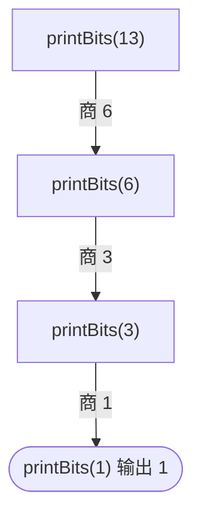

# C 语言复习讲义

## 环境搭建与调试实训

### 从 Hello World 理解编译和运行

在 VS Code 打开工作文件夹，新建 `hello.c`。先在终端执行 `gcc --version`，看到版本信息后再编译。编辑器负责编辑，实际把 C 源码变成可执行程序的是编译工具。VS Code 的 C/C++ 扩展可以提供补全和调试支持。

```c
#include <stdio.h>

int main(void) {
    puts("Hello, C!");
    return 0;
}
```

把文件保存后，在 Windows PowerShell 的项目目录执行以下命令。

```powershell
gcc -std=c11 -Wall -Wextra -g hello.c -o hello.exe
.\hello.exe
```

第一行用 C11 编译，启用常用警告，生成带调试信息的 `hello.exe`。第二行从当前目录启动它。`puts` 会加一个换行，`return 0` 表示正常结束。添加 `-g` 是为调试器保留变量名和源码行等信息。

### 从报错的位置判断是哪一层

| 现象 | 要检查的东西 | 自己验证 |
|---|---|---|
| 终端找不到 `gcc` | 当前终端的 PATH 能否找到编译器 | 执行 `Get-Command gcc`，核对路径 |
| 提示某一行语法错误 | 当前行和上一行的括号、分号、声明 | 从报告的第一个诊断开始修 |
| 链接报 `undefined reference` | 函数定义是否写对，源码是否一起编译 | 有 `main.c` 和 `util.c` 时，两者一起参与构建 |
| 输出与预期不同 | 输进去的内容、整数除法、输出分隔符 | 先手算最短用例，再检查一两轮变量 |
| 打开调试后程序等输入 | 控制台是否能接收标准输入 | 在终端直接运行可执行文件试一次 |

多文件时，头文件声明接口，调用方在调用前看到声明，实施细节放在相应的 `.c` 文件。编译和链接的区别可以用一个实验观察。先用 `gcc -c main.c` 生成目标文件，只把 `main.o` 交给链接器时，若它引用 `util.c` 里的函数，就要补上 `util.o`。

### 用断点找出第一次算错的位置

拿数组中心下标举例，在计算 `right` 那一行打断点。每次暂停时观察 `i`、`left`、`a[i]` 和 `total`，把它们和手算表对比。单步执行过 `left += a[i]` 后，左侧和才应包含当前元素。碰到与当前题无关的函数，单步跳过；需要观察函数内部状态时，单步进入。

练习用 `2 -2 5`。总和是 5。到下标 2 时，左侧 `2 + (-2) = 0`，右侧为空也是 0，所以输出 2。接着用单个数 `7` 检查边界。更多过程见[编译运行与断点调试](c-study-notes.md#review-debugging)与[中心下标](c-study-notes.md#pta-pivot-index)。

## 数制、类型与表达式讲义

### 进制转换从每位的权重开始

同一串数字随着基数变化而改变含义。比如 `(132)₄ = 1 × 4² + 3 × 4 + 2 = 30`，`132` 在四进制里合法，因为数码只用 0 到 3。遇到 `(98)₉` 应先检查数码，9 超出了范围。

从十进制 30 转四进制，除以 4 依次得到商 7 余 2、商 1 余 3、商 0 余 1。先得到的是最低位，所以从最后一次的余数向前读出 `132`。小数则从高位开始。例 `0.625 × 2 = 1.25`，取 1；`0.25 × 2 = 0.5`，取 0；`0.5 × 2 = 1.0`，取 1。结果是 `0.101₂`。

### 固定字长补码与有符号溢出

以 8 位补码为例，位权可以写成 `-128, 64, 32, 16, 8, 4, 2, 1`。`11110110` 的值为 `-128 + 64 + 32 + 16 + 4 + 2 = -10`。手算 `7 - 10` 时，将 `00000111` 与 `11110110` 相加，得 `11111101`，读作 `-3`。

| 8 位运算 | 原始位串 | 如何解释 |
|---|---|---|
| `127 + 1` | `10000000` | 两个正数相加却得到负号，超过 8 位有符号上限 |
| `-1 + 1` | `1 00000000` | 丢掉最高位进位后为零，有符号结果在范围内 |
| `-128 + (-1)` | `1 01111111` | 两个负数相加却出现正号，有符号溢出 |

在题目设定的 8 位补码里可以直接算位串。在 C11 表达式里还要判断运算类型。典型机器上的 `signed char` 在计算前通常提升为 `int`。C11 中有符号表达式溢出行为未定义，无符号运算按其类型的模数回绕。[C11 N1570 `6.2.5、`6.3.1](https://www.open-std.org/jtc1/sc22/wg14/www/docs/n1570.pdf)

### 类型转换要看发生在运算前还是运算后

`(double)(-5 / 2)` 先得整数 `-2` 再转换，`(double)-5 / 2` 在除法前转换，结果为 `-2.5`。余数可以用恒等式检查。在这里 `(-5 / 2) * 2 + (-5 % 2) = -5`，所以余数是 `-1`。

有符号和无符号混算时要辨认转换规则。例如 `-1 < 1u` 中，`-1` 转为 `unsigned int` 的最大值，所以条件不成立。数组下标常用 `size_t`，倒序循环可以写成 `for (size_t i = n; i > 0; --i) use(a[i - 1]);`，判断时不依赖无符号数变为负数。

### 优先级、短路与递增

优先级解决括号如何分组，执行顺序还要看运算符。`size > i && a[i] != 0` 会先检查范围。左边为假时右边不执行，所以可以在右边使用已经验证过的下标。比较整数范围要写成 `2 < x && x < 9`。在 C 中 `2 < x < 9` 先得到 0 或 1，再拿它与 9 比较。

初始 `i = 3`，单独执行 `a = i++;` 得到 `a = 3, i = 4`，再执行 `b = ++i;` 得到 `b = 5, i = 5`。如果在 `i++ + i++` 里让两边都修改同一个变量，两次修改缺少顺序约束，C11 不规定结果。

### 宏展开、常量与作用域

宏在预处理时替换记号。`#define SQUARE(x) ((x) * (x))` 能让 `SQUARE(1 + 2)` 展开为 `((1 + 2) * (1 + 2))`。传 `i++` 会导致参数被写两次，所以需要有副作用的实参时用函数。`const int k = 4;` 是有类型的对象，C11 的 `case` 需要整型常量表达式，可用 `enum { K = 4 };`。

遮蔽和生存期分别看。内部块的同名声明能遮蔽外部名称。块内的普通局部变量离开作用域后就不能通过原地址访问。块内的 `static` 变量的名称仍在块内可见，对象却在整个程序运行期间存在。更多见[考前表达式笔记](c-study-notes.md#review-expressions)和[变量存储期](c-study-notes.md#c-pointer-storage-duration)。

## 流、字符与字符串讲义

### 看见 scanf 读完后留下的字符

设输入是 `42↵hello world↵`，终端的回车在文本流里通常表现为 `'\n'`。`scanf("%d", &n)` 成功读到 42，流里接下来是 `\nhello world\n`。此时 `getchar()` 或 `scanf("%c", &ch)` 会拿到换行。格式里的 `" %c"` 会跳过空白，读到 `h`。如果需要下一整行，先消耗当前行剩余字符，再调用 `fgets`。

`scanf` 的返回值是成功赋值的项数。读两个整数要检查返回 2。输入 `12 x` 时它返回 1，第二个目标没有成功赋值。遇到字符不匹配后接着循环调用同一个格式时，先消耗或处理这个字符，避免一直卡在同一位置。

### fgets 的容量、换行和最后一行

`fgets(buf, sizeof buf, stdin)` 的容量包含末尾的 `'\0'`。例如容量是 5，读入 `ab↵` 时数组前四格为 `a b \n \0`。读入 `abcde↵` 时第一轮只有 `a b c d \0`，接下来的输入从 `e` 开始。返回空指针要先检查，成功时再处理缓冲区。

以下程序逐行显示文本长度。输入约定每行最多 100 个字符，因此 102 格能同时容纳正文、换行和结束符。最后一行没有换行也能处理。输入可能有 Windows 风格行结束时，先找到 `'\r'` 或 `'\n'` 并截断。一般文本处理若允许正文含回车，应只移除实际的尾部行结束符。

```c
#include <stdio.h>
#include <string.h>

int main(void) {
    char line[102];
    while (fgets(line, sizeof line, stdin) != NULL) {
        line[strcspn(line, "\r\n")] = '\0';
        printf("%zu\n", strlen(line));
    }
    return ferror(stdin) ? 1 : 0;
}
```

试输入空行、`a b` 和没有换行的 `xyz`，预期长度依次为 0、3、3。如果正文长度没有题设上限，先决定按段处理、丢弃余下输入还是扩容。缓冲里找不到换行也可能恰好遇到 EOF，需要结合下一次读取的结果判断。

### getchar、putchar 与 ungetc 的输入游标

`getchar()` 返回 `int`，既能表达按 `unsigned char` 解释的输入字符，也能表达 `EOF`。收到 `EOF` 时用 `feof(stdin)` 和 `ferror(stdin)` 判断结束或错误。`putchar(ch)` 输出一个字符并可通过返回 `EOF` 报告写出失败。做字符分类时，先判断 EOF，再调用 `isdigit` 等函数。

`ungetc(ch, stdin)` 可以把读到的分隔符交回输入流。下一个读操作就会拿到它。可移植代码只依赖一次成功回退的保证，并检查返回值。下面程序把开头的一串数字写到输出，读到第一个非数字时退回，再原样复制剩余内容。

```c
#include <ctype.h>
#include <stdio.h>

int main(void) {
    int ch;
    while ((ch = getchar()) != EOF && isdigit(ch)) {
        if (putchar(ch) == EOF) return 1;
    }
    if (ch != EOF && ungetc(ch, stdin) == EOF) return 1;
    if (putchar('|') == EOF) return 1;

    while ((ch = getchar()) != EOF) {
        if (putchar(ch) == EOF) return 1;
    }
    return ferror(stdin) ? 1 : 0;
}
```

输入 `007,x` 输出 `007|,x`。输入空文件输出 `|`。画输入游标时写下三步 `读到逗号 → 退回逗号 → 下一轮从逗号开始`，很容易看出是否会漏字符。另见[逐字符输入详解](c-study-notes.md#c-character-input)。

### 字符数组、结束符和复制函数

`char s[] = "map";` 的容量是 4，`strlen(s)` 是 3。`char t[3] = "map";` 在 C11 中可以初始化，但三个格子都被字母占用，无法用它调用要求字符串的函数。`char *p = s;` 时 `sizeof p` 得到指针的大小，数组容量要另外传递。

| 操作 | 数什么或比较什么 | 典型边界 |
|---|---|---|
| `strlen(s)` | 到首个 `'\0'` 前的字节数 | 要有可访问的结束符，UTF-8 汉字通常不止一字节 |
| `strcmp(a, b)` | 按字节比较，返回负、零、正 | 比较结果不要求恰好是 -1 或 1 |
| `memcpy(dst, src, n)` | 复制恰好 n 个字节 | 源和目标都要够长，区域不能重叠 |
| `memmove(dst, src, n)` | 复制 n 个字节，允许重叠 | 复制字符串时先想要不要连结束符一起搬 |
| `snprintf(buf, cap, ...)` | 有容量限制的格式化写入 | 返回值为负表示错误，大于等于容量表示截断 |

例如把 `"lamp"` 的头一个字符删掉，可以用 `memmove(s, s + 1, strlen(s));`。原长度 4，恰好从第二个字符开始复制三个字母和一个结束符。练习：用同样的方法删去头两个字符，应该复制 `strlen(s) - 1` 个字节，前提是长度至少为 2。

### 字符串的双下标、频率表和状态

原地去重时，`read` 每轮前进一步，只有首次出现的字符才能写到 `s[write++]`。检查 `write <= read`，保证写入时不会破坏右侧尚未读取的内容。最后补 `s[write] = '\0'`。如果题目要求保持顺序，记录“是否见过”比直接排序更符合要求。

单种括号配对可用计数。看见左括号加一，看见右括号减一。一旦为负便可判错，扫完还要等于零。遇到多类括号就需要栈，右括号必须和最近未匹配的左括号同类。例如 `([)]` 的数量相等，匹配顺序仍然出错。[字符串函数笔记](c-study-notes.md#c-string-functions) · [括号匹配例题](c-study-notes.md#pta-parentheses)

## 数组模型与 PTA 题解串讲

### 从题意选择数组模型

| 题目里出现的条件 | 先保存的状态 | 对照题解 |
|---|---|---|
| 每个输出依赖原来的邻居 | 原数组加独立结果，或滚动保存旧值 | [数字信号的平滑滤波](c-study-notes.md#pta-signal-smoothing) |
| 数字长到装不进整数类型 | 每格一位，从个位方向处理进位 | [大整数加一](c-study-notes.md#pta-plus-one) |
| 原地保留符合条件的元素 | 读下标固定扫，写下标按保留次数递增 | [移动零](c-study-notes.md#pta-move-zeroes) |
| 多次问区间和或左右和 | 总和与前缀和，先比较后更新 | [中心下标](c-study-notes.md#pta-pivot-index) |
| 有序序列需要插进一个值 | 预留空位，从右向左移动大元素 | [有序插入](c-study-notes.md#pta-sorted-insert) |
| 连续相同项压成一段 | 当前值和长度，换值结算，末尾结算 | [行程长度压缩](c-study-notes.md#pta-run-length) |

### PTA 7-22 平滑滤波的负数与首尾

输入 `-4 1 2`，首项平均是 `-3 / 2`，数学下取整为 −2。中间求 `(-4 + 1 + 2) / 3`，下取整为 −1。末项为 `3 / 2`，得 1。预期 `-2 -1 1`。如果先将首元素改成 −2，中间计算会误用新值，结果会变成 0。

当除数 `d > 0` 时，C11 向零截断。要实现下取整，可写 `sum / d - (sum % d < 0)`，整除和正数分支都不减。`long long sum = (long long)a[i - 1] + a[i] + a[i + 1];` 在第一步加法前提升类型。长度恰好为 2 时两个输出都由同一对数得到。完整实现见[平滑滤波](c-study-notes.md#pta-signal-smoothing)。

### PTA 7-23 大整数进位追踪

用一个额外位置保存最高位进位。输入 `9 9 9` 时，初始四个格子为 `0 9 9 9`，扫过个位、十位、百位后得到 `0 0 0 0`，最后把预留位从 0 加为 1。普通输入 `1 0 9` 只需要传播过一个 9，输出 `1 1 0`。输入 0 时直接变成 1。

推广到两个大整数相加时，每轮计算 `s = a[i] + b[j] + carry`，当前位写 `s % 10`，下一位进位是 `s / 10`。如果一个数字先用完，把缺失位当 0。两数都用完但仍有进位时还需输出一位。参考[大整数加一程序](c-study-notes.md#pta-plus-one)。

### PTA 7-24 原地移动零的读写轨迹

以 `[0, 4, 0, -2]` 为例，`read` 走到 1 时把 4 写到 0，走到 3 时把 −2 写到 1。此时 `write = 2`，最后两格补零，得到 `[4, -2, 0, 0]`。任意时刻，前 `write` 格是已读部分中的非零元素，顺序与输入一致。这个条件就是循环不变量。

同一套路还能用于原地删除所有等于给定值的元素。一遍扫描完后可以直接返回 `write` 作为新长度。移动零的题目保留原长度，所以还要补零。测试全零、无零、只有一个非零元素和重复的负数。[移动零完整代码](c-study-notes.md#pta-move-zeroes)

### PTA 7-25 中心下标与通用前缀和

为了检查下标 `i`，令 `left` 只包含它前面的元素，`right = total - left - a[i]`。以 `[2, -2, 5]` 为例，`total = 5`。

| `i` | `a[i]` | `left` | `right` | 是否相等 |
|---:|---:|---:|---:|---|
| 0 | 2 | 0 | 3 | 否 |
| 1 | -2 | 2 | 5 | 否 |
| 2 | 5 | 0 | 0 | 是 |

一般前缀和定义为 `prefix[0] = 0`、`prefix[i + 1] = prefix[i] + a[i]`。半开区间 `[l, r)` 的和为 `prefix[r] - prefix[l]`。带负数照样成立。只找中心下标时一边走一边更新左和即可，多次查任意区间才需要整张表。[中心下标完整代码](c-study-notes.md#pta-pivot-index)

### PTA 7-26 顺序表插入与插入排序

向 `[1, 3, 5, 7]` 插入 4，先把 7 右移到空位，再把 5 右移。碰到 3 就停，填入 4。守住 `pos > 0 && a[pos - 1] > x` 的条件顺序。左端到头时短路，避免访问 `a[-1]`。因为比较用 `>`，新元素放在已有同值后面。即使用二分找插入位置，顺序表最坏仍需要移动线性个元素。

插入排序反复对前缀做这件事。先把当前元素保存到临时变量，然后把它前面的较大元素挪右。趟与趟之间，已经处理过的前缀保持有序。更多见[有序插入完整代码](c-study-notes.md#pta-sorted-insert)。

### 二维数组的边界与窗口

遍历矩阵时，先区分行数和列数。相加要求坐标对应；乘法中的一个结果格子是左矩阵一整行与右矩阵一整列的点积。最大池化等窗口题先定左上角，再扫窗口内部。以四个数 `-8 -3 -6 -9` 为例，最大值是 −3，用 0 初始化会得到错误结果。用窗口第一个值或者题设允许的下界初始化。

非重叠 2×2 窗口以 2 为步长。行列都是偶数时，最后一个左上角是 `(r - 2, c - 2)`，内部再向右和向下走一格正好到边界。复习[向量内积](c-study-notes.md#pta-dot-product)并到考试自测练二维窗口。

## 指针、函数与动态内存讲义

### 一张内存图分清对象和地址

`int score = 60; int *p = &score;` 产生两个对象。score 存 60，p 存 score 的地址。`*p = 90;` 沿地址找到 score 并更新它。`&p` 是指针变量自身的地址，类型为 `int **`。

```text
p                       score
┌────────────┐          ┌─────┐
│ score 地址 │ ──────→  │  60 │   *p = 90 后变成 90
└────────────┘          └─────┘
    ↑ &p
```

例如 `p = NULL;` 只修改 p 保存的地址。若另一个指针 q 同时指向 score，通过 q 仍可读到 score。空指针可以比较，解引用前必须确认指向有效对象。详见[指针与内存实验](c-study-notes.md#c-pointer-memory)。

### 数组指针、指针数组与二维形参

| 声明 | 从名字开始读 | 加一时 |
|---|---|---|
| `int *p` | p 指向一个 int | 跨一个 int |
| `int (*row)[3]` | row 是指针，指向三个 int 组成的数组 | 跨一行 |
| `int *refs[3]` | refs 是三个元素的数组，每个元素是 int 指针 | `refs + 1` 指向下一格指针 |
| `int (*whole)[2][3]` | whole 指向完整的 2×3 数组 | 跨整个二维数组 |

`int m[2][3];` 在普通表达式中转换成首行的地址，因此 `int (*row)[3] = m;`。`&m` 指向完整对象，类型为 `int (*)[2][3]`。对于 `void f(int m[][3], size_t rows)`，形参 m 调整成指向一行的指针，所以列宽必须能从类型获得，行数通过参数传。写 `int **` 会期待内存里首先存指针，再由指针找到元素，这和连续的二维数组布局不同。[二维数组逐步推导](c-study-notes.md#c-pointer-array-walkthrough)

### 函数如何带回多个结果

C 的参数按值传递。给函数一个整数时它获得整数的副本；给函数一个地址时它获得地址的副本，通过解引用可以改变外部对象。若要带回最小值与最大值，函数可写成 `void range(const int a[], size_t n, int *low, int *high);`，调用处传 `&lo` 与 `&hi`。也可用结构体把两个结果一起返回。接口应写清 n 大于 0、两个输出指针指向有效且独立的对象。

若要让函数修改外层指针变量，例如让 `p` 指向新位置，传参应写 `&p`，形参写 `int **out`，函数用 `*out` 修改外层指针。先画出 `out → p → 被指对象`，每多一个星号便沿箭头走一层。[输出参数题解](c-study-notes.md#functions-output-parameters) · [二级指针详解](c-study-notes.md#c-double-pointer)

### 指针上的 const 与对象生存期

`const int *p` 表示可以让 p 指向别处，通过 p 只读目标。`int *const p = &x;` 固定 p 保存的地址，通过 p 可以写 x。`const int *const p` 同时限定通过该指针访问的值和指针本身。

地址需要和生存期一起看。函数返回后，普通局部变量已失效，返回它的地址会留下悬空指针。`static` 局部变量有静态存储期。动态内存需要显式释放。`free(p); p = NULL;` 只处理当前这个指针变量，其他曾保存同一地址的别名也不能再使用。[对象生存期笔记](c-study-notes.md#c-pointer-lifetime)

### malloc、calloc 与 realloc 如何配合

先明确多少元素，用 `n * sizeof *values` 计算字节数。`malloc` 分配后内容未初始化，`calloc` 将字节置零。访问之前检查返回值。扩容时让临时指针接收 `realloc` 的结果，扩容失败时仍可用原指针管理旧内存。成功后改用新的指针，重新计算所有指向旧数组内部的位置。

下面是一个可单独运行的实验。先容纳两个整数，再扩到四个，前两个值仍然保留。新增加的两个格子在读取前明确赋值。容量来自外部且很大时，需要先检查 `n > SIZE_MAX / sizeof *values`，以免计算字节数时回绕。

```c
#include <stdio.h>
#include <stdlib.h>

int main(void) {
    int *values = malloc(2 * sizeof *values);
    if (!values) return 1;
    values[0] = 4;
    values[1] = 8;

    int *grown = realloc(values, 4 * sizeof *values);
    if (!grown) {
        free(values);
        return 1;
    }
    values = grown;
    values[2] = 12;
    values[3] = 16;
    printf("%d %d %d %d\n", values[0], values[1], values[2], values[3]);
    free(values);
    return 0;
}
```

预期输出 `4 8 12 16`。当容量为 0 时，应在接口中先决定把它看作空数组还是非法输入，扩上述数组时明确使用正的字节数。[C11 N1570 `7.22.3](https://www.open-std.org/jtc1/sc22/wg14/www/docs/n1570.pdf)

## 结构体、排序与标准库

### 用结构体表示一条完整记录

如果要保存机器的编号、名称和两次读数，`struct Device` 可以把三项绑在一起。`devices[i]` 是整个记录，`devices[i].readings[j]` 指向其内部某次读数。指向记录的指针 `p` 可用 `p->id`，等同于 `(*p).id`。比较内容是否一致，要决定比较哪些字段，并按字段语义比较。

`sizeof(struct Device)` 可能大于各成员大小的和，因为编译器会为对齐插入填充。需要知道具体位置时用 `offsetof`。把整个结构体直接用 `fwrite` 写入文件，结果与平台的布局、字节序和类型宽度有关。要做可互换的文件，应明确字段格式。[结构体数组实例](c-study-notes.md#pta-student-struct)

### 从题意写出排序比较规则

比赛排名若规定分数降序、同分编号升序，只有分数相同才比较编号。若排序的是 `struct Item[]`，传入比较器的是结构体元素的地址。若排序的是 `char *[]`，传入的是指针格子的地址，需要先取出该格存的字符串指针。排序期间按元素类型解读地址，第三个参数使用 `sizeof items[0]`。

```c
#include <stdio.h>
#include <stdlib.h>

typedef struct {
    int id;
    int score;
} Item;

static int compare(const void *left, const void *right) {
    const Item *a = left;
    const Item *b = right;
    if (a->score != b->score)
        return a->score > b->score ? -1 : 1;
    return (a->id > b->id) - (a->id < b->id);
}

int main(void) {
    Item items[] = {{9, 70}, {2, 70}, {1, 69}, {5, 78}};
    size_t n = sizeof items / sizeof items[0];
    qsort(items, n, sizeof items[0], compare);
    for (size_t i = 0; i < n; ++i)
        printf("%d%c", items[i].id, i + 1 == n ? '\n' : ' ');
    return 0;
}
```

预期输出 `5 2 9 1`。直接返回两个字段相减可能导致溢出，关系比较不会遇到这个问题。`qsort` 不保证相等元素的原始顺序，题目要求稳定时可用稳定排序或把输入序号加作最后一级比较。[结构体排序题解](c-study-notes.md#pta-struct-sort) · [字符串指针排序](c-study-notes.md#pta-dynamic-qsort)

### 标准库函数按契约使用

`<stdio.h>` 提供流操作，`<string.h>` 提供字符串和内存操作，`<ctype.h>` 提供字符分类，`<stdlib.h>` 提供内存管理、排序和数值转换。写题时先确认返回值的语义。`fgets` 返回缓冲区地址或空指针。`strtol` 可用结束指针判断有没有读到整数、后面是否有多余字符，并结合 `errno == ERANGE` 检查溢出。

`fopen` 的 `"r"` 打开已有文件，`"w"` 创建或清空文件。每次打开先检查返回结果，处理完调用 `fclose`。文本流读取可复用 `fgets` 循环，读取结束后用 `ferror` 区分错误。字节读入用 `fread` 时，返回值是成功读取的元素数。把读取写在循环条件里，避免使用 `while (!feof(fp))` 后再无条件处理缓冲区。

### 用栈处理最近一次尚未完成的事

数组栈用 `top` 表示下一个可写的位置。压栈前检查容量，执行 `stack[top++] = value`。弹栈前检查非空，执行 `value = stack[--top]`。多种括号匹配需要记下每个左括号的类别。读到右括号时核对栈顶，如果比对成功才弹出。

函数调用也可以想成进出栈。顺序调用两个子函数时，第一个先执行完并返回，然后才开始第二个。遇到递归可画调用树，逐个核对每次入栈的参数和退出后的结果。

## 递归、搜索与整数算法讲义

### 按任务、出口、递进推导递归

写代码前三问。当前函数答什么？哪个输入能直接回答？下一次调用是否更接近出口？以进制输出为例，任务是输出非负数 `n` 的二进制。若 `n < 2` 直接输出一位；否则先递归输出商，再输出余数。把代码中的输出写在递归之前会先打印低位。



从底部返回时，3 输出余数 1，6 输出余数 0，13 输出余数 1，拼成 `1101`。向下走是调用，向上走时补打印。再追踪 0，能直接走基本情况。[原笔记里的递归进制转换](c-study-notes.md#practice-base-conversion)

```c
#include <stdio.h>

static void print_bits(unsigned n) {
    if (n >= 2) print_bits(n / 2);
    putchar('0' + (int)(n % 2));
}

int main(void) {
    unsigned n;
    if (scanf("%u", &n) != 1) return 1;
    print_bits(n);
    putchar('\n');
    return 0;
}
```

`n >= 2` 时先处理商，`n < 2` 时省略递归调用。两种情况都会输出本层的余数，因此输入 0 会打印一位 `0`。

### 汉诺塔从三步写出函数

设 `move(n, from, spare, to)` 的任务是把 n 个盘从 from 移到 to，允许使用 spare。要动最大盘，必须先让上面 n−1 个盘离开。于是第一句 `move(n - 1, from, to, spare);`，然后把最大盘从 from 移到 to，最后 `move(n - 1, spare, from, to);`。当 n 为 0 时直接返回，或单独处理 n 为 1。


每层的辅助柱和目标柱由本次函数实参决定。移动次数满足 `T(0) = 0`、`T(n) = 2T(n - 1) + 1`，所以三盘移动 7 次，n 盘移动 `2ⁿ − 1` 次。递归深度为 O(n)，调用总次数和移动次数同阶。[汉诺塔完整代码](c-study-notes.md#practice-hanoi)

```c
#include <stdio.h>

static void move(int n, char from, char spare, char to) {
    if (n == 0) return;
    move(n - 1, from, to, spare);
    printf("%d %c -> %c\n", n, from, to);
    move(n - 1, spare, from, to);
}

int main(void) {
    move(3, 'A', 'B', 'C');
    return 0;
}
```

把三个函数位置上的柱名写在纸上。第一次递归的目标是 B，于是本层的 C 改作辅助柱。第二次递归从 B 出发，用 A 辅助，目标才是 C。

### 最大公约数、回文与取位

辗转相除依据 `gcd(a, b) = gcd(b, a % b)`。a 和 b 的任何公约数也整除余数；b 和余数的公约数也整除 `a`。例如 `gcd(84, 30) → gcd(30, 24) → gcd(24, 6) → gcd(6, 0)`，余数为 0 时答案为 6。循环实现保留一个余数变量，再同步更新两个数。设输入为非负且至少一个非零，可直接用这个关系。

回文数可以反转数字后和原数比较，也可以从两端逐对比较。反转时要注意类型能否容纳反转结果。用除法拆数字时，`n % 10` 是末位，`n /= 10` 删除末位。奇偶位置之和只要交替累加。输出题先写单个数处理函数，再定多组输入输出，减少在 main 里重复逻辑。

### P1304 试除和筛法的取舍

试除判断 n 时，只要检查到平方根。若 n 是合数，两个因子至少有一个不超过平方根。用 `d <= n / d` 可避免 `d * d` 超出范围。试除函数应在找到一个因子时返回 0，循环完整结束后才返回 1。若成功路径也写成 `return 0;`，外层判断两数同时为质数时永远不成立。

埃氏筛适合反复查询固定上限以内的质数。从尚未划掉的 p 开始，将 `p*p, p*p+p, …` 标记为合数。更小的倍数已有更小质因子。P1304 对每个偶数从小枚举第一个加数，验证互补数也是质数，一旦找到就停。输入 10 时找 `10=3+7`，此时即使还有 `5+5` 也无需输出。若题目要求全部方案则继续枚举到一半。两种程序见[实时试除](c-study-notes.md#luogu-p1304-trial-division)与[筛法 P1304](c-study-notes.md#luogu-p1304)。

### 位运算按一位一位理解

取第 k 位先把它移到最低位置，再和 1 做按位与。对一个无符号整数 `x`，设 `mask = 1u << k`，置位是 `x | mask`，清零是 `x & ~mask`，翻转是 `x ^ mask`。前提是 k 小于对应类型的位宽。用 `x & (x - 1u)` 能清掉最低的一个 1。`x = 0` 时结果仍为 0，因此用它判 2 的幂时先检查 `x != 0`。

例子以 `x = 0b1010` 表示十进制 10 的位串。翻转低两位得到 `1001`。在 C11 源码里可用 `10u` 或 `0xAu` 写原值。复习[位运算详细笔记](c-study-notes.md#c-bitwise)。

### DFS 和 BFS 的访问时机

判断连通块时先定邻接规则。四邻只认上下左右，八邻才包含斜方向。例如两个对角的非空格在四邻规则里属于两块，八邻规则里可能是一块。DFS 一进入合法格就标记，然后展开邻居。BFS 把格子加入队列时就标记，避免同一个格子被多个父节点重复加入。


只有开始格与右侧格成功入访，答案为 2。访问一次每个格子，检查固定个方向，网格复杂度为 O(行数 × 列数)。大网格若担心递归过深，可把尚待访问的格子放进显式栈或队列。对照[油田八邻 DFS](c-study-notes.md#practice-oil-fields)与[消除星星](c-study-notes.md#practice-stars)。

## 计算机基础与考试作答讲义

### 冯·诺依曼模型与存储程序

五个基本组成部分是输入、输出、存储器、运算器和控制器。程序和数据可存于存储器。过程可以写成取指、译码、执行，执行结果按指令的语义写回寄存器或存储器。存储程序使更换任务能通过装入另一组指令完成。若题目拿早期机器作对照，先说明其原始编程方式，再按题设判断它是否采用这一工作方式。

```text
输入设备 ──→ 存储器（指令、数据） ──→ 输出设备
                 ↕
        CPU（控制器、运算器、寄存器）
```

答题时分别解释五个部分的职责。常用字长、存储单位和计算过程可回看[基础复习原笔记](c-study-notes.md#review-computing)。

### 操作系统与网络的概念题

操作系统管理进程、内存、文件和设备。进程是运行中的程序实例，具有执行状态和资源。批处理强调成批提交；分时通过切换使多个会话获得交互体验；实时更关注规定时间内响应。应用程序通过系统提供的接口请求诸如打开文件的操作。

OSI 常考自上而下的顺序。应用、表示、会话、传输、网络、数据链路、物理。网络层负责在网络之间转发，数据链路层处理一段链路上的帧，物理层传送比特对应的信号。星形、总线形、环形、网状描述连接组织形式。纸笔题可先把七层写全，再按题意填位置和功能。

### 纸笔题从定义写到例子

解释“算法的有穷性”时，先说明在合法输入下应在有限步结束，再给一个循环条件永远不变的反例。解释确定性时，可以对照明确的更新关系和一句没有定义的“适当调大”。问输出性时，写清结果由返回值、输出参数或输出流交付。

题目要求画活动记录时，把每次调用的参数、局部变量以及返回的位置分开写。例如 main 调用 A，A 先调 B 再调 C。若 B 又调用 D，返回顺序是 D、B、C、A、main。每个子函数返回后，父函数从调用语句之后继续执行。[函数与参数复习](c-study-notes.md#review-function-basics)

### 机试题的拆分、核对与边界

回忆卷里常把日常故事写得很长。先抽取输入、输出、状态更新和特殊规则，再定接口。函数题先对照题目原型，确定应写回哪个数组、返回什么。程序题写清多组数据循环，空行、行尾空格和同分顺序都以题目约定为准。

| 题型 | 优先核对 |
|---|---|
| 数位处理 | 0、连续 0、位数变化、反转后是否溢出 |
| 字符串 | 空行、内部空格、恰好占满缓冲、最后一行无换行 |
| 数组和窗口 | n 为最小值、全负、首尾、并列最大值 |
| 结构体排序 | 同分时继续比较下一字段、只含一条记录 |
| 函数题 | 返回值与输出参数各负责什么、输入容量是否传入 |
| 递归搜索 | 终止条件、最深路径、重复访问和边界 |

练习先做[考前知识点](c-study-notes.md#课程知识点与考前复习)，再在站内自测接受统一评分，最后按错题回到对应讲义。计算机基础和纸笔题主要参考电子及集电卷、计算机等学院回忆卷；机试模型也参考信通卷和往届计算机学院卷。
