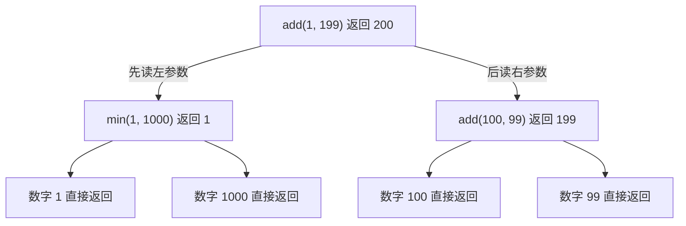
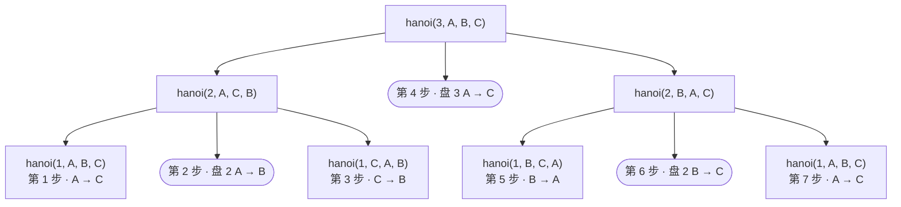

# C 语言学习笔记汇编

按语法、题型和复习目标查阅。题解采用 C11 写法。标为“完整程序”或“完整示例”的代码可单独运行，核心片段放回对应函数中阅读。每题可以先手算变量的变化，再对照代码和边界用例。

## 目录

| 想做什么 | 跳到哪里 |
| --- | --- |
| 查题解 | [阅读路线与题型索引](#阅读路线与题型索引) |
| 学基础 | [基础知识与算法速查](#基础知识与算法速查) · [数组题专题](#数组题专题) · [字符串专题](#字符串专题) |
| 练函数和指针 | [指针入门专题](#指针入门专题) · [函数练习专题](#函数练习专题) |
| 练算法 | [递归与位运算专题](#递归与位运算专题) · [网格搜索专题](#网格搜索专题) |
| 考前复习 | [期中复习路线](#review-midterm) · [课程知识点与考前复习](#课程知识点与考前复习) · [做题检查与自测](#做题检查与自测) |

## 阅读路线与题型索引

- **刚开始刷题** 先做平均成绩、发工资和数组交换，熟悉下标、循环边界与临时变量，再练数组查找、简化 2048 和最长平台。
- **正在学字符串与指针** 先练统计字符一和括号匹配，再看字符串加密。读动态数组进阶前，可以先看指针数组和二级指针。
- **开始练递归与搜索** 先看说反话和进制转换，手算调用与返回，再做汉诺塔、油田合并和消除星星。

数组作业和函数练习有重复题号。按对应题集查题。汉诺塔按具体题目要求调整输出格式。

### 数组作业 7-5 至 7-26

| 题号 | 题解 | 方法 | 复习时检查 |
| --- | --- | --- | --- |
| 7-5 | [简化 2048](#pta-2048) | 非零元素按方向依次写入 | 读写方向一致 |
| 7-6 | [平均成绩](#pta-average) | 数组求和后除以课程数 | 除法前转成 double |
| 7-7 | [数组查找](#pta-array-search) | 顺序查找，再按位置输出邻居 | 检查下标和首尾边界 |
| 7-8 | [奇数偶数](#pta-even-odd) | 两遍顺序扫描，先偶数后奇数 | 写下标接着用，保留组内顺序 |
| 7-9 | [最长平台](#pta-longest-run) | 比较相邻元素，维护当前长度和最大值 | 换值时把当前长度重置为 1 |
| 7-10 | [统计字符一](#pta-lowercase-count) | 用 26 个计数格保存小写字母频率 | 字符减 `'a'` 得下标，按下标顺序输出 |
| 7-11 | [身份证号码最后一位](#pta-id-checksum) | 加权求和、取余、查表 | 前 17 位参与计算，第 18 位用于比较 |
| 7-12 | [括号匹配](#pta-parentheses) | 左括号加一，右括号减一 | 计数途中始终非负，最终为零 |
| 7-13 | [字母统计](#pta-letter-count) | 用 ASCII 码作下标记录字母频率 | 区分大小写，跳过非字母 |
| 7-14 | [字符串加密](#pta-string-encoding) | 字母下标加一取余，再查表 | `Z`、`z` 回到各自表的第 0 格 |
| 7-15 | [动态数组进阶](#pta-dynamic-strings) | 每行分配字符空间，排序指针数组 | 保留空格，用 `strcmp` 比较字符串 |
| 7-16 | [初识结构数组](#pta-student-struct) | 每个结构体保存一名学生 | 姓名按行、学号按字符串读取，每人后留空行 |
| 7-17 | [结构排序](#pta-struct-sort) | 结构体数组按总分降序、同分按姓名升序 | 比较器收到整个结构体的地址 |
| 7-18 | [向量的内积](#pta-dot-product) | 两个向量对应下标相乘并累加 | 按顺序读取完整的两个向量 |
| 7-19 | [一元多项式加法](#pta-polynomial-add) | 以指数作下标，累加系数 | 跳过零项，全部抵消时输出 `0 0` |
| 7-20 | [数据的行程长度压缩](#pta-run-length) | 边读边记录连续相等的一段 | 换值结算旧段，循环后补最后一段 |
| 7-21 | [两数组的差集](#pta-array-difference) | 顺序查找并筛选 | A 保留原顺序和仍符合条件的重复元素 |
| 7-22 | [数字信号的平滑滤波](#pta-signal-smoothing) | 用原数组求邻域平均 | 首尾除以 2，中间除以 3，负数向下取整 |
| 7-23 | [大整数加一](#pta-plus-one) | 从个位向左处理连续进位 | 全是 `9` 时多输出一位 |
| 7-24 | [数组元素的搬运（移动零）](#pta-move-zeroes) | 双下标原地收拢非零元素，再补零 | 写下标不会超过读下标 |
| 7-25 | [寻找数组的中心下标](#pta-pivot-index) | 用总和与左侧和求右侧和 | 先比较，再把当前元素加入左侧和 |
| 7-26 | [有序数组的插入](#pta-sorted-insert) | 从右向左移动大于插入值的元素 | 多预留一格，输出 `n + 1` 项 |

### 函数练习题

| 题号 | 题解 | 核心知识 |
| --- | --- | --- |
| 7-7 | [以参数返回多个值](#functions-output-parameters) | 指针参数与数组长度 |
| 7-8 | [求算式的和 [1]](#functions-series-1) | 连乘、倒数和浮点除法 |
| 7-9 | [求算式的和 [2]](#functions-series-2) | 把连乘改为累加 |
| 7-10 | [求算式的和 [3]](#functions-series-3) | 函数返回值参与表达式 |
| 7-11 | [求算式的和 [4]](#functions-series-4) | 阶乘与函数实参 |
| 7-12 | [表达式求值](#functions-expression) | 递归解析与共享读取位置 |
| 7-14 | [阿克曼函数](#functions-ackermann) | 分段条件与嵌套递归 |

### 其他练习

| 题解 | 方法 | 复习时检查 |
| --- | --- | --- |
| [习题课](#practice-class-sort) | 降序排序后选前一半 | 每班分别取整 |
| [数组交换](#practice-array-swap) | 用临时变量按顺序交换 | 每次修改立即生效 |
| [连续子序列](#practice-contiguous-sequence) | 枚举起点，逐项匹配 | 换起点时重新匹配 |
| [发工资](#practice-cash-breakdown) | 大面值优先，用商与余数分解 | 余额每轮更新 |
| [P1304 哥德巴赫猜想](#luogu-p1304) | 埃氏筛或[当场试除](#luogu-p1304-trial-division)，再升序找质数对 | 第一次找到就停止，输出时无空格 |
| [说反话](#practice-reverse-recursion) | 递归返回时输出 | 每层保留自己的字符 |
| [进制转换](#practice-base-conversion) | 先商后余数 | 高位先输出 |
| [反式加密](#practice-xor-reversal) | 递归倒序与按位异或 | 低四位掩码怎样得到 |
| [汉诺塔](#practice-hanoi) | 两次递归，中间移动最大盘 | 起始、辅助、目标随子任务交换 |
| [约瑟夫环](#practice-josephus) | 从小规模递推幸存下标 | 最后换回从 1 开始的编号 |
| [油田合并](#practice-oil-fields) | 统计上下左右连通块 | 入栈前标记 |
| [消除星星](#practice-stars) | 同色连通块大小与得分 | 搜索返回格子数量 |

### 按知识点反查

| 要查的内容 | 跳转 |
| --- | --- |
| 读入整数、整行与结束符 | [scanf 与 fgets 详解](#c-input) · [getchar、putchar 与 ungetc](#c-character-input) · [999 字符边界](#pta-dynamic-boundary) |
| 字符串与库函数 | [字符数组与结束符](#c-string-basics) · [常用字符串函数](#c-string-functions) · [字符串易错点](#c-string-pitfalls) |
| 地址、传参与数组类型 | [内存中的地址](#c-pointer-memory) · [取地址与解引用](#c-pointer-operators) · [指针参数](#c-pointer-parameters) · [数组与三种声明的对照](#c-pointer-array-walkthrough) · [二级指针](#c-double-pointer) |
| 动态内存与排序 | [生存期及 malloc/free](#c-pointer-lifetime) · [两层内存图](#pta-dynamic-memory-layout) · [qsort 比较函数](#pta-dynamic-qsort) · [逐句语法](#pta-dynamic-syntax) · [头文件对应](#pta-dynamic-headers) |
| 递归与返回 | [调用图读法](#recursion-call-diagrams) · [汉诺塔调用树](#practice-hanoi) · [表达式求值树](#functions-expression) |
| 位运算 | [位运算基础](#c-bitwise) |
| 考试和调试 | [类型与表达式](#review-expressions) · [编译与断点调试](#review-debugging) · [选择、填空与简答](#review-exam-questions) |

## 基础知识与算法速查


### 1. 字符串和结束符

C 语言中的字符串通常存放在字符数组中，以 `\0` 标记结束。`char s[] = "abc";` 实际包含 `a`、`b`、`c` 和 `\0`。存放 30 个字符至少需要 `char s[31]`。

### 2. 字符串处理函数

使用这些函数需要 `#include <string.h>`。

- `strcmp(a, b)`：比较字符串内容。返回 0 表示相同；负数表示 a 按字典顺序较小，正数表示较大。不要用 `a == b` 比较字符串内容。
- `strlen(s)`：返回字符串长度，不包含末尾的 `\0`。返回值类型是 `size_t`，可用 `%zu` 输出。
- `strcpy(a, b)`：将 b 复制到 a，包括结束符。a 必须有足够空间。
- `strcat(a, b)`：将 b 追加到 a 后面。a 必须有足够空间容纳结果及结束符。
- `strchr(s, 'x')`：查找字符第一次出现的位置，找不到返回 `NULL`。
- `strstr(s, "abc")`：查找子串第一次出现的位置，找不到返回 `NULL`。

```c
if (strcmp(s, "0") == 0) {
    printf("字符串是 0\n");
}
```

<a name="c-input"></a>

### 3. 输入：scanf、fgets、stdin

`scanf` 按指定格式读取数据：

```c
int a, b;
scanf("%d,%d", &a, &b);  /* 例如输入 78,32 */
```

`scanf("%s", s)` 读取字符串时遇到空白字符就停止；可用 `%30s` 限制读取长度，目标数组至少需要 31 个位置。

`stdin` 是标准输入流，通常来自键盘，在评测平台上来自测试数据。`fgets` 可以读取包含空格的一行：

```c
char s[82];
while (fgets(s, sizeof(s), stdin) != NULL) {
    printf("%s", s);
}
```

#### 三个参数与返回值

函数声明在 `<stdio.h>` 中。下面的声明省略了 `restrict`，初学时先看参数和返回值的类型。

```c
char *fgets(char *s, int n, FILE *stream);
```

| 写法 | 含义 |
| --- | --- |
| `s` | 可写缓冲区的首地址。`char s[6]` 作为参数时会转换成 `&s[0]`。函数把读取的内容直接写到这个数组里 |
| `n` | 可用容量，包含留给 `'\0'` 的一格。传入 `6` 最多存 5 个输入字符。实际缓冲区至少有 `n` 格，常规读取使用 `n >= 2` |
| `stream` | 从哪里读。`stdin` 是标准输入流，打开的文本文件也可以通过 `FILE *` 传进来 |
| 返回值 | 成功时返回传入的地址 `s`。读到任何字符之前就遇到 EOF，或发生读错误时，返回 `NULL` |

访问 `s` 之前先检查返回值。最后一行即使没有换行，只要 EOF 之前读到了字符，这次也会成功。需要区分读错误与正常到达末尾时，在 `fgets` 返回 `NULL` 后检查 `ferror(stream)` 和 `feof(stream)`。`feof` 反映已经遇到 EOF 的状态，不能预测下一次能否读到字符。

`sizeof s` 在 `s` 是实际数组的作用域里能得到数组容量。函数形参即使写成 `char s[]`，实际也是指针，`sizeof s` 得到的是指针大小。写读入辅助函数时，把真实容量作为参数一起传进去。

#### 换行与字符串结束符

正常的文本输入中，空格和制表符都照样存入。读到换行且有空间时，把 `'\n'` 也存进去，再补 `'\0'`。容量先用尽时，只补 `'\0'`，未读字符留给下次。例如读入 `ab\n` 后，开头四格依次是 `[a][b][\n][\0]`。这时 `strlen(s)` 为 `3`，若数组声明为 `char s[6]`，`sizeof s` 仍为 `6`。

普通文本行可用 `s[strcspn(s, "\r\n")] = '\0';` 去掉行结束符，需要 `<string.h>`。`strcspn` 从头数到第一个 `'\r'` 或 `'\n'`，都没找到时返回 `strlen(s)`，赋值会落在原来的结束符位置。这适用于正文不含回车的行。赋值只修改数组中的字符串，输入流里未读的内容仍在。要判断这次有没有读到换行，先用 `strchr(s, '\n')`，再修改字符串。

#### 用 6 格缓冲区观察每次读入

下面的完整程序会把输入中的换行显示成两个可见字符 `\n`，每次读取结果单独显示在方括号里。

```c
#include <stdio.h>

int main() {
    char s[6];

    while (fgets(s, sizeof s, stdin) != NULL) {
        putchar('[');
        for (int i = 0; s[i] != '\0'; i++) {
            if (s[i] == '\n')
                fputs("\\n", stdout);
            else
                putchar(s[i]);
        }
        puts("]");
    }
    return 0;
}
```

| 输入（用 `\n` 表示换行） | 每次成功读取并打印的结果 |
| --- | --- |
| `ab c\n` | `[ab c\n]`。空格和换行都装得下 |
| `abcde\nB\n` | 依次是 `[abcde]`、`[\n]`、`[B\n]`。第一次只能读 5 个字符，第二次才读到第一行的换行 |
| `\n`（空行） | `[\n]`。读到了换行，所以这次成功 |
| `abc` 后直接 EOF | `[abc]`。第一次有数据，下一次才返回 `NULL` |

没在缓冲区里找到 `'\n'` 时，可能是正文正好填满，换行留在输入流里，也可能是正文还没读完，或者末行没有换行。若任务需要保留任意长度的整行，应继续读并拼接正文。若题目保证正文有上限，可按「正文上限 + 行结束符所占字节 + 1」分配。

#### 先读整数，再读下一整行

`scanf("%d", &n)` 跳过开头的空白并读整数，整数后面的换行通常还在流里。比如输入 `3\nhello world\n`，如果立刻调用 `fgets`，它读到的是 `"\n"`。当题目明确要求正文从下一行开始时，用 `getchar` 循环读完数量行，连同行末可能出现的空格一起消费。`ch` 用 `int` 保存，才能区分字符和 `EOF`。

下面是完整示例，假设第二行包含行结束符在内能放进缓冲区。输出中的方括号便于看出前导和尾随空格有没有保留。

```c
#include <stdio.h>
#include <string.h>

int main() {
    int n;
    char line[128];

    if (scanf("%d", &n) != 1)
        return 1;

    int ch;
    while ((ch = getchar()) != '\n' && ch != EOF) {
    }

    if (fgets(line, sizeof line, stdin) == NULL)
        return 1;

    line[strcspn(line, "\r\n")] = '\0';
    printf("%d [%s]\n", n, line);

    return 0;
}
```

对于 `3\nhello world\n`，输出 `3 [hello world]`。如果题目要求保留整数所在行后面的文字，就直接从当前位置读，跳过整行会把这些文字一起读掉。容量正好卡住换行的实际题例见 [动态数组进阶的 999 字符边界](#pta-dynamic-boundary)。

<a name="c-character-input"></a>

### 4. getchar、putchar 和 ungetc

这三个函数都声明在 `<stdio.h>`。可以把输入想成一串排好队的字符。`getchar` 从队首取一个，`putchar` 往输出写一个，`ungetc` 则把一个字符放回指定输入流的队首。

| 写法 | 做什么 | 成功和失败怎样区分 |
| --- | --- | --- |
| `int getchar(void);` | 从 `stdin` 读一个字符。空格、制表符和换行也会读到 | 成功返回字符值，读到末尾或发生读错误时返回 `EOF` |
| `int putchar(int ch);` | 向 `stdout` 输出一个字符 | 成功返回写出的字符值，写入失败时返回 `EOF` |
| `int ungetc(int ch, FILE *stream);` | 把一个字符放回 `stream`，例如 `ungetc(ch, stdin)` | 成功返回放回的字符值，失败返回 `EOF` |

#### 4.1 用 `int` 接收 getchar 的结果

一次读入的字符会按 `unsigned char` 的值转换成 `int` 返回，另有一个负值 `EOF` 表示当前没有成功读到字符。先用 `int ch` 保存，比较 `ch == EOF` 后，再按字符使用。若先塞进 `char`，结果可能变了。例如在常见的 8 位有符号 `char` 平台上，字节 `0xFF` 可能被存成 `-1`，与常见的 `EOF` 值撞上。

假设输入是 `A`、空格、`B`、换行，然后结束。连续调用 `getchar()` 会依次得到 `'A'`、`' '`、`'B'`、`'\n'`、`EOF`。`'\n'` 是读到的字符，`EOF` 是函数报告的状态。要区分正常读完和读取错误，可以在它返回 `EOF` 后检查 `feof(stdin)` 和 `ferror(stdin)`。

#### 4.2 用 putchar 原样输出每个字符

`putchar('A')` 输出 `A`，`putchar(' ')` 输出空格，`putchar('\n')` 输出换行。它不会自动换行。要输出一位数字 `7`，可以写 `putchar('7')` 或 `putchar('0' + 7)`。`putchar(7)` 会把 `7` 当作字符编码。要输出整数 `123`，可以用 `printf("%d", 123)`。

完整示例。逐字符复制标准输入，直到读到末尾。

```c
#include <stdio.h>

int main(void) {
    int ch;

    while ((ch = getchar()) != EOF) {
        if (putchar(ch) == EOF)
            return 1;
    }

    if (ferror(stdin))
        return 1;
    return fflush(stdout) == EOF;
}
```

循环条件 `(ch = getchar()) != EOF` 先读取并保存返回值，再判断是否退出。圆括号很重要，`ch = getchar() != EOF` 会按 `ch = (getchar() != EOF)` 分组，留在 `ch` 里的只会是 `0` 或 `1`。末尾的 `fflush(stdout)` 把缓冲中的输出提交出去，也让程序能检查这个阶段的写入错误。

如果只想跳过当前行余下的内容，可以用 `while ((ch = getchar()) != '\n' && ch != EOF) {}`。这个循环会把换行也读掉，所以下一次读取从下一行开始。前面 [先读整数，再读下一整行](#c-input) 的例子用的就是这段循环。由于它会丢弃当前行剩下的所有字符，只在确实要跳到下一行时用。

#### 4.3 用 ungetc 把多读的一个字符放回去

最常用的场景是提前读一个字符来决定下一步怎么处理。例如处理注释时，读到 `/` 后再读一个字符。如果它既不是 `*` 也不是 `/`，就先处理原来的 `/`，再把第二个字符放回去，让下一轮按原顺序处理它。

| 操作 | 输入原来是 `AB` 时会发生什么 |
| --- | --- |
| `int ch = getchar();` | `ch` 得到 `'A'`，下一个待读字符是 `'B'` |
| `ungetc(ch, stdin);` | `'A'` 回到同一输入流，排在 `'B'` 前面 |
| `getchar();` | 再次读到 `'A'` |
| 再调一次 `getchar();` | 这次读到 `'B'` |

放回的字符会被下一次读取该流的函数读到，所以 `fgets` 也能读到它。这个操作只影响输入流接下来的读取，原文件内容不变。可移植的写法只依赖连续读取之间放回**一个**字符的保证，检查 `ungetc` 的返回值，并在 `ch == EOF` 时跳过回退。

完整示例。跳过开头的空格和制表符，把第一个其他字符放回，再用 `fgets` 读取剩下这一行。假设剩余内容能放进 `line`。例如输入两个空格后跟 `Apple pie`，第一次遇到的非空格是 `A`，放回后 `fgets` 仍能读到完整的 `Apple pie`。如果读到的是换行，同样放回，所以空行会保留下来。

```c
#include <stdio.h>

int main(void) {
    int ch;
    char line[128];

    do {
        ch = getchar();
    } while (ch == ' ' || ch == '\t');

    if (ch == EOF)
        return ferror(stdin) != 0;
    if (ungetc(ch, stdin) == EOF)
        return 1;
    if (fgets(line, sizeof line, stdin) == NULL)
        return 1;

    if (fputs(line, stdout) == EOF)
        return 1;
    return fflush(stdout) == EOF;
}
```

函数行为与返回值参见 [C11 委员会草案 N1570，§7.21.7.1、§7.21.7.6、§7.21.7.8、§7.21.7.10](https://www.open-std.org/jtc1/sc22/wg14/www/docs/n1570.pdf)。

### 5. 判断素数

素数是大于 1 且只有 1 和自身两个正因数的整数。

```c
int isprime(int num) {
    if (num < 2) return 0;
    for (int i = 2; i <= num / i; i++) {
        if (num % i == 0) return 0;
    }
    return 1;
}
```

只需检查到平方根；`i <= num / i` 也避免了 `i * i` 的潜在溢出。

<a name="luogu-p1304"></a>

#### 洛谷 P1304 哥德巴赫猜想

输入一个偶数 `N`，其中 `4 <= N <= 10000`。依次处理 `4、6、…、N`。对于每个偶数 `even`，输出第一个加数最小的一组质数，格式为 `even=p+q`。

##### 先筛质数，再找一对加数

1. `composite[i]` 为 `1` 表示 `i` 不能作为质数。数组初始化为 `0`，先单独标记 `0` 和 `1`。遇到尚未标记的 `p`，用埃拉托斯特尼筛法标记它的倍数。
2. 从 `p * p` 开始标记。更小的倍数可以写成 `p * k`，其中 `2 <= k < p`，它们已有更小的质因子，前面的筛选已经处理过。任意合数都有一个不超过其平方根的质因子，所以外层筛到 `p * p > n` 就可以结束。
3. 对每个 `even`，从 `p = 2` 开始试，第一个加数定下来，第二个就是 `q = even - p`。只试到 `even / 2`，因为交换两个加数后可以把较小的一个放前面。两项第一次都通过质数检查时立即 `break`，保证 `p` 最小。

完整程序

```c
#include <stdio.h>

int main() {
    int n;
    int composite[10001] = {0};

    scanf("%d", &n);

    composite[0] = composite[1] = 1;
    for (int p = 2; p * p <= n; p++) {
        if (composite[p])
            continue;

        for (int multiple = p * p; multiple <= n; multiple += p)
            composite[multiple] = 1;
    }

    for (int even = 4; even <= n; even += 2) {
        for (int p = 2; p <= even / 2; p++) {
            int q = even - p;
            if (!composite[p] && !composite[q]) {
                printf("%d=%d+%d\n", even, p, q);
                break;
            }
        }
    }

    return 0;
}
```

以 `10` 为例，`p = 2` 时得到 `q = 8`，`8` 已被标记。接着试 `p = 3`，得到 `q = 7`，两项都是质数，于是输出 `10=3+7`。最小输入 `4` 输出 `4=2+2`。枚举范围包含 `even / 2`，所以两项相等的答案也能找到。

埃氏筛耗时 `O(N log log N)`，标记表占 `O(N)` 空间。筛完后每次判质数只需一次数组查表。寻找加数的循环在找到第一组时就结束，两层枚举的保守时间上界为 `O(N²)`。本地使用独立的试除判质数核对了样例以及 `N = 10000` 时的全部 4999 行。

<a name="luogu-p1304-trial-division"></a>

##### 不打表：边枚举边试除

每次选定第一个加数 `p` 后，计算 `q = even - p`，直接用 `isprime` 判断这两个数。对 `4` 从 `p = 2` 开始，仍然用相同的判定和输出逻辑。对更大的偶数，`even - 2` 是大于 2 的偶数，因此从 `3` 开始、每次加 `2` 即可。第一次找到就结束内层循环。

试除判质数时先处理 `2`、`3`，排除它们的倍数。整数除以 `6` 的余数有 `0` 到 `5` 六种，余数 `0、2、4` 对应偶数，余数 `3` 对应 3 的倍数。剩下余数 `1` 和 `5`，所以循环每轮试 `d` 和 `d + 2`，顺序是 `5、7、11、13、17、19……`。合数必有一个不超过平方根的因子，试除只需到这个范围。

完整程序

```c
#include <stdio.h>

int isprime(int x) {
    if (x <= 3)
        return x >= 2;
    if (x % 2 == 0 || x % 3 == 0)
        return 0;

    for (int d = 5; d * d <= x; d += 6) {
        if (x % d == 0 || x % (d + 2) == 0)
            return 0;
    }

    return 1;
}

int main() {
    int n;
    scanf("%d", &n);

    for (int even = 4; even <= n; even += 2) {
        int start = even == 4 ? 2 : 3;

        for (int p = start; p <= even / 2; p += 2) {
            int q = even - p;
            if (isprime(p) && isprime(q)) {
                printf("%d=%d+%d\n", even, p, q);
                break;
            }
        }
    }

    return 0;
}
```

`&&` 会短路。`p` 是合数时，程序直接进入下一轮，省掉对 `q` 的试除。对偶数 `12`，先试 `p = 3` 得到 `q = 9`，试除失败。再试 `p = 5` 得到 `q = 7`，输出 `12=5+7`。

额外空间是 `O(1)`，单次试除的最坏时间是 `O(sqrt(N))`。若每个偶数最多试 `K` 个候选加数，总时间为 `O(NK sqrt(N))`，只用题面给出的上界推算则为 `O(N² sqrt(N))`。本地核对了样例和 `N = 10000` 的全部 4999 行。该范围内最晚找到的一组从 `p = 173` 开始，出现在 `7426`。

### 6. 最大公约数与约分

辗转相除法反复计算余数，直到第二个数为 0：

```c
int Gcd(int a, int b) {
    while (b != 0) {
        int remainder = a % b;
        a = b;
        b = remainder;
    }
    return a;
}
```

上述函数适用于正整数。约分时，分子和分母分别除以它们的最大公约数，例如 `78/32` 变为 `39/16`。通常最小公倍数取非负值；若题目对符号有特殊规定，应遵循题意。

### 7. 冒泡排序

依次比较相邻元素，前者较大时交换，重复多轮，就能得到升序：

```c
void sort(int a[], int count) {
    for (int i = 0; i < count - 1; i++) {
        for (int j = 0; j < count - 1 - i; j++) {
            if (a[j] > a[j + 1]) {
                int temp = a[j];
                a[j] = a[j + 1];
                a[j + 1] = temp;
            }
        }
    }
}
```

### 8. 遍历字符串与判断字母

用 `s[i] != '\0'` 判断是否到达字符串末尾。英文大小写字母可这样判断：

```c
int isLetter(char c) {
    return (c >= 'a' && c <= 'z') ||
           (c >= 'A' && c <= 'Z');
}
```

查找最长单词时，连续字母构成一个单词；遇到非字母就比较长度。只有新单词严格更长时才更新，就能在长度相等时保留最早出现的单词。

### 9. 状态变量与过滤注释

可以用状态变量记录当前处于普通代码、单行注释或多行注释。普通代码中识别 `//` 和 `/*`；单行注释到换行结束，多行注释到 `*/` 结束。在注释内部，其他注释起始符不再起作用。是否保留注释内的换行应依照题目要求。

<a name="practice-josephus"></a>

### 10. 约瑟夫环与递推

n 个人围成一圈，从 1 开始报数，报到 k 的人退出，从下一个人重新开始。求最后留下的人，可以使用从 0 开始编号的递推：

```c
int josephus(int n, int k) {
    int position = 0;
    for (int i = 2; i <= n; i++) {
        position = (position + k) % i;
    }
    return position + 1;
}
```

只有一个人时位置是 0；逐步增加人数并更新位置。最后加 1，转换为题目中从 1 开始的编号。时间复杂度 O(n)，额外空间 O(1)。

### 11. 函数的嵌套调用

一个函数内部可以调用其他函数。例如分别编写求三个数最大值、最小值的函数，然后在第三个函数中调用它们：

```c
int sum(int a, int b, int c) {
    return max(a, b, c) + min(a, b, c);
}
```

调用 `sum` 时，它会调用 `max` 和 `min`，得到结果后相加并返回。被调用的函数应在调用前定义，或提前声明函数原型。输出时按题目要求使用格式，例如 `printf("Max+Min=%d\n", sum(a, b, c));`。

### 12. 数组作为函数参数与金额输出

函数参数 `float list[]` 接收数组，通常还需要用另一个参数传入元素个数，因为函数不能从该参数自动得知数组长度。遍历时可同时求和并查找最小值：先将最小值初始化为 `list[0]`（前提是数组非空），再逐个比较。

逻辑与 `&&` 表示两个条件都成立，例如 `n >= 5 && total >= min`。`printf("%.2f\n", value)` 以小数形式输出并保留两位小数；读取 `float` 时使用 `scanf("%f", &value)`。

浮点数可能存在精度误差；实际处理金额时通常用整数表示分，但练习题应遵循指定的函数类型。

### 13. stdlib.h 与动态内存

`#include <stdlib.h>` 引入标准库中一些函数的声明，例如动态内存分配函数 `malloc`、释放函数 `free`，以及 `abs`、`rand`、`strtol` 等。

```c
float *list = malloc(n * sizeof(float));
if (list == NULL) return 1;
/* 使用 list[0] 到 list[n - 1] */
free(list);
```

`malloc` 按字节申请内存，成功时返回内存地址，失败时返回 `NULL`；申请的内存内容没有初始化。`sizeof(float)` 是一个 `float` 占用的字节数。`free` 释放申请的内存，释放后不能再使用该内存。如果不需要动态分配，也可根据题目规模使用合适的数组。

### 14. 长度为 3 的回文子序列

子序列可以不连续，但必须保持原有顺序。长度为 3 的回文一定形如 `xyx`，由两端字符 x 和中间字符 y 唯一确定。对于每个两端字符，找到它第一次和最后一次出现的位置；两者之间每种不同字符，都能组成一个不同回文。用长度为 26 的数组标记出现过的中间字母，可避免重复计数。

## 数组题专题

本章整理已经做过的数组题。先理解每个变量负责什么，再用小输入手动走一遍。代码采用 C11 写法，解释放在代码块外。

### 1. 下标、长度和初始化

`int a[100];` 提供 100 个整数位置，下标为 0～99。实际输入 n 个数时，使用 `a[0]` 到 `a[n - 1]`，遍历条件写 `i < n`。

`int a[100] = {0};` 会把所有元素初始化为 0。普通局部数组未初始化时，元素值不确定，必须先赋值再读取。

`int grid[4][4];` 表示 4 行 4 列，`grid[i][j]` 的 i 是行号，j 是列号。字符数组每行如果作为字符串读取，需要额外为 `'\0'` 留一个位置。

| 变量 | 用途 | 初始化或边界 |
| --- | --- | --- |
| n、m | 有效长度或行列数 | 全文保持同一含义 |
| i、j | 读取或比较的下标 | 访问前确认合法 |
| k | 下一次写入的位置 | 每行重新设置 |
| sum、count | 总和、数量 | 每组开始时归零 |
| found | 是否找到 | 初始 0，找到后设为 1 |

<a name="practice-class-sort"></a>

### 2. 习题课——从人数最多的班级中选一半

最多选 `n / 2` 个班，每个班最多参加人数为 `a[i] / 2`。正整数除法舍去小数，符合题目取整要求。

先从大到小排序，再把前 `n / 2` 个班的人数分别除以 2 后相加。较大班级允许参加的人数至少与较小班级一样多，因此优先选大班级。

以下为完整程序。

```c
#include <stdio.h>

int main(void) {
    int n, a[100];
    if (scanf("%d", &n) != 1) {
        return 0;
    }
    for (int i = 0; i < n; i++) {
        if (scanf("%d", &a[i]) != 1) {
            return 0;
        }
    }

    for (int i = 0; i < n - 1; i++) {
        for (int j = i + 1; j < n; j++) {
            if (a[i] < a[j]) {
                int temp = a[i];
                a[i] = a[j];
                a[j] = temp;
            }
        }
    }

    int ans = 0;
    for (int i = 0; i < n / 2; i++) {
        ans += a[i] / 2;
    }
    printf("%d\n", ans);
    return 0;
}
```

输入人数 `4 5 6 7 8`，排序后为 `8 7 6 5 4`，选择两个班，结果为 `8 / 2 + 7 / 2 = 7`。

内层用 `a[i]` 与后面各元素比较，遇到更大的就交换，第 i 轮结束时，剩余元素中的最大值已经放到 `a[i]`。这种交换排序与相邻元素交换的冒泡排序要分清。

要逐班取整。两个 7 人班各来 3 人，合计 6 人，先相加再除以 2 会算成 7 人。n 为 1 时，可选班数为 0，答案为 0。

<a name="practice-array-swap"></a>

### 3. 数组交换——每次操作都作用于当前数组

按 `i = 0, 1, …, n - 1` 依次交换 `a[i]` 与 `a[b[i]]`。下面是核心片段，放在两个数组都已读入之后。

```c
for (int i = 0; i < n; i++) {
    int temp = a[i];
    a[i] = a[b[i]];
    a[b[i]] = temp;
}
```

`temp` 保存交换前的 `a[i]`，随后填入另一边的值，最后把旧值写回另一边。

```text
A 初始为 10 20 30，B 为 1 2 0
i = 0：交换 a[0]、a[1]，得到 20 10 30
i = 1：交换 a[1]、a[2]，得到 20 30 10
i = 2：交换 a[2]、a[0]，得到 10 30 20
```

本题要求逐次互换。写成 `result[i] = a[b[i]]` 会变成另一种重排操作，上例得到 `20 30 10`。题目保证 B 中下标合法，每一步都要执行，即使某个位置已经交换过。

输出数组可以使用以下片段，先输出第一个数，从第二个数开始在前面补空格。

```c
for (int i = 0; i < n; i++) {
    if (i > 0) {
        printf(" ");
    }
    printf("%d", a[i]);
}
printf("\n");
```

<a name="practice-contiguous-sequence"></a>

### 4. 连续子序列——枚举起点，再连续比较

A、B 都以 −1 结束，−1 不存入数组。n、m 分别记录两个序列长度。下面是完整程序。

```c
#include <stdio.h>

int main(void) {
    int a[1000], b[1000];
    int n = 0, m = 0, x;

    while (scanf("%d", &x) == 1 && x != -1) {
        a[n++] = x;
    }
    while (scanf("%d", &x) == 1 && x != -1) {
        b[m++] = x;
    }

    int found = 0;
    for (int i = 0; i + m <= n; i++) {
        int j = 0;
        while (j < m && a[i + j] == b[j]) {
            j++;
        }
        if (j == m) {
            found = 1;
            break;
        }
    }

    if (found) {
        printf("ListB is the sub sequence of ListA.\n");
    } else {
        printf("ListB is not the sub sequence of ListA.\n");
    }
    return 0;
}
```

`a[n++] = x` 先执行 `a[n] = x`，再把 n 加 1。`&&` 从左到右判断，前面的读取成功后才检查是否为 −1。

i 是在 A 中尝试的起点，j 是已经连续匹配的数量。每换一个起点，j 都重新从 0 开始。只有 `j == m`，才说明 B 的全部元素已经匹配。

`i + m <= n` 保证从 i 开始至少还剩 m 项，最后一项 `a[i + m - 1]` 的下标不会超过 `n - 1`。B 比 A 长时，循环直接跳过。

例子 A 为 `5 4 3 2 1`、B 为 `3 2 1`，在 i 为 2 时找到。还要测试 A 为 `1 1 2`、B 为 `1 2`，第一个起点失败后，第二个起点应成功。最坏时间复杂度为 `O(nm)`，适用于题目给出的长度上限 1000。

<a name="practice-cash-breakdown"></a>

### 5. 发工资——除法求张数，取余求余额

以下为完整程序，面值从大到小处理，张数大于 0 才输出。

```c
#include <stdio.h>

int main(void) {
    int n;
    int money[7] = {100, 50, 20, 10, 5, 2, 1};

    if (scanf("%d", &n) != 1) {
        return 0;
    }
    for (int i = 0; i < 7; i++) {
        int count = n / money[i];
        n %= money[i];
        if (count > 0) {
            printf("%d:%d\n", money[i], count);
        }
    }
    return 0;
}
```

`n %= money[i]` 等价于 `n = n % money[i]`。输入 2352，先发 23 张百元钞票，余 52 元，再发 1 张 50 元，余 2 元，最后发 1 张 2 元。输出如下。

```text
100:23
50:1
2:1
```

该做法对应题目指定的面值和“大面值优先”规则。张数为零的面值跳过，冒号两侧没有空格。

<a name="pta-2048"></a>

### 6. 简化 2048——读与写的方向一致

每行把非零数字依次靠到指定的一侧，其余位置填 0。题目中的两个相同数字仍然分别占格。用初始全零的数组 b 保存结果。

以下为完整程序。

```c
#include <stdio.h>

int main(void) {
    int direction, a[4][4];
    int b[4][4] = {0};

    if (scanf("%d", &direction) != 1) {
        return 0;
    }
    for (int i = 0; i < 4; i++) {
        for (int j = 0; j < 4; j++) {
            if (scanf("%d", &a[i][j]) != 1) {
                return 0;
            }
        }
    }

    for (int i = 0; i < 4; i++) {
        if (direction == 0) {
            int k = 0;
            for (int j = 0; j < 4; j++) {
                if (a[i][j] != 0) {
                    b[i][k] = a[i][j];
                    k++;
                }
            }
        } else {
            int k = 3;
            for (int j = 3; j >= 0; j--) {
                if (a[i][j] != 0) {
                    b[i][k] = a[i][j];
                    k--;
                }
            }
        }
    }

    for (int i = 0; i < 4; i++) {
        for (int j = 0; j < 4; j++) {
            if (j > 0) {
                printf(" ");
            }
            printf("%d", b[i][j]);
        }
        printf("\n");
    }
    return 0;
}
```

#### 输入和初始化

`direction` 存方向，0 表示左移，1 表示右移。`scanf("%d", &direction)` 成功读到一个整数就返回 1，`!= 1` 时提前结束。输入 0 时，变量的值是 0，`scanf` 的返回值仍是 1。`else` 会处理右移，因为题目保证方向只有 0 和 1。

`a[4][4]` 存原棋盘。读入时，外层 i 依次选中第 0～3 行，内层 j 依次访问该行第 0～3 列。`&a[i][j]` 是这一格的地址，读到的整数就写进这一格。`b[4][4] = {0}` 把结果棋盘的 16 格都初始化为 0。这样只用写入非零数字，没写到的位置自然是空格。

#### 移动时区分读下标和写下标

| 变量 | 作用 |
| --- | --- |
| `i` | 当前处理哪一行。该行的数字只在这一行内移动 |
| `j` | 当前读原棋盘的哪一列，访问 `a[i][j]` |
| `k` | 下一个非零数字应放进结果的哪一列，写入 `b[i][k]` |

用 `0 2 0 4` 走一遍。往左时，从左边开始读也从左边开始写；往右时，从右边开始读也从右边开始写。跳过 0 时，j 继续走，k 保持原值。

| 方向 | j 的扫描顺序 | 写入过程 |
| --- | --- | --- |
| 左移 | 0、1、2、3 | 跳过 0，把 2 写进第 0 列，再跳过 0，把 4 写进第 1 列 |
| 右移 | 3、2、1、0 | 把 4 写进第 3 列，跳过 0，把 2 写进第 2 列，再跳过 0 |

右移先处理 4，所以它占最右边，2 紧挨着它的左边。得到的数组中 2 仍在 4 的左边。左移时每写一个数执行 `k++`，右移时每写一个数执行 `k--`。换下一行时，k 要重新从 0 或 3 开始。如果整行都非零，最后一次写入之后 k 会变成 4 或 −1，此时该行扫描已结束，程序不会访问这个位置。

| 原行 | 左移 | 右移 |
| --- | --- | --- |
| `0 2 0 4` | `2 4 0 0` | `0 0 2 4` |
| `2 0 2 0` | `2 2 0 0` | `0 0 2 2` |
| `0 0 0 0` | `0 0 0 0` | `0 0 0 0` |
| `2 4 8 16` | `2 4 8 16` | `2 4 8 16` |

若从左往右读取，却从最右边依次写入，原来的 2、4 会变为 4、2。读取与写入方向一致可以保持数字的原始顺序。

#### 输出格式

最后两层循环按行打印 b。每行的第 0 列直接打印数字，第 1～3 列先打印空格再打印数字。`printf("\n")` 放在内层循环后面，使每输出完一行才换行。这样一共有四行，每行四个数，开头和结尾都没有多余空格。

<a name="pta-average"></a>

### 7. 平均成绩——转换类型的时机

题目要求用数组存储成绩。以下完整程序用于 `1 <= n <= 100`。

```c
#include <stdio.h>

int main(void) {
    int n, a[100];

    if (scanf("%d", &n) != 1) {
        return 0;
    }
    for (int i = 0; i < n; i++) {
        if (scanf("%d", &a[i]) != 1) {
            return 0;
        }
    }

    int sum = 0;
    for (int i = 0; i < n; i++) {
        sum += a[i];
    }
    double average = (double)sum / n;
    printf("%.2f\n", average);
    return 0;
}
```

样例成绩 `80 75 67 90 97` 的总分是 409，平均值为 81.8，输出 `81.80`。

| 写法 | 运算过程 | 结果 |
| --- | --- | --- |
| `409 / 5` | 整数除法 | `81` |
| `(double)409 / 5` | 先转换，再相除 | `81.8` |
| `(double)(409 / 5)` | 先整数相除，再转换 | `81.0` |

`%.2f` 输出两位小数。`scanf` 读 `double` 用 `%lf`，读本题中的整数成绩用 `%d`。

<a name="pta-array-search"></a>

### 8. 数组查找——找到下标，再找左右邻居

题目 7-7（实验 7_2）。读入 n 个互不相同的整数，接着做 m 次查询。邻居是原数组中紧挨着目标的元素。找到目标后输出左邻居、右邻居，有几个就输出几个。找不到或没有邻居就输出 `NULL`。

```c
#include <stdio.h>

int main() {
    int n, m, a[1000];

    scanf("%d", &n);
    for (int i = 0; i < n; i++)
        scanf("%d", &a[i]);

    scanf("%d", &m);
    while (m--) {
        int x, i = 0;
        scanf("%d", &x);

        while (i < n && a[i] != x)
            i++;

        if (i == n || n == 1)
            puts("NULL");
        else if (i == 0)
            printf("%d\n", a[1]);
        else if (i == n - 1)
            printf("%d\n", a[n - 2]);
        else
            printf("%d %d\n", a[i - 1], a[i + 1]);
    }

    return 0;
}
```

**输入阶段。** `n` 是原数组长度，最大为 1000，因此开 `a[1000]`。`m` 是查询次数。在 `scanf("%d", &a[i])` 里，`&a[i]` 是第 i 格的地址，每次把一个整数存进对应的位置。本题按题目给定的合法输入读数，每次只用 `x` 保存当前查询值。

**外层循环。** `while (m--)` 用减一前的 m 来判断，非零时执行这轮。比如 m 初始为 2，先用 2 判断并把 m 减到 1，再用 1 判断并把 m 减到 0，最后用 0 判断后退出。每轮重新执行 `int x, i = 0;`，所以每次查询都从数组开头找。

**内层循环。** `i` 是正在检查的下标。`i < n && a[i] != x` 的两个条件都成立时，才执行 `i++`。以 `89 7890 22 56 87` 中查找 `22` 为例。

| i | 当前检查的内容 | 下一步 |
| --- | --- | --- |
| 0 | `a[0] = 89` | 不相等，i 加到 1 |
| 1 | `a[1] = 7890` | 不相等，i 加到 2 |
| 2 | `a[2] = 22` | 相等，停止，i 仍为 2 |

查找 `999` 时，i 一直加到 5。`&&` 从左往右判断，`i < n` 为假后就会跳过 `a[i] != x`，所以不会访问 `a[5]`。因此，查完后 `i == n` 代表没找到，`i < n` 时 i 就是目标下标。

**输出阶段。** 左邻居是 `a[i - 1]`，右邻居是 `a[i + 1]`。先判断找不到和没有邻居的情况，再判断目标在开头、末尾还是中间。

| 情况 | 输出 | 原因 |
| --- | --- | --- |
| `i == n` 或 `n == 1` | `NULL` | 找不到，或数组只有一个元素 |
| `i == 0` | `a[1]` | 第一个元素只有右邻居 |
| `i == n - 1` | `a[n - 2]` | 最后一个元素只有左邻居 |
| 其余情况 | `a[i - 1]`、`a[i + 1]` | 左右都有，先左后右，中间一个空格 |

样例依次查 `89、7890、22、56、87、999`，得到如下六行。

```text
7890
89 22
7890 56
22 87
56
NULL
```

一次查询最多比较 n 次，全部查询的最坏时间复杂度是 `O(nm)`，本题最多比较 10 万次。

复习时检查三个顺序。每次查询先把 i 设为 0，比较前先检查下标，访问邻居前先处理找不到和数组首尾。只执行一条语句的循环或分支可以省略大括号。外层查询循环执行多条语句，需要用大括号括起来。


<a name="pta-even-odd"></a>

### 9. 奇数偶数——扫两遍，把偶数放在前面

题目 7-8（实验 7_3）。将 n 个整数读进原数组 a，把偶数和奇数依次放入新数组 b。偶数之间、奇数之间各自保持在原数组中的相对顺序。n 的范围是 1 到 200。

```c
#include <stdio.h>

int main() {
    int n, a[200], b[200];
    scanf("%d", &n);

    for (int i = 0; i < n; i++)
        scanf("%d", &a[i]);

    int k = 0;

    for (int i = 0; i < n; i++)
        if (a[i] % 2 == 0)
            b[k++] = a[i];

    for (int i = 0; i < n; i++)
        if (a[i] % 2 != 0)
            b[k++] = a[i];

    printf("%d", b[0]);
    for (int i = 1; i < n; i++)
        printf(" %d", b[i]);
    putchar('\n');

    return 0;
}
```

**第一遍找偶数。** i 从 0 走到 `n - 1`。每遇到一个满足 `a[i] % 2 == 0` 的数，就写到 b 的下一个位置。

**第二遍找奇数。** i 回到 0 从头扫描，k 接着用第一遍结束时的值。比如第一遍写了 5 个偶数，已经用了 `b[0]` 到 `b[4]`，这时 `k == 5`，第一个奇数放进 `b[5]`。如果把 k 重置为 0，就会覆盖前面写入的偶数。

**`b[k++] = a[i]` 是先写再加。** 它等价于先执行 `b[k] = a[i];`，再单独执行 `k++;`。i 是读的位置，k 是下一个写的位置。两遍都从左往右扫描，因此各组中的数字先遇到哪个，就先写哪个。

样例为 `3 9 4 5 8 7 10 2 6 1`。第一遍写入 `4 8 10 2 6`，第二遍接着写入 `3 9 5 7 1`。例如 10 在原数组里先于 2，结果中 10 也仍在 2 的前面。

判断奇数用 `% 2 != 0`，因为 C 中 `-3 % 2` 是 −1，写 `% 2 == 1` 会漏掉负奇数。0 是偶数。全偶或全奇时，其中一遍没有写入，另一遍会按原顺序写完所有元素。

因为 `n >= 1`，可以先输出 `b[0]`，从第二个数开始用 `printf(" %d", b[i]);` 在数字前加一个空格，最后单独换行。时间复杂度为 `O(n)`，新数组需要 `O(n)` 的额外空间。


<a name="pta-longest-run"></a>

### 10. 最长平台——维护当前长度和历史最大值

题目 7-9（实验 7_8）。平台由连续相等的元素组成，要求输出最长平台的元素个数。数组顺序由输入决定。比如 `7 7 3 7 7` 中有两段长度为 2 的 7，答案为 2。

```c
#include <stdio.h>

int main() {
    int n, a[1000];
    scanf("%d", &n);

    for (int i = 0; i < n; i++)
        scanf("%d", &a[i]);

    int len = 1, ans = 1;

    for (int i = 1; i < n; i++) {
        if (a[i] == a[i - 1])
            len++;
        else
            len = 1;

        if (len > ans)
            ans = len;
    }

    printf("%d\n", ans);
    return 0;
}
```

`len` 表示以当前位置结尾、连续相等的元素有几个。`ans` 表示到目前为止见过的最长长度。题目保证至少有一个数，第一个数自己就是长度为 1 的平台，因此两个变量都从 1 开始。

循环从 `i = 1` 开始，此时前面才有合法的 `a[i - 1]`。如果 `a[i] == a[i - 1]`，当前这段接着延长，执行 `len++`。否则当前元素是新平台的第一个数，执行 `len = 1`。

| 当前读到的数 | 7 | 7 | 3 | 7 | 7 |
| --- | --- | --- | --- | --- | --- |
| `len` | 1 | 2 | 1 | 1 | 2 |
| `ans` | 1 | 2 | 2 | 2 | 2 |

每轮先更新 len，再用它更新 ans。这样即使最长的一段在数组末尾，也会当场记下来。n 为 1 时，比较循环不执行，直接输出 1。

题目样例可分为 `[1 1] [2 2] [4] [5] [7 7 7 7 7 7] [3 3] [9]`，最长的是连续六个 7，输出 `6`。

存入数组后只需扫描一遍，时间复杂度为 `O(n)`，数组占用 `O(n)` 空间，扫描过程只用常数个变量。

<a name="pta-student-struct"></a>

### 11. 初识结构数组——一名学生对应一个结构体

每名学生有姓名、学号、5 门成绩、平均成绩和总成绩。用 `struct Student` 描述一条记录，`students[100]` 保存最多 100 条。先读入并计算所有学生的数据，再按原顺序输出。

完整程序

```c
#include <stdio.h>
#include <string.h>

struct Student {
    char name[23];
    char id[21];
    int scores[5];
    double average;
    int total;
};

void skip_line() {
    int ch;
    while ((ch = getchar()) != '\n' && ch != EOF)
        continue;
}

int main() {
    int n;
    struct Student students[100];

    scanf("%d", &n);
    for (int i = 0; i < n; i++) {
        skip_line();
        fgets(students[i].name, sizeof students[i].name, stdin);
        students[i].name[strcspn(students[i].name, "\r\n")] = '\0';
        scanf("%20s", students[i].id);

        students[i].total = 0;
        for (int j = 0; j < 5; j++) {
            scanf("%d", &students[i].scores[j]);
            students[i].total += students[i].scores[j];
        }
        students[i].average = students[i].total / 5.0;
    }

    for (int i = 0; i < n; i++) {
        printf("Name:%s\n", students[i].name);
        printf("ID:%s\n", students[i].id);
        printf("Score:");
        for (int j = 0; j < 5; j++)
            printf("%d%c", students[i].scores[j], j == 4 ? '\n' : ' ');
        printf("average:%.2f total:%d\n\n", students[i].average, students[i].total);
    }
    return 0;
}
```

- **先选学生，再选成员。** `students[i]` 表示下标为 `i` 的学生，`students[i].scores` 是他的 5 门成绩，`students[i].scores[j]` 取下标为 `j` 的那门。点号 `.` 访问结构体成员。
- **姓名按整行读，学号按字符串读。** 每人读姓名前，`skip_line()` 消费数值输入那一行的剩余内容。第一次清理的是 `n` 所在行，以后清理的是上一人的成绩行。姓名数组留 23 格，能容纳 20 个正文字符、`\r\n` 和 `'\0'`。`strcspn` 用来去掉行结束符，姓名中的空格保留。`%20s` 把学号的前导零原样读入。
- **每人独立累加。** 读 5 门成绩前把这一人的 `total` 置零。总分只用 `int`，平均分用 `total / 5.0` 做浮点除法，再用 `%.2f` 显示两位小数。比如总分 401 时，平均分为 `80.20`。
- **按输出样例写标签。** 四行分别以 `Name:`、`ID:`、`Score:`、`average:` 开头。冒号后立即接数据，最后一行的平均值与 `total:` 之间有一个空格。`Score:` 每名学生只打印一次，放在成绩循环前。
- **最后一门成绩后换行。** `printf("%d%c", ..., j == 4 ? '\n' : ' ')` 在前四门成绩后输出空格，第五门后输出换行。平均分和总分之后的 `\n\n` 先结束当前行，再留一个空行。最后一名学生后也照样留空行。

<a name="pta-struct-sort"></a>

### 12. 结构排序——总分降序，同分按姓名升序

每个数组元素存一名学生的姓名和总分。比较时先看总分，较高者在前。若总分相等，则按 ASCII 字典序排列姓名。输出每名学生的 `Name:` 行和 `total:` 行，之后再输出一个空行。

完整程序

```c
#include <stdio.h>
#include <stdlib.h>
#include <string.h>

struct Student {
    char name[21];
    int total;
};

int cmp(const void *p, const void *q) {
    const struct Student *a = p;
    const struct Student *b = q;

    if (a->total > b->total)
        return -1;
    if (a->total < b->total)
        return 1;
    return strcmp(a->name, b->name);
}

int main() {
    int n;
    struct Student students[100];

    scanf("%d", &n);
    for (int i = 0; i < n; i++)
        scanf("%20s%d", students[i].name, &students[i].total);

    qsort(students, n, sizeof students[0], cmp);

    for (int i = 0; i < n; i++)
        printf("Name:%s\ntotal:%d\n\n", students[i].name, students[i].total);

    return 0;
}
```

- **读入和字段。** 姓名只含字母，最多 20 个字符，所以可用 `%20s` 读进 `name[21]`，多出的一格留给 `'\0'`。总分是 `int`，传 `&students[i].total` 给 `%d`。
- **排序时接收到什么。** 这里的 `qsort` 每个元素是一个完整的 `struct Student`，第三个参数用 `sizeof students[0]`。`p`、`q` 相当于 `&students[i]`、`&students[j]`，用 `const struct Student *` 接收后可以直接读成员。`a->total` 等同于 `(*a).total`。动态数组进阶排序的是 `char *` 格子，所以两题的比较函数用各自的元素类型。
- **比较的优先顺序。** 若左边分数更高，返回 `-1`，请 `qsort` 把它排在前面。若右边更高，返回 `1`。总分相等时才比较姓名，直接返回 `strcmp` 的结果可得到字典序升序。用关系比较为整数决定次序，避免直接相减时越界。
- **对照样例。** `1475` 分先于 `1328` 分。`AlbertEinstein` 和 `BillGates` 同为 `1328` 分，`A` 的 ASCII 码更小，所以 `AlbertEinstein` 在前。输出时标签照样例拼写，冒号与数值之间无空格，每人最后用 `\n\n` 留一行。

<a name="pta-dot-product"></a>

### 13. 向量的内积——相同下标先乘再加

输入 `n` 后，前 `n` 个整数依次放进 `a`，后 `n` 个整数依次放进 `b`。内积等于 `a[0]*b[0] + a[1]*b[1] + … + a[n-1]*b[n-1]`，只输出最后的和。

完整程序

```c
#include <stdio.h>

int main() {
    int n, a[10], b[10];
    int sum = 0;

    scanf("%d", &n);
    for (int i = 0; i < n; i++)
        scanf("%d", &a[i]);
    for (int i = 0; i < n; i++)
        scanf("%d", &b[i]);

    for (int i = 0; i < n; i++)
        sum += a[i] * b[i];

    printf("%d\n", sum);
    return 0;
}
```

- **输入顺序。** 第二行虽然写在同一行，数据顺序还是先给完整的第一个向量，再给完整的第二个向量。`scanf("%d", ...)` 会跳过空白，两个读入循环各取 `n` 个整数。
- **累加过程。** 样例 `1 2 3 4 5 6` 在 `n = 3` 时分成 `(1, 2, 3)` 和 `(4, 5, 6)`。`sum` 从 `0` 出发，第 0、1、2 轮依次加 `4`、`10`、`18`，最后输出 `32`。
- **容量与计算类型。** 题目保证 `n <= 10`，所以下标只访问 `0` 到 `n-1`。输入值、乘积与累加过程都可以用 `int` 保存。计算循环的时间是 `O(n)`，本题两个数组各固定开 10 格。

<a name="pta-polynomial-add"></a>

### 14. 一元多项式加法——用指数当下标

`coef[e]` 保存指数为 `e` 的项的系数和。指数范围为 `0` 到 `1000`，开 1001 格。两行输入的第一个整数是该行的项数，接下来每项按“指数、系数”读取。读到 `(e, c)` 就执行 `coef[e] += c`，没有出现的指数仍是 0。

完整程序

```c
#include <stdio.h>

int main() {
    long long coef[1001] = {0};

    for (int k = 0; k < 2; k++) {
        int n;
        scanf("%d", &n);
        for (int i = 0; i < n; i++) {
            int exponent;
            long long coefficient;
            scanf("%d%lld", &exponent, &coefficient);
            coef[exponent] += coefficient;
        }
    }

    int first = 1;
    for (int exponent = 1000; exponent >= 0; exponent--) {
        if (coef[exponent] == 0)
            continue;
        if (!first)
            putchar(' ');
        printf("%d %lld", exponent, coef[exponent]);
        first = 0;
    }

    if (first)
        puts("0 0");
    else
        putchar('\n');

    return 0;
}
```

- **合并同类项。** `(2, -5)` 和 `(2, 5)` 都加到 `coef[2]`，于是这一格变回 0。下标 0 保存常数项，样例里的 `-2` 和 `2` 也恰好抵消。
- **降序和跳过零项。** 从指数 1000 向下扫描到 0，只输出非零系数的项。数组下标的扫描方向决定输出次序，输入项可以乱序。
- **控制空格。** `first` 初值为 1，表示还没输出过任何项。从第二项开始，每次先输出一个空格，再输出“指数 系数”这一对数字。空格都在项与项之间，行末直接换行。
- **零多项式。** 如果扫完数组时 `first` 仍为 1，表示所有系数都是 0，按题意输出 `0 0`。
- **范围。** 用 `long long` 为系数相加留出余量，读写格式对应 `%lld`。若两行项数分别为 `N` 和 `M`，时间复杂度为 `O(N + M + 1001)`，系数数组固定占 1001 格。

<a name="pta-run-length"></a>

### 15. 数据的行程长度压缩——换值时结算，最后补一段

把连续相等的一段写成“数值 次数”，按原顺序输出。题目保证至少有一个数，因此可以先读取第一个数，令 `current` 保存当前段的值，`count = 1` 记录这一段已经有一个元素。

完整程序

```c
#include <stdio.h>

int main() {
    int n, count = 1;
    long long current, x;

    scanf("%d%lld", &n, &current);
    for (int i = 1; i < n; i++) {
        scanf("%lld", &x);
        if (x == current)
            count++;
        else {
            printf("%lld %d ", current, count);
            current = x;
            count = 1;
        }
    }

    printf("%lld %d\n", current, count);
    return 0;
}
```

- **边读边数。** 第一个数已读，所以循环从 `i = 1` 开始。每读到 `x`，如果 `x == current`，当前段的长度加一。否则先打印旧段，再把 `x` 设成新段的第一个数，次数重置为 1。
- **最后一段由循环外输出。** 循环中只有读到不同的值才会结算旧段。读到最后一个数时，它所属的段还没打印，退出循环后用 `printf("%lld %d\n", current, count)` 补上。前面的每段后面确定紧接另一段，用空格连接。最后一段直接换行。
- **手算样例。** `10 10 10 20 20 5 5 5 5` 分成 `(10, 3)`、`(20, 2)`、`(5, 4)`，输出 `10 3 20 2 5 4`。`2 2 9 2` 的两段 `2` 分别记录，结果是 `2 2 9 1 2 1`。
- **边界和复杂度。** `n = 1` 时，循环不执行，直接输出该数和次数 1。数值用 `long long`，次数最多 1000，用 `int`。只保存当前段和新读到的数，时间 `O(n)`，额外空间 `O(1)`。

<a name="pta-array-difference"></a>

### 16. 两数组的差集——顺序查找，保留原顺序

从左到右处理数组 `A`。对当前的 `A[i]`，到数组 `B` 中顺序查找，只要找到就跳过这一项。查完整个 `B` 仍未找到，才输出这一项。`A` 中同一个值即便出现多次，也各执行一次这个判断。

完整程序

```c
#include <stdio.h>

int main() {
    int n, m;
    long long a[100], b[100];

    scanf("%d%d", &n, &m);
    for (int i = 0; i < n; i++)
        scanf("%lld", &a[i]);
    for (int i = 0; i < m; i++)
        scanf("%lld", &b[i]);

    int printed = 0;
    for (int i = 0; i < n; i++) {
        int j = 0;
        while (j < m && b[j] != a[i])
            j++;

        if (j == m) {
            if (printed)
                putchar(' ');
            printf("%lld", a[i]);
            printed = 1;
        }
    }
    putchar('\n');
    return 0;
}
```

- **找到的位置就是结束条件。** 每次检查一个新的 `a[i]`，都让 `j` 从 0 开始。`j < m && b[j] != a[i]` 先检查边界，再比较元素。`j == m` 时左边为假，短路求值会跳过 `b[j]`，避免读到有效范围以外。
- **如何理解查找结果。** 循环退出后，`j < m` 表示遇到了相同的数，`j == m` 表示没有找到。样例中 `B` 包含 `5` 和 `4`，因此 `A` 中这两个值的每次出现都要跳过，剩余按原顺序输出 `1 3 8 9`。例如 `A = [7, 2, 7]`、`B = [2]` 时，输出 `7 7`。
- **输出格式。** `printed` 表示此前是否已经输出过一个数，从第二个保留元素开始才在前面补空格。全部跳过时，末尾的换行会输出一个空行，符合题意。
- **复杂度。** 最坏做 `n × m` 次比较，本题最多 10000 次。保存输入需要 `O(n + m)` 的空间，筛选过程额外只用常数个变量。

<a name="pta-signal-smoothing"></a>

### 17. 数字信号的平滑滤波——用原数组求邻域平均

用数组 `a` 保存输入，用 `b` 保存结果。首尾位置只有两个参与平均的数，中间位置用左邻、当前位置和右邻这三个数。各位置都只从原数组 `a` 取数据。

完整程序

```c
#include <stdio.h>

int floor_div(long long sum, int count) {
    long long quotient = sum / count;
    if (sum % count < 0)
        quotient--;
    return (int)quotient;
}

int main() {
    int n, a[1000], b[1000];

    scanf("%d", &n);
    for (int i = 0; i < n; i++)
        scanf("%d", &a[i]);

    b[0] = floor_div((long long)a[0] + a[1], 2);
    for (int i = 1; i < n - 1; i++)
        b[i] = floor_div((long long)a[i - 1] + a[i] + a[i + 1], 3);
    b[n - 1] = floor_div((long long)a[n - 2] + a[n - 1], 2);

    for (int i = 0; i < n; i++)
        printf("%d%c", b[i], i == n - 1 ? '\n' : ' ');

    return 0;
}
```

- **下标范围。** `b[0]` 读原数组前两个数，`b[n-1]` 读最后两个数。中间循环遍历 `1` 到 `n-2`，所以 `i-1` 和 `i+1` 都在数组内。当 `n = 2` 时，中间循环为空，两个端点各自得到同一个平均值。
- **结果另存。** 样例如果先把 `a[0]` 改成 `15`，再算中间第一项时就会读到 `15`，加和变成 `15 + 20 + 30`。用 `b[0]` 保存结果后，计算 `b[1]` 时仍可读到原来的 `a[0] = 10`。
- **按题意向下取整。** C 的整数除法向零截断。例如 `-3 / 2` 得 `-1`，而 `-1.5` 向下取整应得 `-2`。分母是正数，只有余数为负才把商减 1，整除时商保持原值。先转换第一项为 `long long` 再求和，给几个 `int` 相加留足范围。邻域平均值向下取整后仍在参与平均的整数最小值和最大值之间，可存回 `int`。
- **输出。** 样例输出 `15 20 30 40 45`。`i == n - 1 ? '\n' : ' '` 使最后一个数后直接换行。每个位置只做常数次运算，总时间 `O(n)`。

<a name="pta-plus-one"></a>

### 18. 大整数加一——从个位向左处理进位

输入最多有 100 位。用数组每格保存一个十进制数字，原数字放在 `a[1]` 到 `a[n]`，并把 `a[0]` 初始化为 `0`，给最高位进位留一个位置。

完整程序

```c
#include <stdio.h>

int main() {
    int n, a[101] = {0};

    scanf("%d", &n);
    for (int i = 1; i <= n; i++)
        scanf("%d", &a[i]);

    int i = n;
    while (i > 0 && a[i] == 9) {
        a[i] = 0;
        i--;
    }
    a[i]++;

    int start = a[0] == 0 ? 1 : 0;
    for (int j = start; j <= n; j++)
        printf("%d%c", a[j], j == n ? '\n' : ' ');

    return 0;
}
```

- **进位只会穿过末尾连续的 `9`。** 从个位开始，遇到 `9` 就改成 `0` 并向左移动。循环结束后，把停止位置的数字加 `1`，这次加法不会再产生进位。比如 `129` 先把个位改成 `0`，再把十位从 `2` 加到 `3`，输出 `1 3 0`。
- **最高位进位。** 若每一位都是 `9`，循环会让 `i` 到达 `0`，`a[i]++` 就把预留的 `a[0]` 从 `0` 加到 `1`。例如 `99` 输出 `1 0 0`。100 位全是 `9` 时，结果长 101 位，数组仍然放得下。
- **选择输出起点。** `a[0]` 为 `0` 时从 `a[1]` 输出，否则从 `a[0]` 输出。输入为 `0` 时，`a[1]` 直接加到 `1`。输出数字之间有一个空格，最后一个数字后直接换行。读入和输出各遍历一次，总时间为 `O(n)`。

<a name="pta-move-zeroes"></a>

### 19. 数组元素的搬运（移动零）——原地收拢非零元素

用 `read` 从左到右扫描原数组，`write` 记录下一个非零元素应该写入的位置。遇到非零元素就写到 `a[write]` 并把 `write` 加一，遇到零时只继续扫描。扫描结束后，把 `a[write]` 到 `a[n - 1]` 全部填成零。

完整程序

```c
#include <stdio.h>

void move_zeros(int a[], int n) {
    int write = 0;
    for (int read = 0; read < n; read++) {
        if (a[read] != 0) {
            a[write] = a[read];
            write++;
        }
    }

    for (int i = write; i < n; i++)
        a[i] = 0;
}

int main() {
    int n, a[1000];

    scanf("%d", &n);
    for (int i = 0; i < n; i++)
        scanf("%d", &a[i]);

    move_zeros(a, n);

    for (int i = 0; i < n; i++)
        printf("%d%c", a[i], i == n - 1 ? '\n' : ' ');

    return 0;
}
```

- **原地写入为什么安全。** 每次处理 `a[read]` 前，`write` 等于此前找到的非零元素个数，所以 `write <= read`。写入的位置只可能在当前位置或它的左边，右边还没读到的元素不会被覆盖。
- **相对顺序为什么不变。** `read` 按原顺序遇到 `1`、`3`、`12`，依次把它们写到下标 `0`、`1`、`2`。此时 `write` 等于 `3`，从下标 `3` 开始补零，得到 `1 3 12 0 0`。
- **边界与复杂度。** 全是零时 `write` 仍为 `0`，从头补零。没有零时 `write == n`，补零循环执行零次。负数也是非零元素。处理过程耗时 `O(n)`，额外空间为 `O(1)`。

<a name="pta-pivot-index"></a>

### 20. 寻找数组的中心下标——总和减去左侧与当前元素

从下标 `0` 开始找第一个左右两侧和相等的位置。读入时累加总和 `total`，遍历时维护当前位置左侧的和 `left`。因为总和由左侧、当前元素、右侧三部分组成，所以 `right = total - left - a[i]`。

完整程序

```c
#include <stdio.h>

int main() {
    int n, a[1000];
    long long total = 0, left = 0;

    scanf("%d", &n);
    for (int i = 0; i < n; i++) {
        scanf("%d", &a[i]);
        total += a[i];
    }

    for (int i = 0; i < n; i++) {
        long long right = total - left - a[i];
        if (left == right) {
            printf("%d\n", i);
            return 0;
        }
        left += a[i];
    }

    printf("-1\n");
    return 0;
}
```

- **更新时机。** 检查下标 `i` 时，`left` 只包含 `a[0]` 到 `a[i - 1]`。先比较左右和，再把 `a[i]` 加进 `left`。下一轮检查 `i + 1` 时，`a[i]` 正好属于它的左侧。
- **样例。** `1 7 3 6 5 6` 的总和是 `28`。到下标 `3` 时，左侧和为 `1 + 7 + 3 = 11`，右侧和为 `28 - 11 - 6 = 11`，输出 `3`。
- **首尾与多个答案。** 左端的 `left` 初始为 `0`，右端的 `right` 按公式得到 `0`。只有一个元素时两侧和都为 `0`，输出 `0`。从左往右找到就返回，因此多个答案时输出最小下标。扫完整个数组仍无解时输出 `-1`。
- **复杂度。** 读入和检查各扫一遍，总时间是 `O(n)`。原数组之外只用常数个变量。负数可以直接参与求和，累计和用 `long long`，避免多个 `int` 相加时超出 `int` 的范围。

<a name="pta-sorted-insert"></a>

### 21. 有序数组的插入——从右向左挪出空位

原数组按从小到大排列，插入后共有 `n + 1` 个元素，所以用 `a[101]` 给最多 100 个原元素留出一格。`pos` 表示当前空位，初始为 `n`，也就是原数组最后一个元素的后一格。

完整程序

```c
#include <stdio.h>

int main() {
    int n, x, a[101];

    scanf("%d", &n);
    for (int i = 0; i < n; i++)
        scanf("%d", &a[i]);
    scanf("%d", &x);

    int pos = n;
    while (pos > 0 && a[pos - 1] > x) {
        a[pos] = a[pos - 1];
        pos--;
    }
    a[pos] = x;

    for (int i = 0; i <= n; i++)
        printf("%d%c", a[i], i == n ? '\n' : ' ');

    return 0;
}
```

- **边找边移动。** `a[pos - 1]` 是空位左边的元素。如果它大于 `x`，就把它复制到 `a[pos]`，再执行 `pos--`，把空位往左挪一格。从右向左移动，每次都只覆盖当前空位。
- **停止位置。** 遇到小于或等于 `x` 的元素，或者空位已到下标 `0`，就把 `x` 写入 `a[pos]`。比较用 `>`，所以新元素会放到已有的相同元素之后。`pos > 0` 写在 `&&` 左侧，`pos` 为 `0` 时跳过右侧的访问，避免读取 `a[-1]`。
- **样例。** 往 `1 3 5 7 9` 插入 `4`，依次右移 `9`、`7`、`5`。空位左边是 `3`，于是把 `4` 放进空位，输出 `1 3 4 5 7 9`。
- **边界与复杂度。** `x` 比所有元素都小时，空位移到 `0`。`x` 大于或等于末尾元素时，直接放在 `a[n]`。输出下标从 `0` 到 `n`。插入最多移动 `n` 个元素，连同读入和输出总时间为 `O(n)`，原数组之外使用 `O(1)` 额外空间。

## 字符串专题


**本章入口**  [字符数组与结束符](#c-string-basics) · [常用字符串函数](#c-string-functions) · [易错点](#c-string-pitfalls) · [7-10 至 7-15 题解](#pta-lowercase-count)

<a name="c-string-basics"></a>

### 1. 字符串是什么

C 语言没有内置的字符串类型。字符串通常存放在 `char` 数组中，由若干字符和末尾的结束符 `\0` 组成。

```c
char word[] = "cat";
```

内存中依次存放 `'c'`、`'a'`、`'t'`、`'\0'`，因此需要 4 个字符的空间。`'\0'` 是值为 0 的字符，不是字符 `'0'`。

单引号表示一个字符，例如 `'a'`；双引号表示字符串，例如 `"a"`，其中还包含结束符。

### 2. 定义和初始化

```c
char a[10] = "hello";
char b[] = "hello";
char c[] = {'h', 'i', '\0'};
char empty[10] = "";
```

`a` 能存储最多 9 个普通字符和 1 个结束符；`b` 的大小由编译器根据初始化内容确定，为 6。定义数组时必须保证有空间存放结束符：`char s[5] = "hello";` 没有空间存放结束符，不能当作普通 C 字符串使用。

```c
char s[10];
s[0] = 'h';
s[1] = 'i';
s[2] = '\0';
printf("%s", s);
```

未初始化的局部字符数组内容不确定，使用字符串函数前必须确保其中有合法的 `\0`。下标从 0 开始，不能访问数组范围之外。

### 3. 数组与字符指针

```c
char a[] = "hello";
const char *p = "hello";
a[0] = 'H';
printf("%s %s", a, p);
```

`a` 是可修改的字符数组；`p` 指向字符串字面量，应通过 `const char *` 使用，不能修改字面量的内容。数组名在多数表达式中会转换成指向首元素的指针，但数组本身不是指针变量：数组名不能重新赋值，而指针变量可以指向别处。

```c
p = "world";       // 可以更改指针指向
// a = "world";    // 错误：数组不能整体赋值
```

### 4. 输入和输出

使用 `<stdio.h>`。

```c
char s[10];
if (scanf("%9s", s) == 1) {
    printf("%s\n", s);
}
```

`%s` 跳过开头的空白字符，读到空格、制表符或换行就停止，并自动添加 `\0`。`%9s` 最多读 9 个字符，为长度为 10 的数组留出结束符的位置；剩余输入仍留在输入流中。`scanf` 的返回值为成功赋值的项目数，应检查是否为 1。数组传给 `%s` 时写 `s`，不用写 `&s`。

读取包含空格的一整行可以使用 `fgets`：

```c
char line[100];
if (fgets(line, sizeof line, stdin) != NULL) {
    line[strcspn(line, "\n")] = '\0';
    printf("%s\n", line);
}
```

`fgets` 最多读取数组大小减 1 个字符，并添加结束符；如果读到了换行符，也会将其存入数组。上例用 `strcspn` 找到换行并去掉它。若一行过长，剩余部分会留在输入流中。`fgets` 失败时返回 `NULL`。不要使用无法限制输入长度的 `gets`。

`puts(s)` 输出字符串并自动换行；`printf("%s", s)` 不会自动换行。不要把用户输入直接当作格式字符串：应写 `printf("%s", s)`，而不是 `printf(s)`。

### 5. 长度和大小

```c
char s[10] = "cat";
printf("%zu\n", strlen(s));  // 3
printf("%zu\n", sizeof s);  // 10
```

`strlen` 计算第一个 `\0` 之前的字符数，不包括结束符；`sizeof` 对数组求得整个数组占用的字节数。两者结果类型是 `size_t`，用 `%zu` 输出。对指针使用 `sizeof` 得到的是指针本身的大小，不是它指向的数组大小。`strlen` 要求输入是以 `\0` 结束的有效字符串。

<a name="c-string-functions"></a>

### 6. 常用字符串函数

以下函数通常需要 `#include <string.h>`。调用时要确保目标空间足够，并满足函数对字符串结束符的要求。

#### 6.1 `strcmp`：比较内容

```c
strcmp(a, b)
```

结果为 0 表示内容相同；小于 0 表示 `a` 排在 `b` 前；大于 0 表示 `a` 排在 `b` 后。只依赖正负和是否为零，不要假设结果一定是 -1 或 1。

```c
if (strcmp(word, "#") == 0) {
    puts("输入结束");
}
```

比较时按字符依次进行，区分大小写。`a == b` 比较的是地址，不是字符串内容。`strncmp(a, b, n)` 最多比较前 `n` 个字符。

#### 6.2 `strcpy`：复制

```c
char source[] = "hello";
char dest[20];
strcpy(dest, source);
```

顺序是“目标、来源”，会复制结尾的 `\0`。目标空间至少要有 `strlen(source) + 1` 字节；源和目标内存不能重叠。

`strncpy(dest, source, n)` 最多复制 `n` 个字符，但如果源字符串长度达到或超过 `n`，结果可能没有 `\0`，不能把它简单地当成总是安全的 `strcpy`。

#### 6.3 `strcat`：拼接

```c
char s[20] = "hello";
strcat(s, " world");
printf("%s\n", s);
```

它把第二个字符串接到第一个字符串末尾。目标数组必须已经是有效字符串，并有足够空间容纳拼接后的内容及 `\0`；两个字符串的存储区域不能重叠。

#### 6.4 查找字符与子串

```c
char text[] = "hello world";
char *p = strchr(text, 'o');
char *q = strstr(text, "world");

if (p != NULL) printf("首次出现的下标：%td\n", p - text);
if (q != NULL) printf("找到：%s\n", q);
```

`strchr` 查找字符第一次出现的位置；`strrchr` 查找最后一次；`strstr` 查找子串。找不到时返回 `NULL`，不要在检查前解引用结果。

#### 6.5 其他常见函数

- `strspn(s, accept)`：计算开头连续属于 `accept` 中字符的长度。
- `strcspn(s, reject)`：计算开头连续不属于 `reject` 中字符的长度。
- `strtok`：按分隔符拆分字符串，但会修改原数组，并维护内部状态；使用时注意不要传入字符串字面量。

### 7. 遍历字符串

```c
char s[] = "apple";
for (int i = 0; s[i] != '\0'; i++) {
    printf("%c\n", s[i]);
}
```

也可以用指针遍历：

```c
for (const char *p = s; *p != '\0'; p++) {
    putchar(*p);
}
```

遍历时不要越过结束符。`strlen` 返回无符号的 `size_t`；处理长度或下标时可以使用 `size_t`，尤其注意从 0 递减可能发生无符号回绕。

### 8. 字符分类与大小写转换

使用 `<ctype.h>` 中的 `isalpha`、`isdigit`、`isspace`、`tolower`、`toupper` 等函数。传入普通 `char` 前，通常应转成 `unsigned char`，避免在 `char` 为有符号类型且值为负时产生未定义行为。

```c
#include <ctype.h>

for (size_t i = 0; s[i] != '\0'; i++) {
    s[i] = (char)toupper((unsigned char)s[i]);
}
```

这些函数受当前区域设置影响；UTF-8 中文是多字节编码，不能把每个字节当成一个完整汉字来处理。

### 9. 常见操作示例

#### 9.1 手写字符串长度

```c
size_t my_strlen(const char *s) {
    size_t n = 0;
    while (s[n] != '\0') {
        n++;
    }
    return n;
}
```

#### 9.2 反转字符串

```c
void reverse(char *s) {
    size_t len = strlen(s);
    for (size_t i = 0; i < len / 2; i++) {
        char temp = s[i];
        s[i] = s[len - 1 - i];
        s[len - 1 - i] = temp;
    }
}
```

这里适用于按字节反转的情况，例如英文 ASCII 字符串；不能直接用于反转 UTF-8 中文。

#### 9.3 按长度稳定排序

```c
#include <stdio.h>
#include <string.h>

int main(void) {
    char str[21][10], temp[10];
    int n = 0;

    while (scanf("%9s", str[n]) == 1 && strcmp(str[n], "#") != 0) {
        n++;
    }

    for (int i = 0; i < n - 1; i++) {
        for (int j = 0; j < n - 1 - i; j++) {
            if (strlen(str[j]) > strlen(str[j + 1])) {
                strcpy(temp, str[j]);
                strcpy(str[j], str[j + 1]);
                strcpy(str[j + 1], temp);
            }
        }
    }

    for (int i = 0; i < n; i++) printf("%s ", str[i]);
    return 0;
}
```

此例依赖题目保证：单词不超过 20 个，且每个单词长度小于 10。第 21 行用于读取结束标志。只在前者更长时交换，因此长度相同的单词保留原顺序。

<a name="c-string-pitfalls"></a>

### 10. 容易出错的地方

1. **忘记结束符**：字符数组不一定自动构成字符串；手动逐个赋值时要添加 `\0`。
2. **数组空间不够**：长度为 `n` 的字符串至少需要 `n + 1` 字节。
3. **输入越界**：`scanf("%s", s)` 不限制长度；应根据数组大小设置宽度，或用 `fgets`。
4. **比较写成 `==`**：比较字符串内容用 `strcmp(a, b) == 0`。
5. **数组整体赋值**：定义后不能写 `a = b` 复制数组；可在空间足够时用 `strcpy(a, b)`。
6. **修改字符串字面量**：不要通过指针修改字面量；需要修改时使用字符数组。
7. **忽略换行**：`fgets` 可能保留换行；输入太长时也可能只读到一部分。
8. **越界访问**：数组下标范围从 0 到数组长度减 1；包括结束标志在内的输入也要考虑存放位置。
9. **字节与字符混淆**：`strlen` 返回字节数；UTF-8 中一个汉字通常占多个字节。

<a name="pta-lowercase-count"></a>

### 11. 统计字符一——用数组记录字母频率

输入一个长度不超过 100000、只含小写英文字母的字符串。按 `a` 到 `z` 的顺序输出出现过的字母和次数，每行格式为 `字母:次数`，冒号两边没有空格。

用 26 个整数存次数。字母在本题的 GCC 环境中按顺序编码，`'a' - 'a'` 得到 0，`'b' - 'a'` 得到 1，`'z' - 'a'` 得到 25。`cnt[s[i] - 'a']++` 就是找到当前字母对应的格子，把次数加一。输出时反过来用 `'a' + i` 找回字母。

完整程序

```c
#include <stdio.h>

int main() {
    char s[100001];
    int cnt[26] = {0};

    scanf("%100000s", s);
    for (int i = 0; s[i] != '\0'; i++)
        cnt[s[i] - 'a']++;

    for (int i = 0; i < 26; i++)
        if (cnt[i] > 0)
            printf("%c:%d\n", 'a' + i, cnt[i]);

    return 0;
}
```

- `s` 多开一格给字符串结束符 `'\0'`。`%100000s` 最多读入 100000 个字符，读完补上结束符。`scanf` 接收字符数组时，直接传 `s` 就能得到首元素的地址。
- `int cnt[26] = {0}` 让 26 个格子从 0 开始。以 `baba` 为例，读入时依次更新 `cnt[1]`、`cnt[0]`、`cnt[1]`、`cnt[0]`。输出时先检查 `cnt[0]`，再检查 `cnt[1]`，因此两行依次是 `a:2` 和 `b:2`。
- 先统计，再扫计数数组。`helloworld` 里 `h` 最先出现，但输出第一行是 `d:1`，因为 `d` 是按字母顺序遇到的第一个非零格。`l` 有 3 个，`o` 有 2 个，没出现的字母直接跳过。
- 时间复杂度为 `O(n + 26)`。字符串占 `O(n)` 的存储空间（代码按题目上限分配），计数数组固定占 26 格。输入值域小且确定时，可复用“值映射为下标”的计数方法，例如用分数直接做下标统计成绩频率。

<a name="pta-id-checksum"></a>

### 12. 身份证号码最后一位——加权求和后查表

题目给出 `T` 组 18 位字符。前 17 位用于计算，最后一位用于比较。校验码一致就输出 `right`，否则输出 `wrong`。

完整程序

```c
#include <stdio.h>

int main() {
    const int w[17] = {7, 9, 10, 5, 8, 4, 2, 1, 6, 3, 7, 9, 10, 5, 8, 4, 2};
    const char check[] = "10X98765432";
    char s[19];
    int t;

    scanf("%d", &t);
    while (t--) {
        scanf("%18s", s);

        int sum = 0;
        for (int i = 0; i < 17; i++)
            sum += (s[i] - '0') * w[i];

        puts(s[17] == check[sum % 11] ? "right" : "wrong");
    }

    return 0;
}
```

- **字符串下标。** `char s[19]` 的前 18 格放输入字符，最后一格放 `'\0'`。`%18s` 跳过前导空白，最多读 18 个字符。题目中的前 17 位对应 `s[0]` 到 `s[16]`，第 18 位对应 `s[17]`。
- **字符转数字，再乘权重。** `s[i] - '0'` 把字符转换成数值。例如第一位是 `'3'`，它对总和的贡献就是 `('3' - '0') * 7 = 21`。每组都重新定义 `sum = 0`，确保上一组不影响下一组。
- **余数当下标。** `sum % 11` 在 0 到 10 之间。把 11 个对应的校验字符依次写进字符串，就能用 `check[sum % 11]` 直接查表。余数 0 取 `'1'`，余数 1 取 `'0'`，余数 2 取 `'X'`。`puts` 输出判断结果，并补上换行。
- **样例手算。** 第一组加权和是 189，余数是 2，查表得到 `'X'`，与输入末位相同。第二组加权和是 271，余数是 7，查得 `'5'`，输入末位是 `'8'`，因此输出 `wrong`。

上一题也用了“计算下标”的写法。统计字符用 `s[i] - 'a'` 定位要更新的计数格，这题用 `sum % 11` 定位要读取的校验码。每组固定做 17 次累加，总时间复杂度为 `O(T)`，额外空间为 `O(1)`。

<a name="pta-parentheses"></a>

### 13. 括号匹配——扫描中计数不能为负，结束时必须为零

输入一个长度最多为 100 的非空字符串。圆括号参与匹配，其他字符跳过。`balance` 记录已读部分的左括号数减右括号数。由于括号只有一种，只需记住还有几个左括号等待配对。

完整程序

```c
#include <stdio.h>

int main() {
    char s[101];
    int balance = 0;

    scanf("%100s", s);
    for (int i = 0; s[i] != '\0'; i++) {
        if (s[i] == '(')
            balance++;
        else if (s[i] == ')')
            balance--;

        if (balance < 0)
            break;
    }

    puts(balance == 0 ? "parentheses match!" : "parentheses do not match!");
    return 0;
}
```

- 遇到左括号加一，遇到右括号减一。若 `balance < 0`，说明当前右括号前面已经没有可配对的左括号，马上 `break`。跳出后 `balance` 仍为负，统一由最后的 `puts` 输出失败结果。
- 读完整个字符串时，`balance > 0` 表示还有左括号未闭合。只有扫描途中始终非负，而且最终等于 0，才算匹配。
- 对 `)(`，第一个字符就让计数变成 −1，直接判失败。若只数两种括号的总数，它们各有一个，这个例子就会被误判。
- 时间复杂度 `O(n)`。读入字符串需要缓冲区，检查配对额外只用一个整数。遇到多种括号的题目时，可以用栈记住最近的待匹配左括号及其类型。

| 输入 | 计数过程（仅看圆括号） | 结果 |
| --- | --- | --- |
| `((a+b)*(c+d))` | `1 → 2 → 1 → 2 → 1 → 0` | `parentheses match!` |
| `((a+b)*)c+d))` | `1 → 2 → 1 → 0 → -1`，提前停止 | `parentheses do not match!` |
| `(()` | `1 → 2 → 1`，最后还有一个左括号 | `parentheses do not match!` |
| `abc` | 始终是 `0` | `parentheses match!` |

<a name="pta-letter-count"></a>

### 14. 字母统计——用 ASCII 码做下标，区分大小写

输入一个不含空白字符、长度最多为 100 的非空字符串。分别统计出现过的英文字母，按 ASCII 码从小到大输出，数字和符号跳过。格式固定为 `The character %c has presented %d times.`，出现一次也写 `times`，句末保留句点。

完整程序

```c
#include <stdio.h>

int main() {
    char s[101];
    int cnt[128] = {0};

    scanf("%100s", s);
    for (int i = 0; s[i] != '\0'; i++) {
        int ch = s[i];
        if ((ch >= 'A' && ch <= 'Z') || (ch >= 'a' && ch <= 'z'))
            cnt[ch]++;
    }

    for (int ch = 'A'; ch <= 'z'; ch++)
        if (cnt[ch] > 0)
            printf("The character %c has presented %d times.\n", ch, cnt[ch]);

    return 0;
}
```

- **计数。** `int ch = s[i]` 把当前字符的编码存到整数变量里。在题目的 ASCII 环境中，`'A'` 对应 65，`'a'` 对应 97，所以 `cnt['A']` 和 `cnt['a']` 是不同的格子。输入可能含数字和符号，先判断字符是否属于两个英文字母区间之一，再访问计数数组。
- **按序输出。** ASCII 中 `'Z'` 小于 `'a'`，大写字母排在所有小写字母之前。`'Z'` 和 `'a'` 之间虽有符号，但计数时没改过这些格子，输出时会被 `cnt[ch] > 0` 跳过。字符串没有英文字母时，输出为空。
- **手算。** 输入 `aZAa1!` 时，`A` 和 `Z` 各出现一次，`a` 出现两次。最终依次输出 `A`、`Z`、`a` 的统计行。
- **和“统计字符一”的联系。** 两题都先统计，再按计数数组的下标顺序输出。只有小写字母时可用 `ch - 'a'` 把下标压到 0–25。区分大小写时直接用字符编码作下标，也能让输出顺序与 ASCII 顺序一致。时间复杂度为 `O(n + 128)`，计数数组占固定的 128 格。

<a name="pta-string-encoding"></a>

### 15. 字符串加密——先移一位，再查编码表

输入一个长度最多为 100 的字母串和两张 26 个字母的编码表。每个字符先变成同大小写的下一个字母，`Z` 回到 `A`，`z` 回到 `a`，再用新字母在原字母表中的位置查对应的编码表。

完整程序

```c
#include <stdio.h>

int main() {
    char s[101], upper[27], lower[27];

    scanf("%100s%26s%26s", s, upper, lower);

    for (int i = 0; s[i] != '\0'; i++) {
        char ch = s[i];
        if (ch >= 'A' && ch <= 'Z')
            s[i] = upper[(ch - 'A' + 1) % 26];
        else
            s[i] = lower[(ch - 'a' + 1) % 26];
    }

    puts(s);
    return 0;
}
```

1. 大写字母减 `'A'`，小写字母减 `'a'`，把字母位置转成 0–25 的下标。
2. 下标加一再对 26 取余，得到下一个字母的位置。例如 `'Z' - 'A'` 是 25，`(25 + 1) % 26` 得到 0，查 `upper[0]`。
3. 用同大小写的编码表取结果，写回 `s[i]`。结果与原串等长，原有的 `'\0'` 留在原位，`puts(s)` 输出整行并换行。

样例中的 `I` 原下标是 8，移到 `J` 后用下标 9 查大写表，得到 `N`。同一组编码表下，`Zz` 先移成 `Aa`，再查出 `Oh`。题目说明中的例子有时只展示查表规则，完整加密按“位移 → 查表”的顺序执行。

两张表各开 27 格，多出的一格存结束符。带宽度的三次 `%s` 转换会各自跳过前导空白，输入分行或用空格分开都能读取。每个字母只做一次换算和一次查表，时间复杂度为 `O(n)`，原地替换只需常数额外空间。

<a name="pta-dynamic-strings"></a>

### 16. 动态数组进阶——按行分配，排序字符串指针

先读字符串个数 `n`，再读 `n` 行，每行长度小于 1000，空格属于字符串内容。按 ASCII 字典序升序输出，每行一个字符串。先分配能容纳 `n` 个 `char *` 的指针数组，再为每一行单独分配字符空间。

**详解索引**  [两层内存图](#pta-dynamic-memory-layout) · [整行读入](#pta-dynamic-input) · [999 字符边界](#pta-dynamic-boundary) · [qsort 比较函数](#pta-dynamic-qsort) · [逐句语法](#pta-dynamic-syntax) · [头文件对应](#pta-dynamic-headers) · [自测](#pta-dynamic-check) · [独立重写路线](#pta-dynamic-mastery)

完整程序

```c
#include <stdint.h>
#include <stdio.h>
#include <stdlib.h>
#include <string.h>

void skip_line() {
    int ch;
    while ((ch = getchar()) != '\n' && ch != EOF)
        continue;
}

int cmp(const void *p, const void *q) {
    const char *x = *(char *const *)p;
    const char *y = *(char *const *)q;
    return strcmp(x, y);
}

int main() {
    int input_n;
    if (scanf("%d", &input_n) != 1 || input_n <= 0)
        return 0;
    skip_line();

    size_t n = (size_t)input_n;
    if (n > SIZE_MAX / sizeof(char *))
        return 0;
    char **a = malloc(n * sizeof *a);
    if (a == NULL)
        return 0;

    char buf[1000];
    size_t count = 0;
    for (; count < n; count++) {
        if (fgets(buf, sizeof buf, stdin) == NULL)
            break;
        if (strchr(buf, '\n') == NULL)
            skip_line();

        size_t len = strcspn(buf, "\r\n");
        buf[len] = '\0';
        a[count] = malloc(len + 1);
        if (a[count] == NULL)
            break;
        memcpy(a[count], buf, len + 1);
    }

    if (count == n) {
        qsort(a, n, sizeof *a, cmp);
        for (size_t i = 0; i < n; i++)
            puts(a[i]);
    }

    for (size_t i = 0; i < count; i++)
        free(a[i]);
    free(a);
    return 0;
}
```

<a name="pta-dynamic-memory-layout"></a>

#### 先手算三行，看清数据放在哪里

假设输入依次是 `Bb b`、`abc d`、`abc`。读完三行时，`a` 指向一排连续的指针格，每个格子再指向一个各自分配的字符块。

```text
a
│
├── a[0] ──► [B][b][空格][b][\0]     5 字节
├── a[1] ──► [a][b][c][空格][d][\0]  6 字节
└── a[2] ──► [a][b][c][\0]           4 字节
```

排序时 `a[0]` 仍指向 `"Bb b"`，`a[1]` 改为指向 `"abc"`，`a[2]` 改为指向 `"abc d"`。三块字符内存的位置没有变化。先用这张图读懂 `a`、`a[i]`、`a[i][j]`，再看代码里的类型转换。

#### 1. 变量、数组和指针的类型

| 表达式 | 类型 | 在这道题里装什么 |
| --- | --- | --- |
| `buf` | 定义为 `char[1000]` | 临时缓冲区，读下一行时会复用 |
| `a` | `char **` | 第一个指针格的地址，也就是 `&a[0]` |
| `a + i` 或 `&a[i]` | `char **` | 第 `i` 个指针格的地址 |
| `a[i]` 或 `*(a + i)` | `char *` | 第 `i` 行字符串的首地址 |
| `a[i] + j` 或 `&a[i][j]` | `char *` | 第 `i` 行第 `j` 个字符的地址 |
| `a[i][j]` | `char` | 那个位置的字符 |

`a[i][j]` 可拆成 `*(*(a + i) + j)`。先访问第 `i` 个格子拿到一行的地址，再到这一行里取第 `j` 个字符。`a + i` 每次跨一个指针格，`a[i] + j` 每次跨一个字符。

`char *fixed[3]` 会直接定义 3 个指针格。本题的数量要等输入后才知道，所以用 `char **a` 保存动态分配的指针数组的首地址。`sizeof *a` 取的是指针格的类型大小，等同于 `sizeof(char *)`。这里 `sizeof` 只需要类型信息，不会真的通过 `a` 访问内存。`sizeof a` 只能得到变量 `a` 本身的大小，行数继续用 `n` 保存。

<a name="pta-dynamic-input"></a>

#### 2. 先读数量，再切换到按行读取

- `scanf("%d", &input_n)` 需要 `int` 变量的地址。返回 1 表示完成了一次赋值。`scanf(...) != 1 || input_n <= 0` 从左到右判断。如果读取失败，左边为真，右边就跳过，因此不会读一个尚未赋值的 `input_n`。
- `scanf` 读完数字，通常会把后面的换行留给下一次读取。第一处 `skip_line()` 读完数量所在的行。跳过范围到本行换行结束，因此下一行的前导空格会保留。
- `getchar()` 每次从标准输入取一个字符，读不到时返回 `EOF`，所以用 `int ch` 接收。`(ch = getchar())` 会赋值并产生该值，`&&` 左右两项都成立时才继续。函数里的 `continue` 会回到 `while` 条件，取下一字符。
- `fgets(buf, sizeof buf, stdin)` 从标准输入按行读，结果中可以有空格。它最多装 `sizeof buf - 1` 个输入字符，再写一个 `'\0'`。读到换行且还有空间时，也会把换行存进数组。若开头就读不到字符，返回 `NULL`，所以代码先检查返回值再使用 `buf`。

<a name="pta-dynamic-boundary"></a>

#### 3. 999 字符边界与两个字符串函数

| 一行内容（以 LF 换行举例） | `fgets` 一次装进去的内容 | 接下来的动作 |
| --- | --- | --- |
| 3 个字符再换行 | 3 个字符、`'\n'`、`'\0'` | 直接去掉换行 |
| 998 个字符再换行 | 998 个字符、`'\n'`、`'\0'` | 直接去掉换行 |
| 999 个字符再换行 | 999 个字符、`'\0'` | 输入里仍有 `'\n'`，调用 `skip_line()` 读掉 |
| 末行有内容，末尾直接 EOF | 内容和 `'\0'` | `skip_line()` 遇到 EOF 结束，保留这行内容 |

`strchr(buf, '\n')` 查找缓冲区中有没有换行，返回字符地址或 `NULL`。判断要在改写 `buf` 之前做。`strcspn(buf, "\r\n")` 返回开头连续多少字符都不属于 `'\r'` 或 `'\n'`，刚好可以当作正文的长度。没有这两种字符时，返回整串长度。两种常见行结束形式 LF、CRLF 都可以用 `buf[len] = '\0'` 截断。`strlen` 则直接数到 `'\0'`，换行仍在字符串中时也会算进去。

例如缓冲区里是 `[a][空格][b][空格][\n][\0]`，`len` 是 4。写入 `buf[4] = '\0'` 后，字符串仍是 `"a b "`，末尾空格保留。排序时这些空格也参与比较。

#### 4. 两次分配、一次复制

`malloc(n * sizeof *a)` 分配第一层的所有指针格。`malloc(len + 1)` 每次分配一行字符空间。C 中 `malloc` 的 `void *` 返回值可以直接赋给对象指针，空间分配失败会返回 `NULL`，成功的内存初始内容未指定。`size_t` 是表示对象大小的无符号类型，程序先检查输入的 `int` 为正，再转换成 `size_t`。`n > SIZE_MAX / sizeof(char *)` 在乘法前检查是否会超出 `size_t` 可表示的范围。

对 `"Bb b"`，正文是 4 个字符，所以申请 5 字节。`memcpy(a[count], buf, len + 1)` 按字节数复制，它会照样复制 `'\0'`，但要由调用者把它计入长度。这里源缓冲区和目标块彼此独立，满足 `memcpy` 要求的不重叠条件。也可以在目标空间足够时用 `strcpy(a[count], buf)`，它会自行复制到结束符。

如果只写 `a[count] = buf`，每一格都将保存同一个地址。读完后，这些格子看到的都是反复复用这块缓冲区后的内容。可以用两个不同的短字符串手算，观察两个指针值相同会发生什么。

<a name="pta-dynamic-qsort"></a>

#### 5. 先理解怎么交换，再看 qsort

假如只需交换第 `i` 和第 `j` 行的排列位置，交换这两个指针值即可。下面三行写在能访问 `a`、`i` 和 `j` 的位置。

```c
char *temp = a[i];
a[i] = a[j];
a[j] = temp;
```

本题用库函数把所有比较和交换做完。`qsort(a, n, sizeof *a, cmp)` 的四个参数分别是数组起点、元素个数、一个元素占的字节数、比较函数。`cmp` 是函数名，作为实参时转换为函数指针。`qsort` 用它反复问“这两个元素谁排前面”。

比较函数的参数是 `const void *`，即通用的只读访问地址。`qsort` 知道每格有多少字节，但元素的具体类型由调用者决定。在本题中，把它当成指向一个不能通过该指针修改的 `char *` 格子的指针，再取出格子里的值。

```c
char *const *slot = (char *const *)p;
const char *text = *slot;
```

第一行得到指针格的地址，大致对应 `&a[i]`。第二行才读出它指向的字符串地址，大致对应 `a[i]`。原代码把两行合为 `const char *x = *(char *const *)p;`。同理得到 `y` 后，用 `strcmp(x, y)` 比较字符内容。

| `strcmp(x, y)` 的结果 | 含义 | 例子 |
| --- | --- | --- |
| 小于 0 | `x` 排在 `y` 前 | `"Bb b"` 在 `"abc"` 前，因为 `'B' < 'a'` |
| 等于 0 | 两串字符完全相同 | 两份单独分配的 `"abc"`，内容仍相等 |
| 大于 0 | `x` 排在 `y` 后 | `"abc d"` 在 `"abc"` 后，因为相同前缀之后，较短串先结束 |

`strcmp` 的返回值只保证符号，判断应使用 `< 0`、`== 0`、`> 0`。本题用 ASCII 编码，比较字节的顺序是空格、大写字母、小写字母。比较地址的大小无法得到字符串的字典序。

##### 跟一次比较，看清回调怎样影响排序

`qsort` 最后一个参数的类型是 `int (*compar)(const void *, const void *)`。读作“`compar` 是一个函数指针，指向一个接收两个 `const void *`、返回 `int` 的函数”。比较函数 `cmp` 的签名与它匹配。写 `qsort(a, n, sizeof *a, cmp)` 时，函数名 `cmp` 转换为函数地址，`qsort` 会在排序过程中反复调用它。

假设某次比较选中了内容为 `"abc d"` 和 `"abc"` 的两个指针格，可以把这一次调用想成 `cmp(&a[1], &a[2])`。

| 步骤 | 这次调用中发生什么 |
| --- | --- |
| 传参 | `p`、`q` 分别指向两个指针格 |
| 解引用 | `*(char *const *)p` 和 `*(char *const *)q` 取出格子里保存的字符串地址 |
| 比较 | `strcmp("abc d", "abc")` 返回正数，因为共同前缀之后 `"abc"` 先结束 |
| 回到排序 | 正数表示第一个元素应排在第二个元素之后，`qsort` 根据这个关系安排元素 |

比较器只需要提供一致的顺序关系。负数表示第一个在前，零表示两者在排序规则下相等，正数表示第一个在后。相等时可返回 0；本题两个内容相同的字符串无论谁在前，输出都一样。调用次序和次数由库实现决定，所以同样的两个字符串即使反过来比较，也要得到方向相反的结果。

#### 6. count、输出和释放顺序

`for (; count < n; count++)` 省略了初始化位置，使用前面设好的 `count = 0`。每完整地保存一行，才执行循环末尾的 `count++`。如果保存第三行之前发生读取或分配失败，`break` 会直接跳出，`count` 仍是 2。此时只有 `a[0]`、`a[1]` 能释放，程序也会跳过排序和输出。

完整读入后，`puts(a[i])` 输出当前字符串的内容并补上一个换行，原有空格保留。`qsort` 重排过的指针仍对应原来的各块内存。先用 `free(a[i])` 释放每一行，再用 `free(a)` 释放存地址的格子。释放格子之后就不能再通过它读取各行地址。

设 `S` 为全部正文字符数，`L` 为最长行的长度。读入、复制、输出的工作量为 `O(S+n)`，指针与字符串占用 `O(S+n)`，再加一个固定的 1000 字节缓冲区。每次 `strcmp` 最多比较 `O(L+1)` 个字节，排序阶段总耗时还取决于 `qsort` 实现所做的比较次数。

<a name="pta-dynamic-syntax"></a>

#### 7. 按代码顺序认语法

##### 函数、参数和控制流

| 语法 | 怎么读 | 在本题的作用 |
| --- | --- | --- |
| `void skip_line()` | 定义一个执行后不返回值的函数，括号里没有参数 | 调用 `skip_line();` 时从当前输入位置读到换行或 EOF |
| `int cmp(const void *p, const void *q)` | 定义一个返回 `int` 的函数，接收两个通用地址 | 符合 `qsort` 的比较函数类型。`qsort` 用返回值的正负或零判断次序 |
| `int main()` | 程序入口，返回类型是 `int` | 前面的 `return 0;` 提前结束程序，末尾的 `return 0;` 报告正常结束 |
| `{ ... }` 与 `;` | 大括号把多条语句组成一个块，分号结束一条简单语句 | `for` 里读取、分配、复制是一个块。只有一条语句的 `if` 和 `for` 体可省略大括号 |
| `(ch = getchar())` | 先调用函数并给 `ch` 赋值，赋值表达式的值就是写进去的值 | 同一个字符可以拿来和 `'\n'`、`EOF` 判断 |
| `!=`、`==`、`<=`、`<`、`>` | 比较运算，条件成立得到 1，其他情况得到 0 | `!=` 用于读取结果或退出条件，`== NULL` 检查失败，`count < n` 控制读入次数 |
| `&&` 与 `\|\|` | 且、或，均从左到右短路计算 | `ch != '\n' && ch != EOF` 要同时成立。`scanf(...) != 1 \|\| input_n <= 0` 的左边为真时，直接进入失败分支 |
| `continue;`、`break;` | `continue` 直接开始准备下一轮，`break` 立即离开最近一层循环 | `skip_line` 每次直接回到 `while` 条件读下一字符。读行或分配失败时，`break` 保留已成功保存的行数 |

在函数定义里，括号用来写形参。如果写 `int cmp(...)`，括号中的类型说明函数接收什么。函数调用里的括号则用来写实参，例如 `strcmp(x, y)`。`qsort(..., cmp)` 里只传函数名，因为要把函数留给 `qsort` 调用。

##### 下标、地址、指针与类型转换

| 写法 | 符号在这里的用途 |
| --- | --- |
| `&input_n` | `&` 取址，`scanf` 得到地址后能把整数写进这个变量 |
| `char **a` | 声明中的两个 `*` 表示两层指针，`a` 指向一个存放 `char *` 的格子 |
| `char buf[1000]` | 声明中的 `[1000]` 指定数组容量 |
| `a[count]`、`buf[len]` | 表达式中的 `[]` 取数组元素，下标从 0 开始 |
| `sizeof *a` | `*a` 的类型是 `char *`，`sizeof` 计算这种类型需要多少字节。在这里不会真正访问 `a` 指向的格子 |
| `sizeof buf` 与 `sizeof(char *)` | 前者对实际数组取总大小，结果是 1000。后者对一个类型取大小，写类型时加括号 |
| `n * sizeof *a` | 中间的第一个 `*` 是乘法，后面的 `*a` 是解引用写法 |
| `(size_t)input_n` | 强制把已验证为正的 `int` 转换成表示大小的无符号类型 `size_t` |
| `(char *const *)p` | 把通用地址 `p` 转成指针格的地址。格子类型是 `char *`，通过这个转换后的指针只读这个格子 |
| `*(char *const *)p` | 最前面的 `*` 解引用，取出格子里保存的字符串首地址 |
| `const char *x` | `x` 是指向只读字符的指针，`cmp` 可以读取字符串内容来比较 |
| `'\n'`、`'\0'`、`"\r\n"` | 单引号写字符常量，双引号写字符串字面量。`'\n'` 是换行，`'\0'` 是字符串结束符，`"\r\n"` 让 `strcspn` 在回车或换行处停止 |

把 `const char *` 和 `char *const` 放在一起读。`const char *x` 中受限制的是通过 `x` 访问的字符。`char *const slot_value` 中受限制的是指针变量本身的值。`char *const *slot` 则是指向这种只读指针格的指针。

##### 读入循环、排序与清理

- `size_t count = 0;` 是定义变量并初始化。`a[count] = malloc(len + 1);` 是给已经存在的格子赋值。`=` 表示初始化或赋值的写法，条件里判断相等用 `==`。
- `for (初始化; 条件; 更新)` 的三个位置分别负责进入循环前的准备、每轮开始的检查、一轮正常结束后的更新。`for (; count < n; count++)` 在外部已初始化 `count`，第一个位置留空但分号保留。`count++` 让计数加一，遇到 `break` 的那轮会跳过更新。
- `fgets(buf, sizeof buf, stdin) == NULL` 比较函数调用的返回值。`stdin` 是标准输入流，`buf` 在这个调用里转换成首元素指针。所以直接写 `buf`。前面的 `scanf` 需要写 `&input_n`，因为它接收的是普通整数变量的地址。
- `buf[len] = '\0';` 会修改缓冲区的一个字符，写入位置之后的旧字节不必清零。接下来的 `memcpy(..., len + 1)` 按指定字节数把正文和刚写进去的结束符复制过去。
- `if (count == n) { ... }` 用相等比较保护排序和输出。内部 `qsort(a, n, sizeof *a, cmp)` 把函数作为参数。每次 `puts(a[i])` 取出一个 `char *` 交给输出函数。
- 两次清理对应两次分配。`for (size_t i = 0; i < count; i++)` 中 `i` 的作用域在这个循环内。`free(a[i])` 释放一行，`free(a)` 释放所有指针格占用的那一整块内存。

<a name="pta-dynamic-headers"></a>

#### 8. 头文件与语法对应

`#include <...>` 是预处理指令，行末没有分号。头文件提供库函数的**声明**，让编译器知道参数和返回值类型，也提供标准宏与类型名。比如 `qsort` 的声明规定了比较函数的参数类型，自定义的 `cmp` 要和它配合。实际执行的标准库函数实现通常由 GCC 在链接时连入。

| 头文件 | 本题用到的名字 | 对应代码和类型 |
| --- | --- | --- |
| `<stdio.h>` | `scanf`、`getchar`、`fgets`、`puts`、`stdin`、`EOF` | `scanf("%d", &input_n)` 的 `%d` 对应 `int *`。`getchar()` 返回 `int`，可用来检查 `EOF`。`fgets(..., stdin)` 从标准输入读，成功时返回缓冲区首地址。`puts` 输出字符串并补换行 |
| `<stdlib.h>` | `malloc`、`free`、`qsort` | `malloc` 参数是字节数，返回 `void *`。`free` 接收分配得到的指针。`qsort` 最后一个参数的类型是 `int (*)(const void *, const void *)`，即指向比较函数的指针 |
| `<string.h>` | `strchr`、`strcspn`、`memcpy`、`strcmp` | `strchr` 返回字符位置或 `NULL`。`strcspn` 返回 `size_t` 类型的长度。`memcpy` 的顺序是目标、来源、字节数。`strcmp` 返回 `int`，用符号判断大小 |
| `<stdint.h>` | `SIZE_MAX` | 表示 `size_t` 能表示的最大值，用在乘法前的边界检查 |
| `<stddef.h>` 可直接提供 | `size_t`、`NULL` | 本程序已经通过所包含的标准头文件获得这两个名字。`size_t` 是大小类型，`NULL` 用于表示空指针 |

C 中 `malloc` 返回的 `void *` 可以直接赋给 `char **` 或 `char *`。`qsort` 传给比较器的是通用地址，代码要先转换成正确的指针类型，再解引用取出字符串地址。这是同一个 `void` 关键字在两种类型中的不同用途。`void skip_line()` 中的 `void` 说明函数没有返回值，`void *` 中的 `*` 说明它仍然是一个指针。

<a name="pta-dynamic-check"></a>

#### 9. 复习题

1. `a[1] = "abc"` 时，`a[1][2]` 是什么？答 `'c'`，`a[1][3]` 是 `'\0'`。用于本题真正分配的内存时，`a[1]` 应保存 `malloc` 返回的地址。
2. 为何不能把所有 `a[i]` 直接指向 `buf`？答 指针格里保存的是地址，同一个地址只能看到同一份缓冲区内容。
3. 若只有一行长度正好是 999，最后再有换行，读取它时会发生什么？答 `fgets` 存完 999 字符并补结束符，`skip_line()` 再吃掉换行。
4. 给出 `"abc"`、`"Abc"`、`"abc d"`、`" abc"` 的顺序。答 `" abc"`、`"Abc"`、`"abc"`、`"abc d"`。
5. `qsort` 回调中的 `p` 类似于 `a[i]` 还是 `&a[i]`？答 `&a[i]`，解引用一次才是字符串首地址。

<a name="pta-dynamic-mastery"></a>

#### 10. 从看懂到独立写出来

先用输入 `Bb b`、`abc d`、`abc` 练四遍。每一遍都先写出预期结果，再运行程序。

| 轮次 | 从空白处写什么 | 怎样知道这轮过关 |
| --- | --- | --- |
| 1. 只读行 | 读 `n`，跳过数量行余下的内容，用 `fgets` 读一行，去掉行结束符 | 用 `printf("[%s]\n", buf)` 临时包住字符串，肉眼检查前导空格、尾随空格和行内空格。给上一行放满 999 个字符，下一行只写一个 `B`，确认下一行仍是 `B` |
| 2. 存住所有行 | 分配 `n` 个指针格，每读一行就分配 `len+1` 字节并复制。读完再按输入顺序打印，最后释放 | 三行分别申请 5、6、4 字节。读完最后一行后，仍能从 `a[0]` 找回 `Bb b`，并且能指出每个 `free` 对应哪次 `malloc` |
| 3. 先自己交换 | 按 `strcmp(a[i], a[j]) > 0` 决定是否用一个 `char *temp` 交换两格。小数据可以暂用熟悉的选择排序练习 | 能解释为什么交换地址后输出顺序会变，并得到 `Bb b`、`abc`、`abc d`。遇到内容相同的两行，比较结果是 0 |
| 4. 换成完整解法 | 用 `qsort`，自己写比较器，补上读取失败或分配失败后的清理 | 看到 `p` 就能画出 `p → 指针格 → 字符串`。能从空白写完整程序，并在第三行读失败时说出 `count` 的值和应当释放的格子 |

第三轮的交换可以单独练。在已经能访问 `a[1]`、`a[2]` 的位置，如果 `strcmp(a[1], a[2]) > 0`，应当把 `"abc"` 所在的地址换到前面。先在纸上写出三次赋值，再和笔记前面的交换代码核对。暂用简单排序只用于练习指针交换，正式解法用 `qsort`。

重写时只保留这串提示词：**读数量 → 分配指针格 → 读一行 → 分配并复制 → 排指针 → 输出 → 逐行释放**。写到比较器时，先补全下面两行的空位，再核对 `p` 和 `x` 的类型。

```text
char *const *slot = (________)p;
const char *x = ________;
```

空位依次填 `char *const *` 和 `*slot`。判断自己是否掌握，可以把同一思路迁移到“先按字符串长度升序，相同长度再按字典序”。读入、分配、复制、交换指针和释放的过程都能复用，只需要在比较器里先比较 `strlen` 的结果，长度相同再调用 `strcmp`。

## 指针入门专题


适合读者：刚学过变量、数组和函数，还分不清 `p`、`*p`、`&p` 的大一同学。

参考网页：[labuladong《指针》](https://labuladong.online/zh/programming-language/c/pointers/)。本讲义围绕该页涉及的基础概念独立组织，使用重新编写的示例、执行过程和练习帮助理解；不是网页原文的逐字转载。文末列出用于核对语言规则的资料。

**本章入口**  [内存中的地址](#c-pointer-memory) · [取地址与解引用](#c-pointer-operators) · [用指针参数修改外部变量](#c-pointer-parameters) · [用同一数组做对照](#c-pointer-array-walkthrough) · [指针数组、数组指针与二维数组](#c-pointer-array-types) · [二级指针](#c-double-pointer) · [生存期及 malloc/free](#c-pointer-lifetime)

### 阅读路线

第一次先读第 1～5 节，掌握“地址、解引用、函数传参”；第二次读第 6～9 节，理解数组及复杂声明；最后阅读错误排查和练习。

代码采用 C11 常用写法。标有“完整示例”的代码块可以单独保存成一个 `.c` 文件运行；其余代码块是局部片段，不要全部拼接成一个程序。

---

### 1. 先做一个实验：修改 `*p`，为什么 `a` 也变了？

#### 1.1 完整示例

```c
#include <stdio.h>

int main(void) {
    int a = 12;
    int *p = &a;

    printf("a = %d\n", a);
    printf("*p = %d\n", *p);

    *p = 35;

    printf("a = %d\n", a);
    printf("*p = %d\n", *p);
    return 0;
}
```

输出：

```text
a = 12
*p = 12
a = 35
*p = 35
```

`a` 没有被复制一份。`p` 保存了 `a` 的地址，`*p` 表示访问这个地址对应的对象，所以 `a` 和 `*p` 访问的是同一个整数。

#### 1.2 逐行理解

```c
int a = 12;
```

创建一个整数变量 `a`，其中保存数值 `12`。

```c
int *p = &a;
```

可以拆成两部分看：

- `int *p`：声明 `p`，它是一个指向 `int` 的指针变量。
- `&a`：取出变量 `a` 的地址，把这个地址保存进 `p`。

```c
*p = 35;
```

沿着 `p` 保存的地址，找到它指向的整数，再把那个整数改为 `35`。

#### 1.3 用图观察

以下地址是为了讲解而虚构的，不是应该写进程序的数值：

```text
变量 a                         指针变量 p
自己的地址：1000               自己的地址：2000
保存的内容：12                 保存的内容：1000
     ▲                              │
     └──────────────────────────────┘
                   p 指向 a
```

注意两个问题：

1. `p` 也是变量，因此它自己也占空间，也有地址。
2. `p` 保存的地址和 `p` 自己的地址不是一回事。

<a name="c-pointer-memory"></a>

#### 1.4 把地址、内容和类型分开

可以把内存想成一排有编号的字节格。地址帮助程序找到对象从哪个位置开始，类型告诉编译器按什么规则访问它。一个 `int` 可能占 4 个字节，实际大小用 `sizeof(int)` 查看。`int a[3]` 会给 3 个整数留出连续的位置，整个数组占 `3 * sizeof(int)` 字节。

拿 `int a = 12; int *p = &a;` 来看，`a` 的内容是 `12`，`p` 的内容是 `&a`，而 `&p` 是存放这个指针变量的位置。画图时给 `a` 和 `p` 各画一个框，再从 `p` 画箭头指向 `a`。执行 `*p = 35;` 时，沿箭头去改 `a`。把另一个地址赋给 `p` 时，只改箭头的指向。

要在程序里看真实的地址显示，可以写 `printf("%p\n", (void *)p);`，看指针变量自己的地址则用 `(void *)&p`。示意图里的数字用来追踪位置，程序实际显示的地址可能每次运行都不同。

---

<a name="c-pointer-operators"></a>

### 2. 一张表分清 `a`、`&a`、`p`、`*p`、`&p`

对下面的代码：

```c
int a = 12;
int *p = &a;
```

逐个区分：

| 表达式 | 类型 | 读法 | 本例中的含义 |
|---|---|---|---|
| `a` | `int` | 变量 a 的值 | `12` |
| `&a` | `int *` | a 的地址 | 指向 a 的地址值 |
| `p` | `int *` | 指针 p 保存的值 | 与 `&a` 相同 |
| `*p` | `int` | p 指向的对象 | 访问 a，当前值为 `12` |
| `&p` | `int **` | 指针变量 p 自己的地址 | 指向 p，而不是直接指向 a |

因此，本例中：

```c
p == &a   // 成立：两个指针指向同一个对象
*p == a   // 成立：读到同一个整数的值
```

#### 2.1 `*` 在声明里和表达式里，不是同一项操作

```c
int *p;  // 声明：p 是指向 int 的指针
*p = 8;  // 表达式：通过 p 修改它指向的整数
```

第二行只有在 `p` 已经指向一个有效、允许写入的 `int` 时才能执行。不能把这两行直接当成安全示例运行。

另外：

```c
int x = 3 * 4; // 这里的 * 是乘法
```

看到符号时，要先看上下文。

#### 2.2 一次声明多个变量的陷阱

```c
int *p, q;
```

实际含义：

- `p` 是 `int *`。
- `q` 是普通 `int`。

如果两个都要声明成指针：

```c
int *p, *q;
```

初学时可以分行写，减少误读：

```c
int *p;
int *q;
```

#### 2.3 怎样打印地址？

使用 `%p`，并把对象指针转换成 `void *` 后传入：

```c
printf("%p\n", (void *)&a);
printf("%p\n", (void *)p);
printf("%p\n", (void *)&p);
```

前两行表示同一个地址，第三行打印的是指针变量本身的地址。地址的显示格式和具体数值依实现及运行环境而定，不要把它写死成某个固定结果。

---

### 3. 为什么还要写 `int *`、`char *` 这些类型？

指针类型不只是一个标签。它帮助编译器确定：

1. 解引用后得到什么类型的对象。
2. 对指针做加减时，按多大的元素前进。
3. 哪些赋值、传参和访问是类型匹配的。

```c
int a = 12;
double b = 2.5;

int *p = &a;
double *q = &b;
```

于是：

```text
*p 是一个 int 对象
*q 是一个 double 对象
```

不要为了消除报错，随意强制转换指针后访问另一种类型的对象。类型匹配还涉及对齐和对象访问规则，不是“地址一样就随便读”。

#### 3.1 `int` 不保证一定是 4 字节

在很多常见环境中，`int` 是 4 字节、`double` 是 8 字节，但不能把这些当成所有 C 实现都保证的数值。

可以使用 `sizeof` 查看当前环境中的大小。下面是一个完整示例：

```c
#include <stdio.h>

int main(void) {
    int a = 12;
    int *p = &a;

    printf("sizeof(int) = %zu\n", sizeof(int));
    printf("sizeof(char) = %zu\n", sizeof(char));
    printf("sizeof(p) = %zu\n", sizeof(p));
    printf("sizeof(*p) = %zu\n", sizeof(*p));
    return 0;
}
```

- `sizeof(p)`：指针变量本身占多少字节。
- `sizeof(*p)`：它指向的类型，即 `int`，占多少字节。
- `sizeof(char)`：C 规定结果是 `1`；一个 C 字节在常见机器上是 8 位，但语言规则不把它固定为 8 位。
- `%zu`：用于打印 `sizeof` 结果所属的 `size_t` 类型。

---

### 4. 指针能用之前，必须先指向有效对象

#### 4.1 声明指针，不等于创建它要指向的整数

错误片段：

```c
int *p;
// *p = 10; // 错误：p 是未初始化的自动局部指针
```

这里只创建了指针变量，没有让它指向一个可以写入的整数。

正确片段：

```c
int a = 0;
int *p = &a;
*p = 10; // 现在修改的是 a
```

#### 4.2 暂时没有目标时，用 `NULL`

```c
int *p = NULL;
```

`NULL` 表示空指针，用来表达“当前没有指向任何对象或函数”。需要包含定义它的标准头文件，例如 `<stddef.h>` 或 `<stdio.h>`。

下面是一个完整示例：

```c
#include <stdio.h>

int main(void) {
    int *p = NULL;

    if (p != NULL) {
        printf("%d\n", *p);
    } else {
        puts("no target");
    }
    return 0;
}
```

输出：

```text
no target
```

对空指针进行读写属于**未定义行为**：C 标准不保证程序会怎样执行。它可能崩溃，也可能表现出其他异常，不能理解成“一定立即报错”。

#### 4.3 非空，不代表一定有效

```c
if (p != NULL) {
    // 这只能排除空指针，不能证明目标仍然存在、没有越界、允许写入
}
```

使用指针时，需要能回答：它从哪里来？指向的对象是否还存在？访问是否在范围内？

---

<a name="c-pointer-parameters"></a>

### 5. 函数传参：为什么传地址就能修改外面的变量？

#### 5.1 C 的函数参数始终是值传递

传整数时，复制整数值；传指针时，复制地址值。**传指针也没有改变“值传递”这条规则。**

下面是完整示例：

```c
#include <stdio.h>

void change_value(int x) {
    x = 99;
    printf("inside function: %d\n", x);
}

void change_target(int *p) {
    *p = 99;
}

int main(void) {
    int a = 12;

    change_value(a);
    printf("after value: %d\n", a);

    change_target(&a);
    printf("after pointer: %d\n", a);
    return 0;
}
```

输出：

```text
inside function: 99
after value: 12
after pointer: 99
```

`change_value(a)` 的过程：

```text
a 中的 12 → 复制给参数 x → x 改成 99
a 自己没有被修改
```

`change_target(&a)` 的过程：

```text
a 的地址 → 复制给参数 p → *p 定位到 a → 把 a 改成 99
```

函数里的 `p` 是地址的副本，但副本仍然指向同一个 `a`。

#### 5.2 经典应用：交换两个变量

完整示例：

```c
#include <stdio.h>

void swap(int *pa, int *pb) {
    int temp = *pa;
    *pa = *pb;
    *pb = temp;
}

int main(void) {
    int a = 3;
    int b = 8;

    swap(&a, &b);
    printf("%d %d\n", a, b);
    return 0;
}
```

输出 `8 3`。这里约定调用者传入的是两个有效、可写的整数地址。

#### 5.3 为什么 `scanf` 经常要写 `&`？

```c
int age;
if (scanf("%d", &age) == 1) {
    printf("%d\n", age);
}
```

`scanf` 需要把输入结果写进 `age`，因此 `%d` 对应的参数需要是 `int *`，传入的是 `&age`。

读字符串时又不同：

```c
char name[20];
if (scanf("%19s", name) == 1) {
    printf("%s\n", name);
}
```

这里 `name` 在传参时转换为指向首元素的指针，已经是需要的 `char *`，不用再加 `&`。

- `19` 限制最多读取 19 个字符，给结尾的 `\0` 留一个位置。
- `%s` 遇到空白就停止，不能靠它一次读取含空格的整行姓名。
- `&name` 的类型是 `char (*)[20]`，不是 `%s` 所要求的 `char *`。

---

### 6. 指针加一：前进一个元素，不是固定加一个字节

完整示例：

```c
#include <stdio.h>

int main(void) {
    int arr[4] = {6, 12, 18, 24};
    int *p = &arr[0];

    printf("%d\n", *p);
    printf("%d\n", *(p + 1));

    p++;
    printf("%d\n", *p);
    return 0;
}
```

输出：

```text
6
12
12
```

过程如下：

```text
arr[0]   arr[1]   arr[2]   arr[3]
   6       12       18       24
   ↑        ↑
   p       p + 1      // 执行 p++ 之前
```

如果当前环境中 `sizeof(int) == 4`，相邻两个 `int` 的存储位置就相差 4 字节。但应记住的通用规则是“移动一个 `int` 元素”。

区分两个表达式：

```c
*(p + 1) // 先定位到下一个元素，再读取它
*p + 1   // 读取当前元素，再把读到的数值加 1
```

在 `p` 指向 `arr[0]` 时，上面分别得到 `12` 和 `7`。

#### 6.1 运算要在数组允许的范围内

对 `int arr[4]`：

```c
int *begin = arr;
int *end = arr + 4;
```

- `arr + 0` 到 `arr + 3` 指向实际元素。
- `arr + 4` 是尾后指针，可以作为循环终点，但不能解引用。
- 不要继续算到 `arr + 5`，也不要算到 `arr - 1`。

常用遍历片段：

```c
for (int *p = begin; p != end; p++) {
    printf("%d\n", *p);
}
```

两个指针相减通常也要求它们指向同一个数组内的元素或尾后位置，结果表示相隔多少个元素，而不是多少字节。

---

### 7. 数组和指针很亲近，但不是同一种东西

#### 7.1 数组经常转换成首元素指针

```c
int arr[3] = {7, 14, 21};
int *p = arr;
```

第二行中，`arr` 转换成了指向首元素的指针，所以这里也可以写：

```c
int *p = &arr[0];
```

对合法下标，数组下标语法与指针运算有以下关系：

```c
arr[0] == *(arr + 0)
arr[1] == *(arr + 1)
arr[2] == *(arr + 2)
```

`arr[i]` 按语言规则就是 `*(arr + i)`。

#### 7.2 `sizeof` 和 `&` 能帮助看出区别

```c
int arr[3] = {7, 14, 21};
int *p = arr;
```

| 表达式 | 含义 |
|---|---|
| `sizeof(arr)` | 整个数组的大小，即 `3 * sizeof(int)` |
| `sizeof(p)` | 一个指针的大小 |
| `&arr[0]` | 指向首个整数的指针，类型是 `int *` |
| `&arr` | 指向整个数组的指针，类型是 `int (*)[3]` |

另外：

```c
p++;    // 可以让指针变量改为指向下一个元素
// arr++; // 错误：不能这样修改数组名
```

因此不要把“数组名经常转换为指针”记成“数组就是指针”。

#### 7.3 数组传给函数时，通常要额外传长度

完整示例：

```c
#include <stddef.h>
#include <stdio.h>

void add_one(int arr[], size_t n) {
    for (size_t i = 0; i < n; i++) {
        arr[i] += 1;
    }
}

int main(void) {
    int arr[] = {7, 14, 21};
    size_t n = sizeof(arr) / sizeof(arr[0]);

    add_one(arr, n);

    for (size_t i = 0; i < n; i++) {
        printf("%d ", arr[i]);
    }
    putchar('\n');
    return 0;
}
```

输出 `8 15 22`。

在函数参数位置：

```c
void add_one(int arr[], size_t n);
void add_one(int *arr, size_t n);
```

这两种声明的参数类型相同。数组形式的参数会被调整为指针，函数不会自动收到完整数组和它的长度。

所以在 `add_one` 内部，不能用 `sizeof(arr) / sizeof(arr[0])` 求调用者数组长度；那里的 `arr` 已经是指针参数。

---

<a name="c-pointer-array-types"></a>

### 8. 对比学习：指针数组、数组指针、二维数组

先看变量名先和什么结合，不必一开始就背复杂口诀。

<a name="c-pointer-array-walkthrough"></a>

#### 用同一个数组比较三种声明

| 声明 | 变量里实际存了什么 | 怎么取出整数 |
| --- | --- | --- |
| `int *p = a;` | 一个地址，指向首元素 `a[0]` | `p[1]`，等价于 `*(p + 1)` |
| `int (*whole)[3] = &a;` | 一个地址，指向整个 `int[3]` | `(*whole)[1]`，先得到整个数组，再取下标 |
| `int *refs[3] = {&a[2], &a[0], &a[2]};` | 三个连续存放的指针。这里第一格和第三格都指向 `a[2]` | `*refs[0]`，先取出第一格的地址，再沿地址访问整数 |

读声明时从名字出发。`refs[3]` 先看出它是三格的数组，每格的类型是 `int *`。`(*whole)` 先看出它是指针，目标是 `int[3]`。在表达式里同样保留括号，`(*whole)[1]` 表示先解引用，再取下标。

```text
a 的三个元素连续存放（示意地址，假设 sizeof(int) == 4）

起始地址    1000          1004          1008
数组        [a[0] = 10]   [a[1] = 20]   [a[2] = 30]
             ↑                           ↑
p ───────────┘                           │
refs[1] ─────┘                           │
refs[0]、refs[2] ────────────────────────┘
whole ─────→ 整个 a，从同一个起点覆盖这三个元素
```

完整示例

```c
#include <stdio.h>

int main(void) {
    int a[3] = {10, 20, 30};
    int *p = a;
    int (*whole)[3] = &a;
    int *refs[3] = {&a[2], &a[0], &a[2]};

    printf("p: %p\n", (void *)p);
    printf("whole: %p\n", (void *)whole);
    printf("int: %zu bytes, row: %zu bytes\n", sizeof *p, sizeof *whole);
    printf("p[1] = %d, (*whole)[1] = %d\n", p[1], (*whole)[1]);

    *refs[0] = 99;
    printf("a[2] = %d, *refs[2] = %d\n", a[2], *refs[2]);

    refs[0] = &a[1];
    printf("*refs[0] = %d, a[2] = %d\n", *refs[0], a[2]);

    return 0;
}
```

地址会随运行变化。下面是本机完整输出中与大小和数值有关的部分，示例中的 `int` 占 4 字节。

```text
int: 4 bytes, row: 12 bytes
p[1] = 20, (*whole)[1] = 20
a[2] = 99, *refs[2] = 99
*refs[0] = 20, a[2] = 99
```

- `p` 和 `whole` 显示同一个起始地址，因为第一个元素就在整个数组的开头。`sizeof *p` 看的是一个 `int`，`sizeof *whole` 看的是整个 `int[3]`。对 `*whole` 使用 `sizeof` 时保留它的数组类型。
- `p + 1` 移到 `a[1]`。这个例子里的 `whole + 1` 到了整个 `a` 的末尾后一格，只能作为边界使用。指向二维数组第一行时，每行都是外层数组的一个元素，此时数组指针加一就能到下一行。
- `*refs[0] = 99` 改的是 `a[2]`，所以同样指着 `a[2]` 的 `refs[2]` 也读到 `99`。`refs[0] = &a[1]` 改的是指针数组里的第一格，`a[2]` 仍然是 `99`。

#### 8.1 指针数组：一个数组，里面放指针

```c
int *slots[3];
```

`slots` 先和 `[3]` 结合，所以它是一个有 3 个元素的数组；每个元素都是 `int *`。

完整示例：

```c
#include <stdio.h>

int main(void) {
    int a = 4;
    int b = 9;
    int c = 16;
    int *slots[3] = {&a, &b, &c};

    printf("%d\n", *slots[1]);

    *slots[1] = 25;
    printf("%d\n", b);
    return 0;
}
```

输出：

```text
9
25
```

示意图：

```text
slots[0] ──→ a
slots[1] ──→ b
slots[2] ──→ c
```

这些被指向的整数不要求相邻存放。

字符串也经常使用指针数组：

```c
const char *names[] = {"Mia", "Leo", "Sam"};
printf("%s\n", names[1]); // Leo
```

这里使用 `const char *` 表示不通过这些指针修改字符串内容。C 中字符串字面量不能被修改。

#### 8.2 数组指针：一个指针，指向整个数组

```c
int (*p)[3];
```

括号使 `p` 先和 `*` 结合，所以它是指针；指向的目标类型是“含 3 个 `int` 的数组”。

完整示例：

```c
#include <stdio.h>

int main(void) {
    int arr[3] = {4, 9, 16};
    int (*p)[3] = &arr;

    printf("%d\n", (*p)[1]);
    return 0;
}
```

输出 `9`。

把 `(*p)[1]` 分两步读：

1. `*p` 找到整个 `arr` 数组。
2. `[1]` 访问这个数组下标为 1 的元素。

#### 8.3 普通二维数组的首元素其实是一行

完整示例：

```c
#include <stdio.h>

int main(void) {
    int grid[2][3] = {
        {1, 2, 3},
        {4, 5, 6}
    };

    int (*row)[3] = grid;

    printf("%d\n", row[0][2]);
    printf("%d\n", row[1][0]);
    printf("%d\n", *(*(row + 1) + 2));
    return 0;
}
```

输出：

```text
3
4
6
```

`grid` 是“包含 2 行的数组”，每一行的类型都是 `int[3]`。它转换为首元素指针时，得到的是指向一行的指针：`int (*)[3]`。

因此：

```text
row + 1       定位到下一行
*(row + 1)    得到下一行这个数组
... + 2       定位到该行的第 3 个整数
*...          读取这个整数
```

二维数组的内存可以这样画。右边的行指针数组是另外一种组织方式，每格真的存着一个地址。

```text
int grid[2][3]               int *rows[2]
┌───── 第 0 行 ─────┐       [rows[0]] ──→ [1][2][3]
[  1  ][  2  ][  3  ]
┌───── 第 1 行 ─────┐       [rows[1]] ──→ [4][5][6]
[  4  ][  5  ][  6  ]
左图两行连续存放。            右图指针格连续，箭头指向的各行可以分开存放。
```

`grid` 在一般表达式里转换成指向第 0 行的 `int (*)[3]`。取 `&grid` 则得到 `int (*)[2][3]`，指向整个两行三列的数组。对 `rows` 使用同样的首元素规则，它的第一格是 `int *`，所以得到 `int **`。`rows[r][c]` 会先从指针数组读出第 `r` 格的地址，再去那一行找第 `c` 项。

对比三种声明：

| 声明 | 它是什么 | 做 `+1` 时按什么前进 |
|---|---|---|
| `int *p` | 指向整数的指针 | 一个 `int` |
| `int *slots[3]` | 存放 3 个整数指针的数组 | `slots` 转换后按一个 `int *` 元素前进 |
| `int (*row)[3]` | 指向一行 3 个整数的指针 | 一个 `int[3]`，即一整行 |

如果函数接收固定 3 列的普通二维数组，可以这样声明：

```c
void process(int grid[][3], size_t rows);
// 与下面这种参数声明对应：
void process(int (*grid)[3], size_t rows);
```

这里需要知道每行的列数，才能正确计算下一行在哪里。

---

<a name="c-double-pointer"></a>

### 9. 二级指针：为什么还会有 `int **`？

#### 9.1 指针变量自己也有地址

完整示例：

```c
#include <stdio.h>

int main(void) {
    int a = 7;
    int *p = &a;
    int **pp = &p;

    **pp = 28;

    printf("%d %d %d\n", a, *p, **pp);
    return 0;
}
```

输出 `28 28 28`。

```text
pp ──→ p ──→ a
```

按层读：

| 表达式 | 类型 | 含义 |
|---|---|---|
| `pp` | `int **` | 指向指针变量 p |
| `*pp` | `int *` | 访问 p 本身 |
| `**pp` | `int` | 再通过 p 访问 a |

#### 9.2 修改“指针所指的数”，和修改“指针本身”不同

- 修改 `a`：可以把 `&a` 作为 `int *` 传入。
- 修改调用者的指针变量 `p`：可以把 `&p` 作为 `int **` 传入。

完整示例：

```c
#include <stdio.h>

void point_to(int **out, int *target) {
    *out = target;
}

int main(void) {
    int a = 7;
    int b = 28;
    int *p = &a;

    point_to(&p, &b);

    printf("%d\n", *p);
    printf("%d\n", a);
    return 0;
}
```

输出：

```text
28
7
```

这次没有修改 `a` 或 `b`，而是把 `p` 从“指向 a”改成了“指向 b”。

执行 `*out = target` 时，`*out` 就是主函数中的指针变量 `p`。

#### 9.3 `int **` 不等于普通二维数组

下面这种直接赋值不正确：

```c
int grid[2][3] = {{1, 2, 3}, {4, 5, 6}};
// int **p = grid; // 类型不匹配，不能这样使用
```

普通二维数组存放的是连续的一行行整数，没有额外存放“每一行的地址指针”。

如果先建立一个行指针数组，就可以得到另一种结构：

```c
int first[3] = {1, 2, 3};
int second[3] = {4, 5, 6};
int *rows[2] = {first, second};
int **p = rows;
```

```text
p ──→ rows[0] ──→ first 中的整数
      rows[1] ──→ second 中的整数
```

`p` 本身是指针，不是数组；它在这个例子里指向行指针数组的首元素。动态分配的“逐行存储二维数据”也常使用类似结构，但不能据此把所有二维数组都当成 `int **`。

---

<a name="c-pointer-lifetime"></a>

### 10. 补充：指针与对象的生存时间

这一节用于理解“地址为什么会失效”，第一次阅读时不必熟练掌握动态内存。

#### 10.1 不要返回普通局部变量的地址

错误示意：

```c
int *bad(void) {
    int a = 12;
    return &a; // 返回后 a 的生存期结束，不能再通过这个地址访问 a
}
```

拿到了一个地址，不代表地址对应的对象就能永远存在。

#### 10.2 动态申请的空间要检查并释放

下面是一个完整示例：

```c
#include <stdio.h>
#include <stdlib.h>

int main(void) {
    int *p = malloc(sizeof *p);

    if (p == NULL) {
        fputs("allocation failed\n", stderr);
        return 1;
    }

    *p = 45;
    printf("%d\n", *p);

    free(p);
    p = NULL;
    return 0;
}
```

申请成功时输出 `45`。

这里先认识三件事：

1. `malloc(sizeof *p)` 申请足够存放一个 `int` 的空间；此处 `sizeof *p` 按 `int` 的类型求大小，不会读取尚未初始化的整数。
2. 申请成功后，必须先写入数值，才能把它当作已初始化整数读取。
3. `free(p)` 释放申请的空间，此后不能继续用旧地址访问这块空间，也不能重复释放。

`p = NULL` 只清空这个变量。如果还有其他指针保存了旧地址，那些指针也已经失效，不会被这一行自动修复。

<a name="c-pointer-storage-duration"></a>

#### 10.3 先问目标能活多久，再问谁负责释放

| 目标怎么来的 | 什么时候还能用这个地址 | 谁管理这段空间 |
| --- | --- | --- |
| 普通局部变量，例如函数里的 `int buf[3];` | 执行所在代码块期间。函数结束后，通过返回的地址访问 `buf` 就越过了它的生存期 | 程序随代码块自动管理 |
| `static` 局部变量或普通全局变量 | 程序运行期间。`static` 局部变量离开函数后名字在外部不可见，但对象继续存在 | 程序管理 |
| `malloc` 申请成功得到的空间 | 从申请成功到释放为止，可以跨函数使用 | 由程序中负责这块空间的一方调用 `free`，同一块只释放一次 |

常见实现用栈存放需要实际存储的普通局部变量，用堆管理动态分配。C 代码判断地址能不能用时，看对象的生存期。比如函数里写 `int *p = malloc(3 * sizeof *p);`，局部变量 `p` 和动态分配的三个整数位置分开管理。函数可以把地址值返回给调用者。调用者接手后，应在用完时释放这块空间。

如果 `q = p`，两个指针保存同一块空间的地址。`free(p)` 后，不能再用 `q` 来读写或再次释放。反过来，若还没调用 `free(p)`，直接把唯一保存地址的指针改成 `NULL`，程序就失去释放这块空间的途径，造成内存泄漏。把局部数组地址、静态对象地址或指向动态块中间的地址传给 `free` 都不合法。

---

### 11. 容易混淆的操作，一次对照清楚

#### 11.1 修改指向，还是修改数值？

```c
int a = 5;
int b = 9;
int *p = &a;

p = &b; // 改的是 p：从指向 a，变成指向 b
*p = 20; // 改的是 p 指向的整数：现在修改 b
```

此时 `a == 5`，`b == 20`。

#### 11.2 指针赋值会复制整个对象吗？

```c
int a = 5;
int *p = &a;
int *q = p;

*q = 18;
```

复制的是地址值，因此 `p`、`q` 都指向同一个 `a`。最后 `a == 18`，不是各自独立保存一个整数副本。

#### 11.3 `(*p)++` 和 `*p++` 有什么不同？

```c
(*p)++; // 把 p 指向的数值加一，p 的指向不变
*p++;   // 按 *(p++) 分组：p 前进，解引用使用递增前的指针值
```

第二种写法不表示“把元素加一”。初学时先分开写，并确保移动后没有越界：

```c
*p += 1; // 修改数值
p += 1;  // 移动指针
```

#### 11.4 排查错误时按这个顺序看

| 现象或写法 | 问题 | 怎样检查 |
|---|---|---|
| 声明 `int *p` 后马上 `*p = ...` | 没有有效目标 | 是否先赋了合法地址 |
| 对 `NULL` 读写 | 空指针解引用 | 无目标时不要访问 |
| `p` 非空却仍然异常 | 可能越界或目标已失效 | 检查数组边界和生存期 |
| `scanf("%d", a)` | 需要地址却传入整数 | `%d` 应接收 `int *` |
| 函数里 `p = &b`，外面的 p 没变 | 只修改了局部指针副本 | 返回新指针，或使用二级指针 |
| 用函数参数 `arr` 的 `sizeof` 算长度 | 参数已经调整为指针 | 显式传入长度 |
| 把 `int **` 当成 `int (*)[3]` | 内存结构和类型不同 | 看目标是一个指针，还是一整行数组 |
| 修改字符串字面量 | 目标不可写 | 要修改时使用可写字符数组 |

最后一项的对比：

```c
const char *s = "cat"; // 读取字符串字面量，不修改它
char word[] = "cat";  // 创建可写的字符数组
word[0] = 'b';         // word 变成 "bat"
```

---

### 12. 自测：先画箭头，再看答案

#### 题 1：最终 `a`、`*p` 分别是多少？

```c
int a = 6;
int *p = &a;
*p += 4;
```

#### 题 2：最终 `a`、`b` 分别是多少？

```c
int a = 6;
int b = 15;
int *p = &a;
p = &b;
*p = 30;
```

#### 题 3：下面两项分别得到多少？

```c
int arr[] = {10, 20, 30};
int *p = arr;
// 求 *(p + 2) 和 *p + 2
```

#### 题 4：为什么不能靠这个函数交换外面的变量？

```c
void swap_wrong(int a, int b) {
    int t = a;
    a = b;
    b = t;
}
```

#### 题 5：下面三个声明分别是什么？

```c
int *a[4];
int (*b)[4];
int **c;
```

#### 题 6：普通二维数组应该用哪个类型接收？

```c
int grid[2][4];
// 选择：int *、int **、int (*)[4]
```

#### 题 7：指针数组中两个指针指向同一项

```c
int a[3] = {10, 20, 30};
int *refs[2] = {a + 1, a + 1};
*refs[1] = 50;
refs[1] = a;
```

最后 `*refs[0]`、`*refs[1]` 和 `a[1]` 分别是多少？

#### 参考答案

1. 都是 `10`。`p` 指向 `a`，`*p += 4` 修改的就是 `a`。
2. `a == 6`，`b == 30`。先改变 `p` 的指向，再修改新目标。
3. 分别是 `30`、`12`。前者移动访问位置，后者对读到的数值做加法。
4. `a`、`b` 是局部参数副本。可改成指针参数并传入原变量地址，参考第 5 节。
5. `a` 是有 4 个整数指针的数组；`b` 是指向 4 个整数构成的数组的指针；`c` 是指向整数指针的指针。
6. `int (*)[4]`。`grid` 转换后指向第一行，而一行的类型是 `int[4]`；此题只讨论指针类型，不要读取未初始化的元素。
7. 分别是 `50`、`10`、`50`。先沿第二个指针把数组的第二项改成 `50`，随后只改变第二个指针的指向。

---

### 13. 自己运行示例的方法

把某一段“完整示例”保存为 `pointer_demo.c`，在已经配置好 GCC 的环境中编译：

```sh
gcc -std=c11 -Wall -Wextra -Wpedantic pointer_demo.c -o pointer_demo
```

如果旧版 Windows MinGW 对标准的 `%zu` 格式报错，可以启用它提供的标准格式支持后重试：

```sh
gcc -std=c11 -D__USE_MINGW_ANSI_STDIO=1 -Wall -Wextra -Wpedantic pointer_demo.c -o pointer_demo
```

Windows PowerShell 下运行：

```powershell
.\pointer_demo.exe
```

Linux 或 macOS 下运行：

```sh
./pointer_demo
```

每次只改一行，先预测输出，再运行验证。对于明确标注为错误、越界或未定义行为的代码，不要通过“这次有没有崩溃”来判断它是否正确。

### 14. 资料与规则核对

- 原网页：[labuladong《指针》](https://labuladong.online/zh/programming-language/c/pointers/)。本文覆盖该页的基础主题，并补充了独立示例和易错点。
- [GNU C 手册：指针与数组](https://www.gnu.org/software/c-intro-and-ref/manual/html_node/Pointers-and-Arrays.html)：可进一步查看数组下标与指针运算的关系；阅读 GNU 文档时要区分它标注的 GNU 扩展与标准 C。
- [C11 委员会草案 N1570](https://www.open-std.org/jtc1/sc22/wg14/www/docs/n1570.pdf)：用于核对边界规则，不要求初学者直接通读。

标准条款索引：6.2.4（生存期）、6.2.5（数组与类型）、6.3.2.1（数组转换）、6.5.2.1（数组下标）、6.5.2.2（函数调用）、6.5.3.2（取地址与解引用）、6.5.6（指针加减）、6.7.6.3（数组形参调整）、7.22.3（动态内存）。

## 函数练习专题


本章整理函数练习的概念、关键写法和易错点。

<a name="functions-output-parameters"></a>

### 7-7 以参数返回多个值

本题场景：对一组整数求最大值、最小值，以及严格大于平均值的元素个数。重点是通过函数参数带回三个结果。

以下用 `a` 表示数组，`n` 表示元素个数，`mx、mn、cnt` 分别表示三个结果。

#### 1. 为什么要用指针参数？

先看普通参数：

```c
void g(int x){
    x = 10;
}

int main(void){
    int a = 3;
    g(a);
    printf("%d\n", a);  // 仍然是 3
    return 0;
}
```

调用 `g(a)` 时，函数里的 `x` 得到的是 `a` 的值的一份副本。修改 `x`，不会修改 `main` 中的 `a`。

要修改原变量，可以把它的地址传进去：

```c
void g(int *p){
    *p = 10;
}

int main(void){
    int a = 3;
    g(&a);
    printf("%d\n", a);  // 现在是 10
    return 0;
}
```

这里有三个关键写法：

| 写法 | 在这段代码中的含义 |
| --- | --- |
| `int *p` | 声明一个指向 `int` 的指针变量 `p` |
| `&a` | 取得变量 `a` 的地址 |
| `*p = 10` | 通过 `p` 保存的地址，把那个位置的整数改成 `10` |

可以理解为：`p` 记着 `a` 在哪里，`*p` 访问那个位置里的整数。

**C 的指针参数仍然按值传递：复制的是地址。** 函数拿到这个地址的副本后，可以通过它修改原变量。题目写“引用参数”，在这里用 C 的指针实现；C++ 的引用参数才会写成 `int &x`。

#### 2. 对照本题理解参数

函数定义：

```c
void f(int a[], int n, int *mx, int *mn, int *cnt)
```

函数调用：

```c
f(a, n, &mx, &mn, &cnt);
```

| 参数位置 | 调用时传入什么 | 函数怎样使用 |
| --- | --- | --- |
| `a` | 数组首元素的地址 | 用 `a[i]` 读取元素 |
| `n` | 元素个数的值 | 控制循环、计算平均值 |
| `&mx` | `main` 中 `mx` 的地址 | 用 `*mx` 写入最大值 |
| `&mn` | `main` 中 `mn` 的地址 | 用 `*mn` 写入最小值 |
| `&cnt` | `main` 中 `cnt` 的地址 | 用 `*cnt` 写入计数 |

函数中的 `mx` 是指针，`main` 中的 `mx` 是整数，它们是两个不同的局部变量。名字一样不会让它们自动关联；真正建立联系的是调用时传入的 `&mx`。

```text
main 中：整数变量 mx
                ↑ 指向这里
f 中：指针参数 mx，保存上面那个变量的地址

在 f 中执行 *mx = 5
→ main 中的整数变量 mx 变为 5
```

函数运行完后，`main` 中的三个变量已经被赋值，所以可以直接输出。

#### 3. 为什么返回类型是 void？

```c
void f(...)
```

`void` 表示这个函数没有通过 `return` 返回一个值。三个结果通过指针参数写回，因此不需要写 `return mx;`。

一个函数的一次 `return` 只能返回一个值。需要带回多个结果时，可以使用本题的指针参数，也可以用结构体等方式。本题练习的是前一种方式。

不要写：

```c
return mx, mn, cnt;
```

这不是返回三个结果。对于允许返回值的函数，这种写法中的逗号表达式最终只提供最后一个表达式的值；在本题的 `void` 函数中也不应这样写。

#### 4. 数组传入函数时发生了什么？

```c
void f(int a[], int n, ...)
```

在函数参数声明中，`int a[]` 会调整为 `int *a`。调用 `f(a, ...)` 时，数组表达式在这里转换为首元素地址，不会复制整个数组。

因此：

- 函数可以通过 `a[i]` 访问原数组中的元素。
- 如果函数给 `a[i]` 赋值，也会修改原数组；本题只读取数组。
- 必须另外传入 `n`。函数里的 `a` 是指针，不能用 `sizeof(a) / sizeof(a[0])` 推算原数组长度。

调用时直接写 `a`，这里不需要写 `&a`。`&a` 的类型是指向整个数组的指针，与本题需要的 `int *` 不同。

#### 5. 几行关键代码

**① 用第一个元素初始化最大值和最小值。**

```c
*mx = *mn = a[0];
```

相当于先后执行：

```c
*mn = a[0];
*mx = a[0];
```

不能随意初始化为 `0`。例如所有数据都是负数，最大值若从 `0` 开始，就可能一直错误地保留为 `0`。题目保证 `n > 1`，所以可以访问 `a[0]`。

**② 平均值要进行浮点除法。**

```c
double avg = (double)sum / n;
```

`(double)sum` 先把总和转换成 `double`，再进行除法。例如 `-3 / 2` 的整数除法结果是 `-1`，而 `(double)-3 / 2` 得到 `-1.5`。

只写 `double avg = sum / n;`，会先进行整数除法，再把结果转换为 `double`，已经丢失的小数不会恢复。

这在负数数据中会影响计数：`-2、-1` 的平均值是 `-1.5`，大于平均值的有一个 `-1`；如果误算成 `-1`，就会数成零个。

本题也可以直接使用等价条件，完全不计算浮点平均值：

```c
if((long long)a[i] * n > sum) (*cnt)++;
```

因为 `n > 0`，所以 `a[i] > sum / n` 在数学上等价于 `a[i] * n > sum`。这里转换成 `long long` 后再乘，避免先用 `int` 乘法溢出。初学时可先理解正文中的平均值写法。

**③ 计数时增加的是指向的整数。**

```c
(*cnt)++;
```

先通过 `*cnt` 找到 `main` 中的计数变量，再把它加一。

不要写成：

```c
*cnt++;
```

后缀 `++` 的优先级更高，这会按 `*(cnt++)` 理解，增加的是指针本身，并没有把那个整数加一。

**④ 每组数据都要重新初始化。**

```c
long long sum = 0;
*cnt = 0;
```

每次调用函数都重新开始求和、计数，避免上一组结果影响下一组。`main` 中的 `mx、mn、cnt` 虽然声明时没有初始化，但函数会先赋值再读取，因此这里可以这样写；仅取得它们的地址不会读取其未初始化的值。

#### 6. 易错点与自测

| 易错点 | 正确理解 |
| --- | --- |
| 选择 C，却使用 `cin` | 本题使用 `scanf、printf`；`cin` 属于 C++ |
| 普通参数赋值后，希望修改外部变量 | 传入变量地址，再用 `*指针` 修改 |
| 调用时写 `f(a, n, mx, mn, cnt)` | 后三个参数需要地址，应加 `&` |
| 把指针赋成整数，如 `mx = a[i]` | 要写 `*mx = a[i]`，修改它指向的整数 |
| 把最大值、最小值都初始化为 `0` | 用本组数据的第一个元素初始化 |
| 使用 `>= avg` | 题目要求严格大于，用 `> avg` |
| 使用 `i <= n` 遍历数组 | 下标为 `0` 到 `n-1`，条件应为 `i < n` |
| 不重置计数器 | 每组重新把 `*cnt` 赋为 `0` |


题目出处为课程函数练习，题号 **7-7**。

<a name="functions-series-1"></a>

### 7-8 求算式的和[1]

题目场景：累加 `1 / [k × (k+1) × … × (2k-1)]`，其中 `k` 从 `1` 到输入的 `n`。题目要求函数 `f(n)` 计算分母的连乘积，返回类型为 `double`。

#### 1. 函数的参数类型与返回类型可以不同

```c
double f(int n)
```

- 前面的 `double` 表示函数返回一个双精度浮点数。
- 参数中的 `int n` 表示传入的是一个整数。
- 调用 `f(3)` 时，形参 `n` 得到 `3`；函数应计算 `3 × 4 × 5`，返回 `60.0`。

上一题用指针参数写回多个结果；本题只需要返回一个乘积，因此可以直接使用 `return`。

#### 2. 累加从 0 开始，连乘从 1 开始

```c
double sum = 0;  // 累加器
double ans = 1;  // 连乘积的累积变量
```

`0 + x = x`，所以累加从 `0` 开始；`1 × x = x`，所以连乘从 `1` 开始。如果连乘变量初值是 `0`，之后乘任何数都还是 `0`。

#### 3. 根据首尾项确定循环边界

分母从 `n` 乘到 `2n-1`，两端都包含：

```c
for(int i = n; i <= 2 * n - 1; i++){
    ans *= i;
}
```

共有 `(2n-1)-n+1 = n` 个因子。例如 `n=3` 时依次乘 `3、4、5`；`n=1` 时只乘一个 `1`。

用数学形式检查首项、末项、项数，通常比只凭感觉写循环边界更可靠。

#### 4. 函数调用得到的值可以参与表达式

```c
sum += 1.0 / f(i);
```

可以拆成：

```c
double tmp = f(i);
sum = sum + 1.0 / tmp;
```

函数算完分母后，把结果交回调用位置，再计算倒数并累加。这里要调用 `f(i)`，因为外层循环正在计算第 `i` 项；如果每次调用 `f(n)`，就会重复累加最后一项。

#### 5. 整数除法与浮点除法

```c
1 / 6       // 两个操作数都是 int，结果为 0
1.0 / 6     // 有一个操作数是 double，结果约为 0.166667
```

本题中 `f(i)` 已经返回 `double`，因此 `1 / f(i)` 也会进行浮点除法。写成 `1.0 / f(i)` 是为了清楚表达计算倒数的意图。

连乘变量本身也应为 `double`。不能先用 `int` 算出一个可能溢出的乘积，再指望函数的 `double` 返回类型自动修复它。

#### 6. return 要放在连乘循环之后

```c
for(...){
    ans *= i;
}
return ans;
```

执行 `return` 会结束当前函数。若把它放在循环体内，就会只乘第一个因子便返回。

函数定义放在 `main` 前面，调用时编译器就已经知道它的参数和返回类型。如果定义放在 `main` 后面，则应先写声明：

```c
double f(int n);
```

#### 7. 控制输出的小数位数

```c
printf("sum = %.6f\n", sum);
```

`%.6f` 表示按定点小数形式输出，保留小数点后六位，输出时会进行舍入。等号两边各有一个空格，必须与题目要求一致。这里的 `sum` 是输出的文字，实际变量名可以不同。

对 `double`：`scanf` 读入时用 `%lf`，`printf` 输出时用 `%f`。本题读入的 `n` 是 `int`，所以仍使用 `scanf("%d", &n)`。

题目出处为课程函数练习，题号 **7-8**。

<a name="functions-series-2"></a>

### 7-9 求算式的和[2]

本题与上一题的变化是：分母由连乘积改为连续整数之和 `n + (n+1) + … + (2n-1)`。

#### 1. 改运算时，同时检查初值

| 任务 | 更新语句 | 正确初值 |
| --- | --- | --- |
| 连加 | `ans += i;` | `ans = 0` |
| 连乘 | `ans *= i;` | `ans = 1` |

仅把 `*=` 改为 `+=`，却保留初值 `1`，会使每个分母多出 `1`。例如 `f(2)` 应为 `2+3=5`，错误初值会算成 `1+2+3=6`；`f(1)` 应为 `1`，却会算成 `2`。

迁移上一题代码时，应核对运算符、初始值、循环边界和输出格式，而不是只替换一个运算符。

#### 2. 不同函数中的同名局部变量互不影响

`main` 中的 `ans` 用来累加各项倒数，`f` 中的 `ans` 用来计算当前分母。它们是两个独立的局部变量；修改 `f` 中的变量，不会直接修改 `main` 中的变量。

`f` 每调用一次，都会重新执行它自己的初始化语句。结果通过 `return` 交回调用位置，随后由 `main` 累加。

#### 3. 用最小输入排查初值错误

取 `n=1` 时，本题只有第一项，答案应为 `1.000000`。若函数把分母算成 `2`，结果就会变成 `0.500000`。先检查最小输入，常能直接发现多加一次、少算一次等错误。

题目出处为课程函数练习，题号 **7-9**。

<a name="functions-series-3"></a>

### 7-10 求算式的和[3]

本题求 `1 + (2+3)/2 + (3+4+5)/3 + … + [n+(n+1)+…+(2n-1)]/n`，仍要求函数 `f(n)` 返回连续整数之和，类型为 `double`。

#### 1. 先看清每一项中函数结果的位置

| 题号 | `f(i)` 计算什么 | 在 main 中累加什么 |
| --- | --- | --- |
| 7-8 | `i × (i+1) × … × (2i-1)` | `1.0 / f(i)` |
| 7-9 | `i + (i+1) + … + (2i-1)` | `1.0 / f(i)` |
| 7-10 | `i + (i+1) + … + (2i-1)` | `f(i) / i` |

7-10 可以直接复用 7-9 的求和函数，只需根据新公式修改调用处的表达式。题目要求函数求和，因此不要把 `f` 改成只返回当前项的平均值。

#### 2. 返回类型参与表达式的类型转换

```c
ans += f(i) / i;
```

`f(i)` 是 `double`，即使 `i` 是 `int`，这里也会进行浮点除法。例如 `f(2)=5.0`，`f(2)/2` 得到 `2.5`，不会截断成 `2`。

#### 3. 用样例逐项核对公式

`n=3` 时，三项依次为 `1/1=1`、`(2+3)/2=2.5`、`(3+4+5)/3=4`，总和为 `7.5`，输出应为 `sum = 7.500000`。

#### 4. 连续整数求和也可以用等差数列公式

首项为 `n`，末项为 `2n-1`，共有 `n` 项，因此：

```text
f(n) = (首项 + 末项) × 项数 / 2
     = (3n - 1) × n / 2
```

函数内部也可以用 `return (3.0 * n - 1) * n / 2;` 计算。`3.0` 使后续乘法使用浮点运算，避免先用 `int` 乘法计算可能溢出的中间值。初学时使用循环更容易对照题意；理解后可以用公式减少运算。

题目出处为课程函数练习，题号 **7-10**。

<a name="functions-series-4"></a>

### 7-11 求算式的和[4]

题目场景：求 `1/2! + 2/3! + … + n/(n+1)!`，要求调用 `fact(n)` 计算 `n!`，返回类型为 `double`。

#### 1. 阶乘是从 1 到 n 的连乘积

数学中的 `n!` 表示 `1 × 2 × … × n`。例如 `3! = 6`，`4! = 24`。计算时累积变量初值为 `1`，更新语句是 `ans *= i`。

若初值为 `0`，每次乘法结果都是 `0`，函数无法得到阶乘。以它作分母时就会发生除以零，无法得到题目要求的正常数值。常见浮点环境可能显示 `inf`，不能把它当作正常答案。

按初值 `1`、从 `1` 乘到 `n` 的写法，传入 `0` 时循环不执行，函数返回 `1`，也正好符合 `0! = 1`。

#### 2. 根据通项决定函数实参

第 `i` 项为 `i/(i+1)!`，所以调用处应写：

```c
ans += i / fact(i + 1);
```

分子是 `i`，阶乘的输入是 `i+1`。原来代码中的 `i / f(i + 1)` 在公式结构上是正确的，需要修正的是阶乘函数的初值，并按题目要求统一函数名。

`fact` 返回 `double`，因此这里是浮点除法，不需要额外把 `i` 转成 `double`。

#### 3. 区分数学符号与 C 运算符

数学中 `n!` 表示阶乘，但 C 没有直接计算阶乘的 `!` 运算符。C 中的 `!n` 是逻辑非，结果为 `0` 或 `1`；不能用它代替阶乘函数。

#### 4. 函数名和调用处保持一致

题目指定函数名 `fact` 时，函数定义与调用都应使用 `fact`。仅将定义从 `f` 改为 `fact`，却保留调用 `f(...)`，会造成函数名不匹配。

#### 5. 用前三项检查结果

输入 `3` 时：`1/2! + 2/3! + 3/4! = 1/2 + 1/3 + 1/8 = 23/24`，按六位小数输出为 `sum = 0.958333`。

题目出处为课程函数练习，题号 **7-11**。

<a name="functions-expression"></a>

### 7-12 表达式求值

题目场景：输入不含空格的表达式字符串，计算其中嵌套的 `add(x,y)、sub(x,y)、max(x,y)、min(x,y)`。输入中的十进制数不超过 `1000`，每个表达式不超过 `300` 个字符。

#### 1. 字符串不是可以直接执行的 C 代码

输入 `add(1,2)` 后，程序得到的是一串字符，需要自己识别运算名称、数字和分隔符，再计算结果。不能直接把输入内容当作函数调用执行。

#### 2. 什么情况下适合递归？

一个表达式的两个参数也可以是表达式，例如 `add(min(1,1000),add(100,99))`。大问题与内部小问题的结构相同，所以可以让求值函数调用自己。

约定 `f()` 的任务为：**从当前位置开始，读取一个完整表达式，返回它的值，并把读取位置移动到这个表达式之后。**

只有两种处理情况：

- 数字：读取完整数字后直接返回，这是递归的终止情况。
- 函数形式：读取名称，跳过左括号，递归计算第一个参数，跳过逗号，递归计算第二个参数，跳过右括号，然后运算并返回。

递归能结束，是因为每次处理嵌套参数都向字符串内部前进，最终到达数字。

#### 3. 共享读取位置 p 的作用

用数组 `s` 保存表达式，用整数下标 `p` 表示下一个要读取的字符。所有递归调用共同推进 `p`，不用复制子串，也不用手动搜索配对括号。

```c
p++;          // 跳过当前函数的左括号
int a = f();  // 完整读完第一个参数
p++;          // 跳过当前函数的逗号
int b = f();  // 完整读完第二个参数
p++;          // 跳过当前函数的右括号
```

即使第一个参数本身包含逗号和括号，递归调用也会把它完整读完。因此返回时，`p` 指向的是当前层的分隔符。

每读取一个新的表达式，必须先执行 `p = 0`。

#### 4. 多位数字怎样转换成整数？

```c
ans = ans * 10 + s[p] - '0';
```

`s[p]-'0'` 把数字字符转换成对应整数。例如读取 `123` 时：`0 → 1 → 12 → 123`。必须循环读取连续数字，不能只读一个字符。

字符 `'3'` 与整数 `3` 不同，不能直接把字符编码当作数字参与运算。

#### 5. 每次递归调用都有自己的局部变量

当前层的函数名 `op`、第一个结果 `a`、第二个结果 `b` 应声明为局部变量。进入内层调用后，内层有自己的一份变量，不会覆盖外层保存的运算名称和结果。

字符串 `s` 与位置 `p` 在这份实现中使用全局变量，是为了让各层共享输入与读取进度。要区分“需要共同推进的位置”与“各层需要分别保存的数据”。

先单独写 `int a = f();`，再读取第二个参数并写 `int b = f();`，可以明确读取顺序。不要依赖一个复杂表达式中多个函数调用的求值先后顺序。

#### 6. 字符串结束符与比较

四种运算名称都由三个字母组成，保存名称的数组应至少有四个位置：三个字母加上末尾的 `\0`。

```c
char op[4];
op[3] = '\0';
```

`strcmp(op, "add") == 0` 表示两个字符串内容相同，需要包含 `<string.h>`。不能用 `op == "add"` 比较内容，因为那样比较的是地址。

示例代码最后直接返回较小值，是因为题目保证表达式合法，排除 `add、sub、max` 后只剩 `min`；它不是针对任意字符串的错误处理程序。

#### 7. 按子表达式检查结果

例子用 `add(min(1,1000),add(100,99))`。外层要等左、右参数都读完，才把两个返回值相加。



`sub(1,999)` 的结果是 `-998`。输入中的数字与计算的中间结果要区分：即使输入是非负数字，减法结果也可能是负数，因此求值结果使用有符号整数。

每个字符只需读取一次，时间复杂度为 `O(L)`；递归额外空间取决于嵌套深度，最坏为 `O(L)`，其中 `L` 为表达式长度。

题目出处为课程函数练习，题号 **7-12**。

<a name="functions-ackermann"></a>

### 7-14 阿克曼（Ackmann）函数

题目场景：按分段定义求 `akm(m,n)`，初始输入满足 `0 <= m <= 3`、`0 <= n <= 10`。

#### 1. 将分段定义转换成条件分支

| 数学定义的条件 | 返回的结果 |
| --- | --- |
| `m == 0` | `n + 1` |
| `m > 0` 且 `n == 0` | `akm(m-1, 1)` |
| `m > 0` 且 `n > 0` | `akm(m-1, akm(m,n-1))` |

先判断 `m == 0`，若满足就直接返回。因此执行到第二个判断时，已经知道 `m > 0`；执行到最后一个分支时，已经知道 `m > 0` 且 `n > 0`，无需重复写出条件。

注意条件使用 `==` 判断相等，不能误写为赋值运算符 `=`。

#### 2. 基本情况与边界情况的区别

`m == 0` 时直接返回数值，不再递归，这是基本情况。

`n == 0` 时仍要调用 `akm(m-1,1)`，只是避免继续计算 `n-1`。它不是最终的数值答案，而是另一条递归规则。

输入 `(0,0)` 时应得到 `1`，因此不能在判断 `m == 0` 前先无条件处理 `n == 0`，否则可能递归到非法的负数 `m`。

#### 3. 嵌套递归先求内层结果

```c
return akm(m - 1, akm(m, n - 1));
```

可拆成两步理解：

```c
int tmp = akm(m, n - 1);
return akm(m - 1, tmp);
```

内层返回值会成为外层函数的一个实参。不能把内层函数调用替换成 `n-1`，也不能把它当作两个函数结果相加。

#### 4. 每次调用都有独立的参数

递归进入下一层时，会建立那一层自己的 `m、n`。内层完成后回到外层，外层仍保留原来的参数，再用内层结果继续计算。

以 `akm(1,1)` 为例。第一个子调用返回 `2` 后，才知道第二个子调用是 `akm(0,2)`。

```text
akm(1,1) 最后返回 3
├─ ① akm(1,0) 返回 2
│  └─ akm(0,1) 命中基本情况，返回 2
└─ ② akm(0,2) 命中基本情况，返回 3
```

#### 5. 初始输入范围不等于中间参数范围

题目只限制最初输入的 `n <= 10`。递归返回的结果会作为新的参数，因此中间调用的 `n` 可能超过 `10`。如果以后尝试用数组保存结果，不能直接假定第二个下标只需开到 `10`。

这个函数增长很快，直接递归也会产生很多重复调用。题目给出的较小范围适合练习定义与递归，不应据此认为任意更大的输入都能迅速算完。

在本题给定输入范围内，最大结果为 `akm(3,10)=8189`，可用 `int` 保存。结果的数值大小与递归调用次数、递归深度是不同的概念。

题目出处为课程函数练习，题号 **7-14**。

## 递归与位运算专题

<a name="recursion-call-diagrams"></a>

### 1. 每层保留自己的变量，返回后继续执行

递归调用下一层时，当前层暂停。下一层结束后，当前层从调用语句后面继续执行。每层的普通局部变量分别保存各自的值。`return` 结束当前这一层调用。

写递归时，先确定本次调用负责完成什么，再确定什么时候直接结束，以及如何把问题缩小。

后续递归题配一张小图。单支调用画出下探和返回的两条顺序，多支调用用树状图标清执行次序。图里优先保留参数变化、基本情况和返回后接着做的事。

<a name="practice-reverse-recursion"></a>

### 2. 说反话——把输出放在递归调用后面

下面是完整程序。

```c
#include <stdio.h>

void print_reverse(void) {
    int ch = getchar();
    if (ch == '\n' || ch == EOF) {
        return;
    }
    print_reverse();
    putchar(ch);
}

int main(void) {
    print_reverse();
    putchar('\n');
    return 0;
}
```

输入 ABC 后按回车，调用和返回过程如下。

```text
第 1 层读 A，等第 2 层返回后输出 A
└─ 第 2 层读 B，等第 3 层返回后输出 B
   └─ 第 3 层读 C，等第 4 层返回后输出 C
      └─ 第 4 层读到 \n，直接返回
```

输出顺序是 `C → B → A`，最后由 `main` 补上换行。

`getchar` 会读到空格，用 int 保存返回值可以同时判断普通字符和 EOF。输入空行时，第一层立即返回，main 输出一个换行。

<a name="practice-base-conversion"></a>

### 3. 十进制转任意进制——商是高位，余数是低位

先递归处理商，再输出余数。适用范围为非负整数 x、`2 <= n <= 36`。long long 可容纳题目要求的 `2^63 - 1` 上界，下面的 `^` 在数学记号里表示乘方。

以下为完整程序。

```c
#include <stdio.h>

void print_base(long long x, int n) {
    if (x >= n) {
        print_base(x / n, n);
    }

    int r = x % n;
    if (r < 10) {
        putchar('0' + r);
    } else {
        putchar('A' + r - 10);
    }
}

int main(void) {
    long long x;
    int n;

    if (scanf("%lld%d", &x, &n) != 2) {
        return 0;
    }
    print_base(x, n);
    putchar('\n');
    return 0;
}
```

用 `print_base(37, 2)` 观察每层先递归处理商，返回后输出自己的余数。

```text
调用时 x   37 → 18 → 9 → 4 → 2 → 1（小于 2，停止向下调用）
输出时 x    1 →  2 → 4 → 9 → 18 → 37
该层余数    1    0    0    1     0     1
```

从第三行左往右读，得到 `100101`。

`'0' + r` 把 0～9 变成数字字符；在本题 GCC 环境中，`'A' + r - 10` 把 10～35 变成 A～Z。输入 0 时直接输出 0，输入 `255 16` 输出 FF。把余数放在递归前输出，会得到相反的位序。

<a name="practice-xor-reversal"></a>

### 4. 反式加密——异或翻转低四位，再倒序

下面是完整程序，递归返回时输出翻转后的字符。

```c
#include <stdio.h>

void transform(void) {
    int ch = getchar();
    if (ch == '\n' || ch == EOF) {
        return;
    }
    transform();
    putchar(ch ^ ((1 << 4) - 1));
}

int main(void) {
    transform();
    putchar('\n');
    return 0;
}
```

C 中 `^` 是按位异或，与 0 异或保留该位，与 1 异或翻转该位。`1 << 4` 得到 16，减 1 后得到 15，二进制最低四位全为 1。

```text
  0001 0000
- 0000 0001
-----------
  0000 1111
```

所以 `(1 << 4) - 1`、15、`0x0F` 都能表示本题的低四位掩码。像十进制 10000 减 1 要借位一样，二进制 `10000 - 1` 借位后得到 1111。

B 的编码 `0100 0010` 与 `0000 1111` 异或，得到 `0100 1101`，即 M。输入 `BYE` 时，每层保留读到的字符，等递归返回才翻转并输出。

```text
进入时读入   B → Y → E → \n（直接返回）
返回时处理   E → Y → B
翻转后输出   J   V   M
```

对 `JVM` 做同样处理，可以恢复 `BYE`。

推广到低 k 位时，要确保移位次数和结果都在整数类型允许的范围内。本题的 k 为 4，使用 int 可以表示。更多取位、清零和移位范围示例见 [位运算基础](#c-bitwise)。

<a name="practice-hanoi"></a>

### 5. 汉诺塔——先挪开上层，再移动最大盘

约定 `hanoi(n, from, spare, to)` 的任务是借助 spare，将 n 个盘子从 from 移到 to。每次移动一个盘子，大盘始终放在小盘下面。

| 参数 | 当前调用中的分工 |
| --- | --- |
| n | 要移动的盘子数量 |
| from | 起始柱 |
| spare | 辅助柱 |
| to | 目标柱 |

移动 n 个盘子分三步。

1. 把上面的 n−1 个从 from 移到 spare，借助 to。
2. 把剩下的最大盘从 from 移到 to。
3. 把 n−1 个从 spare 移到 to，借助 from。

只剩一个盘子时，直接从起始柱移到目标柱。以下完整演示程序输入正整数 n，按 `A->C` 这样的格式输出每一步；具体题目的柱名和输出格式应按题意调整。

```c
#include <stdio.h>

void hanoi(int n, char from, char spare, char to) {
    if (n == 1) {
        printf("%c->%c\n", from, to);
        return;
    }

    hanoi(n - 1, from, to, spare);
    printf("%c->%c\n", from, to);
    hanoi(n - 1, spare, from, to);
}

int main(void) {
    int n;
    if (scanf("%d", &n) != 1 || n < 1) {
        return 0;
    }
    hanoi(n, 'A', 'B', 'C');
    return 0;
}
```

第一处递归的参数顺序是“数量、起始、辅助、目标”。当前任务要把小盘移到原 spare 柱，所以原 spare 放到第四个参数，原 to 放到第三个参数充当辅助。

输入 `3` 时，执行顺序是左子树、当前层的搬盘语句、右子树。图中的三个圆角结点是这一层的 `printf`。遇到 `hanoi(1, ...)` 时按代码直接搬一次并返回。



跟着步数走，左子树的前三步做完后，最外层才执行第 4 步。用较小的输入 `2` 检查程序时，输出如下。

```text
A->B
A->C
B->C
```

移动次数满足 `T(n) = 2 * T(n - 1) + 1`、`T(1) = 1`，得出数学公式 `2^n - 1`。1、2、3 个盘子分别移动 1、3、7 次。在 C 中可以从 0 开始循环执行 `steps = steps * 2 + 1` 来计数，同时注意数值范围。输出全部步骤需要指数级时间，递归深度为 n。

### 6. 对照递归任务与结束条件

| 题目 | 子任务 | 当前层如何继续 | 结束条件 |
| --- | --- | --- | --- |
| 说反话 | 倒序输出后面的字符 | 输出当前字符 | 换行或 EOF |
| 进制转换 | 输出商对应的高位 | 输出余数 | x 小于进制时直接输出一位 |
| 汉诺塔 | 移动上面 n−1 个盘子 | 移最大盘，再递归搬回小盘 | 剩一个盘子 |
| 表达式求值 | 分别计算两个参数 | 用两个返回值求当前结果 | 读到数字 |

<a name="c-bitwise"></a>

### 7. 位运算基础

二进制从右向左编号，最右边是下标 `0`。例如 `13` 写成 `1101`，下标 `3、2、0` 上是 `1`，所以 `13 = 8 + 4 + 1`。下面用 4 位来手算低位。C 程序里整数的实际位数由类型决定。

#### 7.1 六个运算符怎么计算

| 运算符 | 每一位怎么处理 | 手算例子 |
| --- | --- | --- |
| `&` 按位与 | 两边都是 `1` 才保留 `1` | `1100 & 1010 = 1000` |
| `\|` 按位或 | 至少一边是 `1` 就得到 `1` | `1100 \| 1010 = 1110` |
| `^` 按位异或 | 同位不同得 `1`，相同得 `0` | `1100 ^ 1010 = 0110` |
| `~` 按位取反 | 把操作数的每一位翻转 | `~12u` 的最低 4 位是 `0011`，其余原来为零的高位也变成 `1` |
| `<<` 左移 | 向左移动，右侧空位补 `0` | `5u << 1` 得到 `1010`，也就是 `10` |
| `>>` 右移 | 无符号数向右移动，左侧空位补 `0` | `13u >> 2` 丢掉末尾的 `01`，得到 `0011`，也就是 `3` |

按位运算会逐位计算。逻辑与 `&&`、逻辑或 `||` 和逻辑非 `!` 根据整个值的真假得到 `0` 或 `1`。例如 `2 & 1` 是 `10 & 01`，结果为 `0`。`2 && 1` 的两个操作数都非零，结果为 `1`。`&&` 和 `||` 支持短路求值。C 中 `2 ^ 3` 按异或得到 `1`。若题目要算整数的 `2` 的三次方，合法移位范围内可写 `1u << 3`。 [C11 N1570 §6.5.3.3、§6.5.7、§6.5.10 至 §6.5.14](https://www.open-std.org/jtc1/sc22/wg14/www/docs/n1570.pdf)

#### 7.2 用掩码读写某一位

掩码是用来指定哪些位参与操作的整数。`1u << k` 只把下标 `k` 上的一位置为 `1`。下面从同一个 `x = 13u`（`1101`）出发，每行单独计算。先令 `k = 1`、`mask = 1u << k`，掩码的低 4 位是 `0010`。

| 要做什么 | C 写法 | 结果 |
| --- | --- | --- |
| 检查第 `k` 位是否为 `1` | `(x & mask) != 0u` | `1101 & 0010 = 0000`，结果为假 |
| 取第 `k` 位的值 | `(x >> k) & 1u` | 先移到最右边，再取最低位，结果为 `0` |
| 把第 `k` 位置为 `1` | `x \| mask` | `1111`，即 `15` |
| 把第 `k` 位清为 `0` | `x & ~mask` | `1101`，这一位本来就是 `0` |
| 翻转第 `k` 位 | `x ^ mask` | `1111`。用同一掩码再翻一次，恢复 `1101` |

想把结果写回 `x` 时，可以用 `x |= mask`、`x &= ~mask` 或 `x ^= mask`。例如清掉 `13u` 的最低位，低 4 位相当于 `1101 & 1110 = 1100`，结果是 `12`。若 `mask` 有多个 `1`，`(x & mask) != 0u` 表示至少命中一位，`(x & mask) == mask` 表示掩码里的位置全部为 `1`。

低 `k` 位全为 `1` 的掩码一般用 `(1u << k) - 1u`，前提是 `k` 小于 `unsigned int` 的值位数。例如 `1u << 4` 是 `10000`，减 1 得到 `01111`。若需要选中 `unsigned int` 的全部值位，可直接用 `<limits.h>` 中的 `UINT_MAX`。`0xB6u & 0xFu` 取最低 4 位得到 `6`。`(0xB6u >> 4) & 0xFu` 取下标 `4` 到 `7`，得到 `0xB`。

下面的完整程序用三个二进制位记录三个开关。

```c
#include <stdio.h>

int main(void) {
    const unsigned int read_mask = 1u << 0;
    const unsigned int write_mask = 1u << 1;
    const unsigned int save_mask = 1u << 2;
    unsigned int flags = read_mask | write_mask;

    printf("start: %u\n", flags);
    printf("save enabled: %u\n", (flags & save_mask) >> 2);

    flags |= save_mask;
    printf("set save: %u\n", flags);

    flags &= ~write_mask;
    printf("clear write: %u\n", flags);

    flags ^= read_mask;
    printf("toggle read: %u\n", flags);

    return 0;
}
```

初始低三位是 `011`。设置保存位后成为 `111`，清除写入位后成为 `101`，翻转读取位后成为 `100`。对应的十进制值依次为 `3、7、5、4`。查询保存位时，先用与运算保留这一位，再右移到最低位。

#### 7.3 移位范围、整型提升与括号

- `1u` 的类型是 `unsigned int`。移位前左右操作数分别做整型提升，结果类型由提升后的**左操作数**决定。以常见平台为例，`unsigned char byte = 12;` 中的 `~byte` 会先把 `byte` 提升为 `int`，再按 `int` 的位宽取反。只想保留低 8 位时可写 `(~(unsigned int)byte) & 0xFFu`。
- **移位次数要有效。** 移位次数为负数，或大于等于提升后左操作数的位宽，行为未定义。以 32 位 `unsigned int` 为例，`1u << 31` 有效，`1u << 32` 越界。有符号数左移时，原值须非负，数学结果须在结果类型范围内。C11 中负的有符号数右移由实现定义。做掩码题时通常用无符号类型。 [C11 N1570 §6.3.1.1、§6.5.3.3、§6.5.7](https://www.open-std.org/jtc1/sc22/wg14/www/docs/n1570.pdf)
- **先加括号再比较。** 判断偶数用 `(x & 1u) == 0u`。`x & 1u == 0u` 会先算 `1u == 0u`，整个表达式恒为 `0`。构造低位掩码时也保留括号，`1u << k - 1u` 会先算 `k - 1u`，然后才移位。

#### 7.4 清除最低的一个 1

对非零的无符号整数 `x`，`x & (x - 1u)` 会清除最靠右的那一个 `1`。例如 `12u` 是 `1100`，减 1 后是 `1011`，按位与得到 `1000`。减一会把最靠右的 `1` 变成 `0`，并将其右边原有的 `0` 变成 `1`，与原数相与后那些右侧位仍为 `0`。

下面是完整程序。每轮清除一个 `1`，循环次数就是二进制中 `1` 的个数。

```c
#include <stdio.h>

unsigned int count_ones(unsigned int x) {
    unsigned int count = 0;

    while (x != 0u) {
        x &= x - 1u;
        count++;
    }

    return count;
}

int main(void) {
    printf("%u\n", count_ones(13u));
    printf("%u\n", count_ones(0u));
    return 0;
}
```

对 `13`，过程中 `1101 → 1100 → 1000 → 0000`，所以输出 `3`。`0` 会直接输出 `0`。若只想判断无符号整数 `x` 是否为 2 的整数次幂，可用 `x != 0u && (x & (x - 1u)) == 0u`，因为这样的数恰有一个 `1`。

#### 7.5 手算自测

| 问题 | 检查答案 |
| --- | --- |
| `9u ^ 5u` 等于多少？ | `1001 ^ 0101 = 1100`，即 `12` |
| `13u` 的下标 `2` 对应哪一位？清掉它后是多少？ | 从右往左数的第三位，掩码为 `0100`，清掉后是 `1001`，即 `9` |
| `(1u << 5) - 1u` 得到什么？ | 低 5 位全为 `1`，即 `31` |
| `18u >> 2` 为什么等于 `4`？ | `10010` 丢掉最后两位 `10`，留下 `100` |
| `0` 能通过 `x != 0u && (x & (x - 1u)) == 0u` 吗？ | 不能。第一个条件为假，后面的表达式不求值 |

## 网格搜索专题

### 1. 先标记，再搜索相邻格子

一个格子通过规定方向能到达的所有同类格子组成一个连通块。油田按有油的格子分块，星星按颜色分块，两道题都只走上、下、左、右。

找到一个格子就立即标记，再检查邻居，避免相邻两格互相访问、重复计数。访问数组前，先判断行列下标是否越界。

<a name="practice-oil-fields"></a>

### 2. 油田合并——一块油田只计数一次

每次发现尚未标记的 @，答案加一，再把整块连通的 @ 改成 *。每组 n、m 不超过 50，读到 EOF 结束。

以下是完整程序，使用两个普通数组保存坐标。最多 2500 个格子，每格入栈前立即标记，因此最多存入一次。

```c
#include <stdio.h>

int n, m;
char grid[50][51];
int rows[2500], cols[2500];

void dfs(int i, int j) {
    int di[4] = {-1, 1, 0, 0};
    int dj[4] = {0, 0, -1, 1};
    int top = 0;

    grid[i][j] = '*';
    rows[top] = i;
    cols[top] = j;
    top++;

    while (top > 0) {
        top--;
        int row = rows[top];
        int col = cols[top];

        for (int d = 0; d < 4; d++) {
            int r = row + di[d];
            int c = col + dj[d];

            if (r < 0 || r >= n || c < 0 || c >= m) {
                continue;
            }
            if (grid[r][c] == '@') {
                grid[r][c] = '*';
                rows[top] = r;
                cols[top] = c;
                top++;
            }
        }
    }
}

int main(void) {
    while (scanf("%d%d", &n, &m) == 2) {
        for (int i = 0; i < n; i++) {
            if (scanf("%50s", grid[i]) != 1) {
                return 0;
            }
        }

        int ans = 0;
        for (int i = 0; i < n; i++) {
            for (int j = 0; j < m; j++) {
                if (grid[i][j] == '@') {
                    ans++;
                    dfs(i, j);
                }
            }
        }
        printf("%d\n", ans);
    }
    return 0;
}
```

`rows[k]` 与 `cols[k]` 是同一个格子的行、列号。top 表示当前待处理格子的数量。存入时先写 `[top]` 再加一，取出时先减一再读取 `[top]`，后放入的先处理，这是栈的规则。

`di[d]、dj[d]` 分别改变行、列。`(-1, 0)` 为上，`(1, 0)` 为下，`(0, -1)` 为左，`(0, 1)` 为右。字符串每行多留一格存结束符，`%50s` 最多读 50 个字符。

`@* / *@` 的两格仅斜角接触，答案为 2。`@@ / @@` 的四格上下左右相连，答案为 1。搜索整块的过程不会改变其他未连通油田的数量，时间复杂度为 `O(nm)`。

改写成递归 DFS 时，检查递归深度、数组边界和读取地址。

<a name="practice-stars"></a>

### 3. 消除星星——每块数出大小，再取最高得分

棋盘为 10×10。一次消除一块上下左右相连的同色星星，至少需要两颗。由 `20 = 5 * 2 * 2`、`45 = 5 * 3 * 3`、`80 = 5 * 4 * 4` 得到公式 `5 * count * count`。

以下为完整程序。

```c
#include <stdio.h>

char grid[10][11];

int dfs(int row, int col, char color) {
    if (row < 0 || row >= 10 || col < 0 || col >= 10) {
        return 0;
    }
    if (grid[row][col] != color) {
        return 0;
    }

    grid[row][col] = '.';
    int count = 1;
    count += dfs(row - 1, col, color);
    count += dfs(row + 1, col, color);
    count += dfs(row, col - 1, color);
    count += dfs(row, col + 1, color);
    return count;
}

int main(void) {
    for (int row = 0; row < 10; row++) {
        if (scanf("%10s", grid[row]) != 1) {
            return 0;
        }
    }

    int best = 0;
    for (int row = 0; row < 10; row++) {
        for (int col = 0; col < 10; col++) {
            if (grid[row][col] == '.') {
                continue;
            }
            char color = grid[row][col];
            int count = dfs(row, col, color);
            if (count >= 2) {
                int score = 5 * count * count;
                if (score > best) {
                    best = score;
                }
            }
        }
    }
    printf("%d\n", best);
    return 0;
}
```

dfs 返回同色且尚未访问的格子数量。越界、颜色不同或已访问时返回 0，当前格记 1，再加上四个方向的返回值。原颜色保存在局部参数 color 中，即使格子变成点号，下一层仍按原色判断。

例如只有第 0 行的前两个格子是 `A`，其余格子都是 `.`。从 `(0, 0)` 开始可以这样追踪。

```text
dfs(0, 0, 'A') 标记本格，count = 1
├─ 上、下、左三个方向各返回 0
└─ 右 dfs(0, 1, 'A') 标记本格，count = 1
   └─ 四个方向各返回 0，其中左边已经标记
返回时，右边返回 1，起点把它加到自己的 1 上，返回 2
```

外层依次标记各块用于统计初始棋盘，将每块得分与 best 比较，最终求得第一次消除一块时的最高得分。100 颗全部同色时为 50000，没有相邻同色星星时为 0。

## 课程知识点与考前复习

**复习入口**  [期中复习路线](#review-midterm) · [期中单选与简答](#review-midterm-practice) · [类型、输入输出与表达式](#review-expressions) · [编译与断点调试](#review-debugging) · [选择、填空与简答](#review-exam-questions)

| 复习任务 | 需要会做什么 |
| --- | --- |
| 选择、判断、读程序 | 能判断数据类型、表达式结果、作用域、分支走向和最终输出 |
| 填空、补程序 | 能写出循环区间、状态更新、数组下标和函数参数 |
| 简答题 | 先下定义，再说明执行过程、成立条件或复杂度 |
| 上机题 | 先确定输入何时结束和输出格式，再写处理逻辑，最后跑边界用例 |

<a name="review-midterm"></a>

### 期中复习路线

本节按《期中考试概念与单选简答全考点汇总》整理。汇总所列范围从课程绪论到函数基础，递归、自动机列在本次范围之外。下列练习聚焦概念、单选判读和简答。

| 模块 | 复习时要能独立说清 | 对应笔记 |
| --- | --- | --- |
| 绪论与程序设计语言 | 理论、抽象、设计，程序与算法，源代码到运行的过程 | [课程绪论、语言与构建](#review-computing) |
| 数据表示与 C 基础 | 进制换算、逻辑门、变量和常量，格式符、表达式与控制流程 | [数据表示与语法判读](#review-expressions) |
| 计算方法 | 算法五特征、结构化设计、N-S 盒图、循环设计与方法选择 | [计算方法与算法建模](#review-methods) |
| 函数基础 | 原型与参数、数组传参、作用域与生存期 | [函数、参数与变量](#review-function-basics) |
| 自测 | 先做单选并推导，再口述简答 | [期中自测与答案](#review-midterm-practice) |

<a name="review-computing"></a>

### 1. 计算机、程序与编译

- 冯·诺依曼结构的五大部件是**运算器、控制器、存储器、输入设备、输出设备**。运算器做算术与逻辑运算，控制器取指令并协调执行，存储器保存程序和数据，输入输出设备分别接收与输出信息。CPU 的主要组成包括运算器与控制器。
- 数据总线传送数据，地址总线说明要访问哪个位置，控制总线传送读写等控制信号。以键盘输入两个数、计算乘积并显示为例，数据依次经历输入、存储、运算、写回和输出。
- 机器语言用机器指令编码表示，汇编语言用助记符表示机器指令，高级语言可以直接表达变量、分支、循环和函数。程序是可保存的代码或指令，进程是运行中的程序实例。
- C 程序通常经历**预处理 → 编译 → 汇编 → 链接**。`#include` 和 `#define` 在预处理阶段处理。编译器把翻译单元转换成汇编代码，汇编器生成目标文件，链接器把目标文件和需要的库组合起来，解析跨文件的符号引用。解释执行和编译执行是不同的实现方式，有的系统会结合两种方式。
- 多文件程序中，头文件通常放接口声明，`.c` 文件放实现，构建时编译所需的每个 `.c` 文件。调用处看不到声明，要先查头文件。链接提示 `undefined reference`，要看实现文件是否参与了链接、名字是否一致。
- **形式描述**用符号及规则规定哪些写法合法。表达式的构造可以递归描述，例如常量能构成表达式，两个合法表达式用二元运算符组合也能构成表达式。还要检查运算符本身对操作数的类型要求。

#### 绪论与语言概念

- 课程的三种学科形态是**理论、抽象、设计**。理论用推理说明性质，抽象保留问题的关键特征，设计选择数据组织和求解步骤。课程学习路线可记为感性认识、归纳原理、动手实践，再用实践检验原理。汇总中的实践顺序是实验与上机、课程设计、科技实践、专业实习、综合设计。
- **程序设计语言、程序设计、程序**依次对应工具、过程和产物。用语言表达数据与步骤，经过分析、设计、编码和调试形成程序。教材中的“程序 = 数据结构 + 算法”强调数据怎样组织、问题怎样求解。
- 语言层次可从机器指令编码、汇编助记符、高级语言一路看到面向领域的工具，例如查询语言和报表生成器。自然语言可以表达任务目标，实际落地时需要明确语法、输入输出和约束。形式描述用明确规则区分允许的写法，例如规定某个符号后面可以接哪几类表达式。
- 源文件和可执行文件都能存成字节。源文件的字节按字符编码表示源文本，目标文件通常含目标代码和符号等链接信息，链接器解析引用并生成可执行文件，加载器准备程序的运行环境。编译强调先翻译再使用产物，解释强调运行时依照程序表示执行。同一语言可以有不同实现。 [GCC 构建阶段](https://gcc.gnu.org/onlinedocs/gcc/Overall-Options.html)

<a name="review-expressions"></a>

### 2. 数据表示、输入输出与表达式

#### 进制、补码和类型

- `bit` 表示二进制位。常见平台上，一个字节有 8 位。整数按位权展开，例如 `(10110)₂ = 16 + 4 + 2 = 22`。十进制转其他进制时，反复除以基数取余，余数逆序读。`28` 转八进制得到 `34`。
- C 整数字面量 `010` 是八进制，值为 8，`0x10` 是十六进制，值为 16。题目要求比较不同进制的数时，可以先转成同一进制。
- 习题常设定**固定 8 位补码**。求 `-15` 时，先写 `+15` 的 `00001111`，逐位取反后加一，得到 `11110001`。位宽决定结果，算之前先确认题设。
- 数据类型决定**取值范围、存储表示、可进行的操作**。变量有名称、类型和值。用 `sizeof` 查看当前环境中的类型大小，用 `<limits.h>` 查整数范围。普通 `char` 有符号还是无符号取决于实现，题目涉及越界转换时要看给定环境。
- 字符、字符串与整数是三种不同的表示。`'7'` 是字符常量，`"7"` 是字符序列，`7` 是整数。输入文本中的 `123` 先以字符序列出现，`scanf("%d", &x)` 解析后在 `x` 中存的是整数 123。浮点表示能覆盖较大范围，许多十进制小数在二进制浮点里只能近似表示。
- 标识符区分大小写。常用规则是字母或下划线开头，后面可加数字。关键字有已定义的语法用途，变量名优先选含义清楚的英文词。`#define N 100` 做预处理替换，`const int n = 100` 定义带类型的只读对象。

#### 进制小数、逻辑门与加法器

| 考点 | 手算办法 |
| --- | --- |
| 容量单位 | 课件题若明确每级按 1024 换算，就按题设推进。标准记号下 `1 KiB = 1024 B`、`1 MiB = 1024 KiB`，而 `1 kB = 1000 B`。 [NIST 二进制前缀](https://physics.nist.gov/cuu/Units/binary.html) |
| 小数位权 | 小数点后依次乘基数的负一次方、负二次方等，例如 `(1101.01)₂ = 13 + 1/4 = 13.25` |
| 十进制小数转二进制 | 反复乘 2，依次取整数部分，再用余下的小数继续。比如 `0.625` 依次取到 `1、0、1`，得到 `(0.101)₂` |
| 二进制与八、十六进制互转 | 从小数点分别向两侧按 3 位或 4 位分组，整数左端及小数右端可补零。例如 `(1010.11)₂ = (A.C)₁₆` |
| 逻辑门 | AND 全为 1 才得 1，OR 至少有 1 就得 1，NOT 取反，XOR 两项不同时得 1。NAND、NOR 分别在 AND、OR 后取反 |
| 半加器 | 输入两位 `A、B`，本位和 `S = A XOR B`，进位 `C = A AND B` |
| 全加器 | 再计入低位进位 `Cin`。`S = (A XOR B) XOR Cin`，`Cout = (A AND B) OR ((A XOR B) AND Cin)`。证明时列 8 种组合，检查奇数个 1 时本位和为 1，至少两个 1 时向上进位 |

逻辑门公式里的输入是单个二进制位。在 C 中，`&`、`|`、`^` 按位计算，`&&`、`||`、`!` 按真假计算，逻辑运算的结果是 0 或 1。单选遇到 `2 & 1` 与 `2 && 1`，前者为 0，后者为 1。 逐位手算和移位边界见 [位运算基础](#c-bitwise)。

#### 字符编码、类型与常量

- ASCII 使用 7 位，可表示 128 个编码值。常用锚点为 `' ' = 32`、`'0' = 48`、`'A' = 65`、`'a' = 97`。UTF-8 对 ASCII 范围采用相同的单字节编码，其余 Unicode 码点使用最多四字节。ASCII 数值题按题设计算，C 的 `sizeof(char)` 恒为 1，具体每字节多少位看 `CHAR_BIT`。 [RFC 3629](https://www.rfc-editor.org/rfc/rfc3629.html) · [C11 N1570 §5.2.4.2.1、§6.5.3.4](https://www.open-std.org/jtc1/sc22/wg14/www/docs/n1570.pdf)
- 标识符区分大小写，`age` 与 `Age` 可分别声明，`1st` 和 `my-age` 不能作为一个变量名。考关键字数量先看版本，C99 有 37 个，C11 有 44 个。C99 的最小翻译限额要求内部标识符至少前 63 个字符有效，外部标识符至少前 31 个字符有效。 [C11 N1570 §5.2.4.1、§6.4.1](https://www.open-std.org/jtc1/sc22/wg14/www/docs/n1570.pdf)
- 变量可从**名、地址、类型、值**四项描述，类型可从**取值范围、表示与存储、允许的操作**三方面描述。普通局部 `int x;` 先赋值再读取。读变量获取当前值，写变量覆盖原值，`x = x + 1` 先取旧值计算再写回。整数和浮点类型所占字节数看当前平台的 `sizeof`，最小保证查 `<limits.h>` 和 `<float.h>`。C11 的 `_Bool` 可通过 `<stdbool.h>` 写作 `bool`。 [C11 N1570 §5.2.4.2、§6.7.9、§7.18](https://www.open-std.org/jtc1/sc22/wg14/www/docs/n1570.pdf)
- `15`、`3.14`、`'A'`、`"Hello"` 是常见字面写法。课件里的“命名常量” `const int limit = 10;` 是带类型的只读对象，“符号常量” `#define LIMIT 10` 在预处理阶段用替换记号展开。普通 `const int` 对象名在 C11 中不能用作 `case` 所需的整型常量表达式。写简单数值宏时，替换内容直接写 `10`，多写的 `=` 或分号也会被替换进去。 [C11 N1570 §6.6、§6.7.3、§6.10.3](https://www.open-std.org/jtc1/sc22/wg14/www/docs/n1570.pdf)
- 十进制 `0.1` 的二进制展开会循环，有限精度只能存近似值。若题意允许误差，可以用 `fabs(x - y) <= eps` 表达绝对误差判等，`eps` 取题目给定的阈值。数据尺度变化大时还需按题意考虑相对误差。 [C11 N1570 §5.2.4.2.2、§7.12.7.2](https://www.open-std.org/jtc1/sc22/wg14/www/docs/n1570.pdf)

#### 输入输出

| 需求 | 写法 | 读题时确认什么 |
| --- | --- | --- |
| 读取一个 `int` | `scanf("%d", &n)` | 返回 1 表示已成功赋值一次，`n` 的数值保存在变量里 |
| 读取 `long long` | `scanf("%lld", &x)` | 格式说明与对象类型匹配 |
| 读取 `float` / `double` | `scanf("%f", &f)` / `scanf("%lf", &d)` | 输入浮点时两种格式有区别 |
| 输出两位小数 | `printf("%.2f\n", average)` | 小数在计算时就要保住，`%.2f` 控制显示 |
| 读一个字符 | `scanf("%c", &ch)` | `%c` 会读取空格、换行；`" %c"` 会先跳过前导空白 |
| 按词或按行读字符串 | `scanf("%99s", s)` / `fgets(s, sizeof s, stdin)` | 设定数组容量；`fgets` 读到的换行可能保留，`sizeof s` 要在 `s` 仍是数组的地方使用 |

固定数量且题面保证输入合法时，可以按题意直接读取。读取次数少和数据是否合法是两件事。`while (scanf("%d%d%d", &a, &b, &c) == 3)` 适合组数未知、每组 3 个整数的输入。若题目另有结束标记，读完整组后先检查标记，再处理。用 `getchar()` 逐字符读时，用 `int` 接收才便于区分普通字符与 `EOF`。

- 格式说明需要和传入类型匹配。`scanf("%d", &n)` 传整数的地址，`scanf("%9s", s)` 传字符数组转换得到的首元素地址，容量至少 10 格。`scanf("%d,%d", &a, &b)` 要读到格式中的逗号，返回值是成功赋值的项数。`printf("%.2f", f)` 接收提升成 `double` 的 `float` 值。 [C11 N1570 §6.5.2.2、§7.21.6](https://www.open-std.org/jtc1/sc22/wg14/www/docs/n1570.pdf)
- 转义序列 `\n` 是换行，`\t` 是制表，`\\` 表示一个反斜杠，`\0` 是零值字符。读数后要取下一个非空白字符时用 `" %c"`。如果题目要求从下一整行开始读，用 `getchar` 循环读到换行或 EOF。 [逐字符输入输出](#c-character-input) · [整行读取](#c-input)

#### 表达式、分支与循环

| 易错写法或现象 | 正确推导 |
| --- | --- |
| `5 / 3` 和 `5 % 3` | 整数商是 1，余数是 2。`-5 / 3` 得到 -1，`-5 % 3` 得到 -2 |
| `(double)(sum / n)` | 整数除法已发生。求平均用 `(double)sum / n` |
| `3 * 5 % 4 + 2 / 3 - 7` | `*`、`/`、`%` **同优先级、从左向右结合**。先按 `((3 * 5) % 4) + (2 / 3) - 7` 分组，结果是 -4 |
| `10 < age < 30` | 左边先比较，得到 0 或 1。区间条件写 `10 < age && age < 30` |
| `a = b` 与 `a == b` | 一个赋值并产生赋后的值，另一个比较相等并产生 0 或 1 |
| `i < n && a[i] == x` | `&&` 左边为假就跳过右边，首个条件保护下标。`\|\|` 左边为真就跳过右边 |
| `x = (y = y - 5, 30 / y)` | 逗号运算符先算左边，再算右边，整个表达式取右边的值。若 `y` 初值为 10，最后 `y = 5`、`x = 6` |
| `*dst++ = *src++` | 按 `*(dst++) = *(src++)` 理解，用原指针所指的元素做复制，随后两个指针各前进一步 |

优先级与结合性决定表达式的**分组**。例如 `f() + g()` 的两个调用谁先执行，C 没有用 `+` 的结合性规定。C 的语句包括表达式、复合、选择、循环、标记和跳转语句。`switch` 从匹配的标签进入，遇到 `break` 退出，否则可能继续执行后面的分支。`while` 先判断，`do ... while` 至少执行一次。`break` 退出最近一层循环或 `switch`，`continue` 开始循环的下一轮处理。`if` 或循环体只有一条语句时可省略大括号，增加第二条语句时要补上。

- **运算分组与先后。** 单独执行 `j = ++i` 时 `j` 得到更新后的值，`j = i++` 时得到原值。`i++ + i++` 在 C11 中是未定义行为，选择题遇到它要选语言规则对应的选项。`flag ? x++ : y++` 先判断条件，然后只执行选中的一侧。区分函数实参之间的分隔逗号与逗号运算符。 [C11 N1570 §6.5、§6.5.2.4、§6.5.15、§6.5.17](https://www.open-std.org/jtc1/sc22/wg14/www/docs/n1570.pdf)
- **类型转换。** `char` 和 `short` 在运算中常先提升为 `int`，当 `int` 装不下其全部值时提升为 `unsigned int`。混合运算按通常算术转换决定共同类型，遇到有符号和无符号混合时要检查规则。赋值时再转成左边的类型，例如 `int n = 3.8;` 得到 `3`。 [C11 N1570 §6.3.1、§6.5.16](https://www.open-std.org/jtc1/sc22/wg14/www/docs/n1570.pdf)
- **控制流。** `else` 跟最近且尚未配对的 `if` 结合。多出来的 `if (ok);` 或 `while (ok);` 以空语句作受控体。`switch` 的控制表达式须为整数类型，`case` 须是转换后互异的整型常量表达式。`for` 省略中间条件时视为恒真，里面的 `continue` 会先转到第三部分再重新判断。 [C11 N1570 §6.8](https://www.open-std.org/jtc1/sc22/wg14/www/docs/n1570.pdf)
- **AI 辅助设计。** 提供任务目标、输入输出、实现约束和验证要求。拿到候选程序后，自己走查关键分支，运行典型样例和边界数据，根据结果修正。

<a name="review-methods"></a>

### 3. 计算方法与算法建模

算法是解决问题的一组步骤。简答题可按**可执行性、确定性、有穷性、输入、输出**五点作答，其中可有零个或多个输入，至少有一个输出。结构化设计从输入、处理、输出划分顶层任务，再逐步细化为顺序、选择和循环。可用伪代码、流程图或 N-S 图表达，N-S 图通过嵌套的框表示结构。

| 方法 | 怎样做 | 典型练习 |
| --- | --- | --- |
| 累加、连乘、更新最值 | 先确定有意义的初始状态，再遍历更新 | 求和从 0 开始，求积从 1 开始，求最大值可从第一个有效元素开始。全负数组能检验最值初始化 |
| 逐位拆解 | 十进制取个位 `n % 10`，去掉个位 `n /= 10`，反转时用 `rev = rev * 10 + digit` | 发工资、三位数、回文、数字反转。`1200` 反转是 `21`，整数 `0` 的位数是 1 |
| 迭代或递推 | 先定初值和相邻状态的关系，再用循环更新 | 阶乘用 `i` 乘已有结果。辗转相除重复令 `(a,b) → (b,a%b)`，到 `b = 0` 时返回 `a` |
| 逆推 | 已知最后状态，用逆关系求前一状态 | 猴子吃桃若每天吃一半又多一个，则前一天的数量是 `2 * (今天剩的 + 1)`。第 10 天剩 1 个，倒推 9 次得 1534 |
| 穷举 | 定义候选范围，逐个检验。范围本身可以体现限制 | 枚举百位 `i`、十位 `j`、个位 `k`，要满足 `i > j > k` 时直接限制内层循环。判断两条陈述恰有一真，可用 `(p != 0) != (q != 0)` |
| 数值近似 | 根据上一项递推下一项，累计到题设精度 | 算 `sin(x)` 时 `x` 用弧度，从 `term = x` 开始，第 `k` 次更新乘 `-x*x / ((2.0*k)*(2*k+1))`，`k` 从 1 开始。按题意判断最后一项是否加入 |
| 有限状态机 | 给出有限个状态和初态，按“当前状态 + 输入”确定下一状态，处理结束条件 | 扫描 `/* ... */` 时区分刚读到斜杠、注释内、刚读到星号与已闭合。只统计夹在两辆车之间的空拍时，读到后一辆车才结算中间长度 |

试除时，`i <= n / i` 可以表达正整数范围内的 `i*i <= n`，避免平方溢出。分解质因数时，遇到能整除的 `i` 就反复除，最后若剩余值大于 1，把它作为一个质因数。

#### 简答时把方法说完整

- **算法五特征要会举反例。** 有穷性看能否在有限步骤内结束，`while (1) {}` 可用于说明。确定性看每一步是否明确，“选一个较大的数”缺少判据。可行性要求每一步能通过有限次基本操作完成，整数除以零不满足要求。输入可以有零个或多个，输出至少有一个结果，返回值同样可以作为输出。
- **结构化设计。** 按课程口径，顺序、选择、循环是三种基本控制结构，可按单入口、单出口组织成更复杂的流程。自顶向下先拆整体任务，逐步求精再把子任务细化到可执行步骤。例如先拆成输入、判断质数和输出，再为判断质数规定试除区间与提前退出条件。
- **五种算法描述。** 自然语言方便构思，传统流程图用箭头与图形表示控制流，N-S 盒图用嵌套框表示结构，伪代码突出逻辑，程序代码用语言语法给出可运行实现。传统流程图中处理常用矩形，输入输出常用平行四边形，判断用菱形。N-S 盒图主要靠框的嵌套表达控制关系。
- **循环设计四要素。** 写清初始化、继续条件、本轮处理和下轮准备。逆序分析可以先确定什么时候继续和每轮做什么，再定更新，最后倒推初值。已知次数可以用计数器，未知次数可先读一条，再按结束标记决定是否处理和读取下一条。
- **递推与迭代。** 递推给出初值和前后项关系，迭代用循环反复更新状态。辗转相除的更新要先保留 `a % b`。泰勒级数可用相邻项比值更新每一项，省去从头计算阶乘。质因数分解按从小到大试除并除尽当前因子，后续剩下的可整除因子不会再由已除尽的小因子组成。穷举时要说明候选范围、检验条件和怎样避免重复或遗漏。

<a name="review-function-basics"></a>

### 4. 函数、参数与递归

#### 函数设计与调用

- 函数设计先定输入与输出，再写函数体。专门判断质数的函数可写成 `int isPrime(int n)`，约定返回 1 表示质数，返回 0 表示其余情况。调用前应见到带参数类型的声明或定义。常见头文件包括 `<stdio.h>`、`<stdlib.h>`、`<math.h>`。
- C 的实参按值传递。`swap(a, b)` 如果形参是两个 `int`，交换的是副本。把 `&a` 和 `&b` 传给两个指针形参，函数仍然复制实参的值，复制的是地址，因此通过 `*p` 能改外部变量。通过指针参数可以传回多个结果。
- 数组名在作为实参时通常转换成指向首元素的指针。`int a[]` 形参调整为 `int *a`，长度应另外传入。`f(a[i])` 在参数是普通 `int` 时只复制元素值，`f(&a[i])` 在参数是 `int *` 时可以间接修改元素。
- 同名局部变量可出现在不同函数中。普通局部变量和形参属于各自调用。调用栈按**后进先出**工作，活动记录通常保存局部状态及返回位置。例如 `main → A → B` 时，`B` 返回到 `A`，`A` 才返回到 `main`。
- 现代 C 需要显式写出函数的返回类型与形参类型。读程序时要把“运算转换”和“实参转换”分开。例如有原型 `int fun(int x)`，调用 `fun(c + f)` 时，若 `c` 是 `char`、`f` 是 `float`，`c` 先进行整型提升，再按算术转换参与浮点加法。加法结果在调用时转换为 `int`，值在可表示范围内时截去小数部分。
- 练习复用时，可用“判质数 + 数字反转”判断可逆质数，也可用“求闰年 + 求月天数 + 算星期偏移”打印日历。枚举验证一段范围内的哥德巴赫命题，只覆盖已检查的数。`rand() % 6 + 1` 可以用来练习模拟掷骰子，程序需要种子时通常初始化一次。

#### 函数原型、作用域与生存期

函数把一段逻辑收进可重复调用的接口。原型如 `int sum(int a, int b);`，让调用处知道返回类型、参数数目和各参数类型。在 C11 中，无参数原型用 `int f(void);`，单独的声明 `int f();` 没有指定参数列表。调用结束时，普通形参副本与该次调用的普通局部变量一起结束生存期。函数调用栈可以用后进先出解释嵌套调用的返回顺序。 [C11 N1570 §6.2.4、§6.5.2.2、§6.7.6.3](https://www.open-std.org/jtc1/sc22/wg14/www/docs/n1570.pdf)

| 声明形式 | 名字在哪里可见 | 对象存在多久与初值 |
| --- | --- | --- |
| 块内普通 `int x;` | 从声明处开始，所在块内可见 | 随块建立与结束。没有初始化时先赋值再用 |
| 块内 `static int x;` | 从声明处开始，所在块内可见 | 整个程序运行期间。省略初始化时为 0，连续调用可保留上次的值 |
| 文件作用域 `int x;`，且没有显式初始化 | 从声明处开始，在该翻译单元内可见，同名局部变量可遮蔽它 | 整个程序运行期间。若最终按暂定定义处理，初值为 0 |

单选可用 `static int k;` 和 `int k = 0;` 各放进一个函数，再连续调用两次。若都执行 `return ++k;`，前者依次返回 `1、2`，后者依次返回 `1、1`。数组形参 `int a[]` 调整为 `int *a`，通常把元素个数另传。只读形参可以写 `const int a[]`。 [C11 N1570 §6.2.1、§6.2.4、§6.7.6.3、§6.7.9、§6.9.2](https://www.open-std.org/jtc1/sc22/wg14/www/docs/n1570.pdf)

下面的完整程序用两个函数判断 `n` 是否恰为两个质数的乘积。`4 = 2 × 2` 也满足条件。测试数据有 `T` 组，每组输出 `Yes` 或 `No`。

```c
#include <stdio.h>

int isPrime(int n) {
    if (n < 2) return 0;
    for (int i = 2; i <= n / i; i++)
        if (n % i == 0) return 0;
    return 1;
}

int isDesc(int n) {
    for (int i = 2; i <= n / i; i++)
        if (n % i == 0 && isPrime(i) && isPrime(n / i)) return 1;
    return 0;
}

int main() {
    int t, n;
    scanf("%d", &t);
    while (t--) {
        scanf("%d", &n);
        puts(isDesc(n) ? "Yes" : "No");
    }
    return 0;
}
```

#### 递归与约瑟夫环

| 问题 | 基本情形 | 规模缩小或更新 |
| --- | --- | --- |
| 幂 `power(x, n)` | `n = 0` 返回 1 | `x * power(x, n - 1)`，假设指数非负 |
| 位数 | 非负整数小于 10 时返回 1 | `1 + digits(n / 10)` |
| 斐波那契 | 按题目下标，例如 `F(1)=0, F(2)=1` | `F(n-1)+F(n-2)`，直接双递归会重复计算，可改用循环 |
| 汉诺塔 | `n = 0` 时无盘可搬 | 把 `n-1` 个盘从起点搬到辅助柱，搬最大盘到目标柱，再把 `n-1` 个盘从辅助柱搬到目标柱 |
| 约瑟夫环 | 只有一人时，幸存下标 `f(1)=0` | `f(i)=(f(i-1)+k)%i`。若题目从 1 编号，最后输出 `f(n)+1` |

下面两条调用链只依赖一个子调用，斐波那契则要等两个子调用都返回再相加。

```text
power(2,3) → power(2,2) → power(2,1) → power(2,0) 返回 1
  逐层乘 2，返回值依次为 1 → 2 → 4 → 8

digits(507) → digits(50) → digits(5) 返回 1
  逐层加 1，返回值依次为 1 → 2 → 3

F(4) 返回 2
├─ F(3) 返回 1
│  ├─ F(2) 返回 1
│  └─ F(1) 返回 0
└─ F(2) 返回 1
```

跟踪递归时，每进入一层记下“参数值、调用回来后要做的事”。直接递归是函数自己调用自己，间接递归经过另一个函数再回到自身。汉诺塔每层两次搬 `n-1` 个盘，再搬一次最大盘，故 `T(n)=2T(n-1)+1`，共 `2^n-1` 步。约瑟夫环中，淘汰下标 `(k-1)%i` 后，从它的下一位开始给剩余人重新编号。新编号 0 对应原圈里的 `k % i`，所以反推时加 `k` 再对 `i` 取模。只求幸存者用从小到大的循环即可，时间 `O(n)`，额外空间 `O(1)`。如果题目要每轮淘汰顺序，则需要模拟过程。

### 5. 数组、字符串、指针与二维下标

- 一维数组的元素同类型、连续存放。容量为 `N` 时，下标范围为 `0` 到 `N-1`。同时记清实际读了几个数。`int a[4] = {1, 2}` 后面两项补 0。数组只在 `main` 使用且容量较小时，可以定义在 `main` 里。
- 初学时先把“读下标”和“写下标”区分开。简化 2048 读到非零才写入，新数组初值为 0，朝左从左端扫和写，朝右从右端扫和写，相等数字各占一个格。奇偶重排用两遍从左到右的扫描，第一次追加偶数，第二次追加奇数，写下标接着使用。判断奇数用 `x % 2 != 0`，也适用于负数。
- 长度至少为 1 的最长平台，从 `cur = best = 1` 开始。下标 `i` 从 1 开始，`a[i] == a[i-1]` 时增加 `cur`，否则把 `cur` 重置为 1。**每轮都更新 `best`**，最后一段最长时也能得到答案。例 `2 2 1 2 2 2` 的答案是 3。
- C 字符串以 `'\0'` 结束。`"Hello"` 需要 6 个字符位置。`strlen` 数结束符之前的字符，`sizeof` 作用在实际数组上给总字节数。对 `char s[] = "program"`，`printf("%s", &s[3])` 输出 `gram`。`strcmp` 看返回值的正负或是否为零，复制或拼接前要检查目标数组的容量。整行读取用 `fgets`，`gets` 已从 C11 移除。
- 指针移动按所指类型步进。`p + i` 前进 `i` 个元素，`*(p + i)` 与 `p[i]` 等价。指向同一数组元素的两个指针可相减，结果以元素为单位。结构体对象用 `player.name` 访问成员，指向结构体的指针用 `p->name`，等价于 `(*p).name`。
- 二维数组按行存放。若 `COLS` 是固定列数，形参可写 `int a[][COLS]`。对于真正声明为一维的平铺缓冲区，`rows × cols` 矩阵的 `(i,j)` 对应 `i*cols+j`。转置后有 `cols` 行、`rows` 列，所以用 `b[j*rows+i] = a[i*cols+j]`。使用二维下标时，直接写 `b[j][i] = a[i][j]`。

| 任务 | 实现步骤 | 边界 |
| --- | --- | --- |
| 插入、删除、计数 | 插入时从后向前挪，为新元素留出位置；删除时从前向后覆盖空位；有界分值可用值当下标统计次数 | 先确认容量、插入位置和计数下标范围 |
| 顺序查找 | 按原下标逐个比较，从命中位置取前后元素 | 查邻居时检查是否为首尾，只有一个元素时没有邻居。最坏 `O(n)` |
| 二分查找 | 在有序数组中比较中点，排除一半。闭区间 `[l,r]` 用 `l <= r`，更新为 `r = mid-1` 或 `l = mid+1` | 中点可用 `l + (r-l)/2`；最坏 `O(log n)`。当题目要保留原顺序且输入无序，顺序查找直接得到原下标 |
| 选择排序 | 每轮找未排区的最小元素，最后与未排区首项交换 | 也可实现降序，每轮选最大值。常见直接交换版可能改变相等元素的相对顺序 |
| 冒泡升序 | 比较相邻项，前者大于后者时交换 | 外层 `pass` 从 1 到 `n-1` 时，内层 `i < n-pass`，比较 `a[i]` 与 `a[i+1]`。严格用 `>` 可保持稳定 |
| 矩阵乘法 | `A(m×p)` 与 `B(p×n)` 得 `C(m×n)`，`C[i][j]` 累加 `A[i][k]*B[k][j]` | 先确认相接的两个维度相等。每个结果格从 0 开始累加 |
| 鞍点 | 按本题的定义，找所在行的最大值、同时是所在列的最小值的元素 | 若有并列行最大值且题目要求全部结果，应检查每个候选 |
| 网格模拟与搜索 | 用二维下标表示位置，方向可保存在增量数组里。迷宫先判越界、墙和访问标记，再扩展四邻。海龟还要记录朝向和笔的状态 | 搜索能否到达时可保留全局访问标记。枚举所有路径时才按当前路径撤销标记；模拟格子移动前应确保坐标可用 |

### 6. 上机题的常见模型

| 题型 | 思路 | 手工检查 |
| --- | --- | --- |
| 年份与生肖 | 用 `year % 12` 确定周期位置。余数 0 对应猴，随后依次是鸡、狗、猪、鼠、牛、虎、兔、龙、蛇、马、羊 | 用两个相差 12 年的年份对照 |
| 三位数抽奖 | 拆出三位，求最小值与最大值，中间值用三者总和减去两端。全相同得 5000，排序后相邻差均为 1 得 3000，恰两位相同得 2000，其余得 1000 | `777`、`231`、`272`、`139` 分别覆盖四种分支 |
| 体测是否达标 | 每项至少 60 且总分至少 240。达标输出平均分的一位小数，否则输出 `fail` | `60 90 90` 输出 `80.0`，`59 100 100` 输出 `fail`，`0 0 0` 表示结束 |
| 24 小时时差 | 两时刻先转成距零点的分钟数，终点减起点，负数加 1440 | `23:50 → 00:10` 是 20 分钟，相同时刻结果为 0 |
| 行程编码解码 | 每组是一个数字字符和一个小写字母，次数用 `digit - '0'`，用循环重复输出字母 | `3a1b2c` 输出 `aaabcc`。整条结果末尾换行 |
| 质数的直接后代 | 先写判断质数的函数，再试除找到可整除的一对因数，检查两者是否都是质数 | `4、6、49` 符合，`1、7、8、12` 不符合 |

读题时圈出输入组数、结束标记、可用整数范围、输出大小写和行尾格式。写完挑三类数据试一遍，样例、最小输入、能区分两个分支的临界值。

<a name="review-debugging"></a>

### 7. 编译运行与断点调试

- VS Code 负责编辑和调用工具，GCC 负责编译链接，GDB 负责调试。配置 PATH 后重新开终端，可用 `gcc --version`、`gdb --version` 检查。先在终端编译运行一次，再配置编辑器按钮。下面是 Windows PowerShell 中的一组命令。

```powershell
gcc -std=c11 -Wall -Wextra -g main.c -o main.exe
.\main.exe
```

- 多文件示例可用 `gcc -std=c11 -Wall -Wextra -g main.c util.c -o main.exe`。VS Code 的 `tasks.json` 定义构建任务，`launch.json` 定义调试的程序和调试器。`preLaunchTask` 对应构建任务的 `label`，`program` 应指向实际生成的可执行文件，必要时指定 `miDebuggerPath`。运行按钮找不到输入位置时，在能接收标准输入的终端里运行。
- Dev-C++ 可启用生成调试信息，重新编译后使用断点、变量观察和调用栈。IDE 的菜单和快捷键随版本可能有差异，可按“继续、单步跳过、步入、步出”四个动作查找。VS Code 调试常用 `F5`、`F10`、`F11`、`Shift+F11`。
- 排错时在**第一次偏离预期的位置**观察变量。数组越界先看下标与有效元素数，除法异常先看分母，递归停不下来时追踪参数是否不断靠近基本情形。测最长平台，可以在更新 `cur` 和 `best` 处暂停，把每次值与手算结果对照。

<a name="review-exam-questions"></a>

### 8. 选择、填空与简答自测

<a name="review-midterm-practice"></a>

#### 期中单选自测

先遮住答案，写下最短的推导过程。题目练习汇总中的考点。

| 题号 | 题目 | 选项 |
| --- | --- | --- |
| 1 | 在“程序设计语言、程序设计、程序”中，哪个对应完成任务所用的工具？ | A. 程序设计语言　B. 程序设计　C. 程序　D. 进程 |
| 2 | 构建时，解析不同目标文件间符号引用的是哪一步？ | A. 预处理　B. 汇编　C. 链接　D. 加载 |
| 3 | 二进制 `(1011.01)₂` 的十进制值是多少？ | A. 11.25　B. 11.5　C. 13.25　D. 13.5 |
| 4 | 全加器的 `A = 1, B = 0, Cin = 1` 时，`(S, Cout)` 是什么？ | A. (0, 0)　B. (0, 1)　C. (1, 0)　D. (1, 1) |
| 5 | `double d;` 从键盘读入时，应选哪种写法？ | A. `scanf("%f", &d)`　B. `scanf("%lf", &d)`　C. `scanf("%lf", d)`　D. `scanf("%d", &d)` |
| 6 | 输入 `7[换行]A[换行]`，先用 `"%d"` 成功读完 7，再用 `"%c"`，读到什么？ | A. `'7'`　B. `'A'`　C. `'\n'`　D. `'\0'` |
| 7 | `(double)(5 / 2)` 的值是多少？ | A. 2.5　B. 2.0　C. 3.0　D. 表达式有语法错误 |
| 8 | 已知 `int i = 1;`，`i++ + i++` 的标准 C11 行为是什么？ | A. 得 2　B. 得 3　C. 得 4　D. 未定义行为 |
| 9 | `int x = 0; if (1) if (0) x = 1; else x = 2;` 最后 `x` 是多少？ | A. 0　B. 1　C. 2　D. 3 |
| 10 | 哪种算法描述主要用嵌套盒表示控制结构？ | A. 自然语言　B. 传统流程图　C. N-S 盒图　D. 伪代码 |
| 11 | `void f(int a[10])` 中，`sizeof a` 得到什么？ | A. 10　B. `10 * sizeof(int)`　C. `sizeof(int *)`　D. `sizeof(int)` |
| 12 | 函数内有 `static int k;`，每次执行 `return ++k;`。连续调用两次的返回值是什么？ | A. 0、0　B. 1、1　C. 0、1　D. 1、2 |

#### 单选答案与推导

| 题号 | 答案 | 推导 |
| --- | --- | --- |
| 1 | A | 语言用来表达，设计是过程，程序是产物 |
| 2 | C | 链接器在目标文件与库之间解析符号 |
| 3 | A | `8 + 2 + 1 + 1/4 = 11.25` |
| 4 | B | 三个输入共有两个 1，本位和为 0，向高位进 1 |
| 5 | B | `scanf` 的 `%lf` 需要 `double *` |
| 6 | C | 整数转换留着换行，`%c` 直接消费下一字符 |
| 7 | B | 先算整数商 2，然后转成 `double` |
| 8 | D | 同一个对象被两次修改，两个修改之间没有求值顺序约束 |
| 9 | C | 外层条件真，内层条件假，`else` 与内层 `if` 配对 |
| 10 | C | N-S 盒图通过盒的嵌套组织顺序、选择和循环 |
| 11 | C | 形参声明调整为 `int *a` |
| 12 | D | 静态局部变量初始为 0，第一次返回后仍保存 1 |

#### 期中简答自测

| 题号 | 问法 | 作答要点 |
| --- | --- | --- |
| 1 | 算法的五个特征是什么？如何举反例？ | 有穷性、确定性、可行性、零个或多个输入、至少一个输出。分别用无法终止、步骤含糊、整数除以零说明前三项不满足的情形 |
| 2 | 源文件已经以二进制存储，为什么 CPU 仍需要翻译后的程序？ | 源文件字节在字符编码规则下表示代码文本，CPU 根据指令集解释指令编码。翻译和链接产生具备目标指令及装载信息的程序 |
| 3 | 编译程序与解释程序的核心区别是什么？ | 编译将程序提前翻译成目标形式，产物可在适用环境中重复使用。解释器在运行时按程序表示执行。C 的 GCC 工具链可作为前者的例子，Shell 对命令脚本的执行可作为后者的例子 |
| 4 | 从 `.c` 到运行经历哪些阶段？ | 预处理展开宏和头文件，编译生成汇编表示，汇编生成目标文件，链接解析符号并生成可执行文件，加载器准备执行环境 |
| 5 | 结构化程序设计有哪三种基本结构？N-S 盒图从哪里看出控制关系？ | 顺序、选择、循环。用嵌套盒表示结构的包含关系，从框的位置和条件看执行路径 |
| 6 | 解释自顶向下、逐步求精 | 先把整体目标拆成若干子任务，再逐层细化输入、处理步骤和输出，直到每个步骤可以实现 |
| 7 | 类型三要素、变量四属性是什么？`const` 与 `#define` 怎样区分？ | 类型决定取值范围、表示和存储、允许的操作。变量有名字、地址、类型和值。`const` 声明带类型的只读对象，宏由预处理器展开替换记号 |
| 8 | 为什么题目常用误差阈值判断两个浮点结果是否相等？ | 很多实数只能近似存储，运算也会舍入。若允许近似相等，按题设用误差阈值，例如 `fabs(x - y) <= eps` |
| 9 | `scanf("%d", &n)` 后紧接 `scanf("%c", &ch)` 为什么可能得到换行？ | 整数转换停在分隔符，`%c` 按当前位置读。需下一个非空白字符时用 `" %c"`，需下一整行时消费到换行或 EOF |
| 10 | 普通 `swap(int a, int b)`、数组形参与 `static` 局部变量分别考什么？ | C 按值传参，普通交换只动副本。传地址可通过解引用修改原变量。数组形参调整为指针，长度另传。普通局部变量随块结束，`static` 的对象跨调用保留，名字仍受块作用域约束 |

#### 课程综合自测


| 题目 | 作答要点 |
| --- | --- |
| 为什么两个不同函数里的同名局部变量互不干扰？ | 作用域不同。普通局部变量属于各自的调用，每次调用有独立的活动记录 |
| 两个函数嵌套调用时，为什么适合用栈保存活动记录？ | 内层后调用、先返回，故它的记录后入栈、先出栈。取出返回位置，就能回到上一层 |
| 如何把整个数组交给子函数修改？ | 在调用时传入数组名和长度，形参用指针或数组形式。函数拿到首元素地址的副本，通过下标访问原数组 |
| 如何比较二分查找和线性查找？ | 先说明二分要求有序，再写取中点与缩减区间。比较最坏开销 `O(log n)` 与 `O(n)`。无序数组若只查一次，可以直接线性扫 |
| `int a[4] = {1, 2, 3};` 的最后一项是什么？`sizeof a / sizeof a[0]` 在定义数组的作用域里是多少？ | 对 `int a[4] = {1, 2, 3};`，最后一项是 0，数组容量是 4 |
| `3 * 5 % 4 + 2 / 3 - 7` 的结果？ | 按 `(15 % 4) + 0 - 7` 算得 -4。简答写出乘、除、取余同级及整数除法 |
| `0 < n && n <= 1000` 应放在何处检查？ | 题面保证时直接作为写法依据。需要检查时，在成功读到 `n` 之后、用它控制循环或访问数组之前判断 |
| `n = 5, k = 3` 的约瑟夫环最后剩下几号？ | `f(1..5)` 依次为 `0, 1, 1, 0, 3`。题目从 1 编号，输出 4 |
| 逐轮比较时，怎么避免漏掉最后一个平台？ | 每次更新当前长度后就更新历史最大值。用最后一段最长和全相等的输入检查 |

## 做题检查与自测

### 1. 先确认规则

| 要确认什么 | 已做题中的例子 |
| --- | --- |
| 输入怎样结束 | 固定 n 项、−1、EOF、换行 |
| 是否必须连续 | 连续子序列必须逐项相邻 |
| 修改是否逐次生效 | 数组交换作用于每一步的当前数组 |
| 方向是否影响顺序 | 2048 左右移动的读取方向 |
| 什么时候取整 | 逐班取半，平均值先转换 double |
| 一次操作的范围 | 油田整块访问，星星同色连通块 |
| 输出格式 | 大小写、句号、冒号、空格、小数位 |

### 2. 先预测，再运行

| 练习 | 测试数据 | 应得到什么 |
| --- | --- | --- |
| 习题课 | n 为 1，人数为 9 | 0 |
| 习题课 | `7 7 1 1` | 6 |
| 数组交换 | A 为 `10 20 30`，B 为 `1 2 0` | `10 30 20` |
| 连续子序列 | A 为 `1 1 2`，B 为 `1 2` | 找到 |
| 连续子序列 | A 为 `1 3 2`，B 为 `1 2` | 找不到 |
| 发工资 | 2352 | `100:23`、`50:1`、`2:1` |
| 简化 2048 | `0 2 0 4` 右移 | `0 0 2 4` |
| 平均成绩 | `80 81` | `80.50` |
| 数组查找 | 数组为 89、7890、22、56、87，查 22 | 7890 56 |
| 数组查找 | 数组只有 7，查 7 | NULL |
| 奇数偶数 | -3 0 -2 5 | 0 -2 -3 5 |
| 最长平台 | 7 7 3 7 7 | 2 |
| 最长平台 | 1 2 2 2 | 3 |
| 说反话 | 空行 | 输出一个换行 |
| 进制转换 | `0 2`；`255 16` | 分别为 0、FF |
| 反式加密 | BYE | JVM |
| 汉诺塔 | 2 个盘子，从 A 到 C，借 B | `A->B`、`A->C`、`B->C` |
| 油田合并 | `@* / *@` | 2 |
| 消除星星 | 100 颗全部同色 | 50000 |

### 3. 排查错误

- 编译失败，先看第一条 error，检查括号、分号、变量名和类型。
- 输出错误，手动记录每轮下标与变量值，检查初始化、循环边界和公式。
- 段错误，检查 scanf 所需地址、数组下标、字符串结束符、递归结束条件和深度。
- warning 要逐条读内容，检查返回值可以处理读取失败，运行错误仍需结合实际代码定位。
- 输出逐项对照样例，核对最后是否换行、最后一个数字后是否多空格。
- 标为完整程序的代码可以单独保存运行，核心片段要放回相应函数，多个 main 分别运行。
